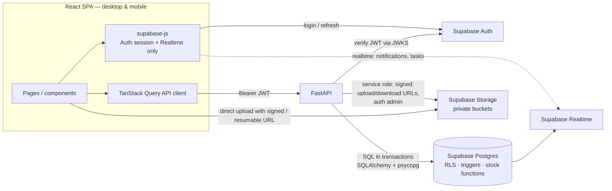

# RMS DEVELOPMENT MASTER PLAN

**Replacement Management System (RMS) — Analysis, Architecture & Phase-wise Claude Code Prompts**

| Item | Value |
|---|---|
| Source of truth | `Replacement_Management_System_Workflow.xlsx` (sheets `RMS_Workflow`, `Roles_Steps_Dropdowns`) |
| Workbook coverage | `RMS_Workflow`: 10 process rows (rows 2–11, 11 columns incl. an unlabelled column K). `Roles_Steps_Dropdowns`: 79 field/option rows (rows 2–80, 12 columns). No hidden sheets, rows, columns, comments or data-validations exist. |
| Stack (mandatory) | React + TypeScript · Python FastAPI · Supabase (PostgreSQL, Auth, Storage, RLS, Realtime) · Render (future deployment only) |
| Implementation phases | Exactly 4 (32 copy-paste prompts) |
| Document status | Planning only — no application code has been produced |

### Legend used throughout this document

| Tag | Meaning |
|---|---|
| **[WB]** | Confirmed workbook requirement (traceable to a sheet + row) |
| **[ARCH]** | Recommended technical architecture decision |
| **[IMP]** | Proposed improvement (not in the workbook; safe to drop) |
| **[DEC-xx]** | Business-owner decision still required (see §5) |

Workbook references use the form `WF r5` (sheet `RMS_Workflow`, row 5) and `DD r42` (sheet `Roles_Steps_Dropdowns`, row 42).

---

## Table of Contents

1. [Project Overview](#s1)
2. [Business Workflow Understanding](#s2)
3. [Excel Workbook Analysis](#s3)
4. [Business Rules and Exceptions](#s4)
5. [Identified Ambiguities and Decisions Required](#s5)
6. [Recommended System Architecture](#s6)
7. [Technology Stack](#s7)
8. [Database Architecture](#s8)
9. [Authentication and Authorization](#s9)
10. [Admin Panel Architecture](#s10)
11. [Responsive UI/UX Strategy](#s11)
12. [Local Development Setup](#s12)
13. [Phase 1 – Complete Implementation Prompts](#s13)
14. [Phase 2 – Complete Implementation Prompts](#s14)
15. [Phase 3 – Complete Implementation Prompts](#s15)
16. [Phase 4 – Complete Implementation Prompts](#s16)
17. [Testing and Acceptance Strategy](#s17)
18. [Local UAT Checklist](#s18)
19. [Future Render Deployment Readiness](#s19)
20. [Final Project Completion Checklist](#s20)

**Phase-wise progress checklist (tick as each prompt passes its verification):**

| Phase | Prompts | Status |
|---|---|---|
| Phase 1 — Foundation, DB, Auth & Admin | P1-01 … P1-09 | ☐ |
| Phase 2 — Core RMS Workflow & Inward | P2-01 … P2-08 | ☐ |
| Phase 3 — Inventory, Servicing, Parts & Commercial | P3-01 … P3-08 | ☐ |
| Phase 4 — Reporting, Automation, Hardening & UAT | P4-01 … P4-07 | ☐ |

---

### Addendum 2026-11 (change request of 12-11-2026)

This plan is amended by **[`docs/RMS_MASTER_PLAN_ADDENDUM_2026-11.md`](docs/RMS_MASTER_PLAN_ADDENDUM_2026-11.md)**:
amendments **AMD-01 … AMD-21** cover Offline / E-Commerce gate entry, cartons, multi-document rows,
sub-categories, item-level categorisation, admin-configurable field profiles, department round-trips,
the A/c Actions PDF, Accounts CN / Challan entry, the Dispatch Slip and the feature hold. The new open
decisions are **DEC-35 … DEC-44** in `docs/DECISIONS.md`. Where an amendment conflicts with a section
below, the amendment wins for its scope. Guards G-01…G-18 stay non-bypassable. The implementation plan
is `docs/RMS_CHANGE_PLAN_2026-11-12.md`. The sections below are unchanged.

---

<a id="s1"></a>
## 1. Project Overview

### 1.1 Purpose
The RMS digitises the full lifecycle of replacement / sales-return consignments that customers (parties) send back to Hicks: gate inward, video-evidenced unboxing, itemisation, product-specific inspection, custody handover, technical servicing, dismantling and parts recovery, custody segregation, store issue, replacement dispatch and Credit Note (CN) commercial resolution — ending with party notification and GS closure.

### 1.2 What the system must be
- **A mini-ERP, not a set of forms.** It has one PostgreSQL database, a controlled workflow engine, a quantity-based inventory ledger with custody, and commercial records linked to the originating Goods Slip (GS).
- **Configuration-driven.** Labels, dropdowns, fields, responsible roles, step assignments, numbering, templates and branding are edited by a Super Admin from the UI. The **safety and reconciliation guards** (§4.2) are system rules that configuration cannot switch off.
- **Mobile-first for operations.** Gate, unboxing, inspection, handover, technician and store users work on phones and tablets. Accounts, management and admin users work mostly on desktops.
- **Auditable.** Every state change, stock movement, approval and configuration change is attributable to a user and a timestamp.

### 1.3 Key people and roles named in the workbook [WB]

| Person (workbook) | Role(s) | Steps |
|---|---|---|
| Anuj | Gate Inward User | Stage-1 Step-1 |
| Aman | Unboxing & Inward Verifier; Technician Coordinator (data entry); handover initiator | Steps 2, 3, 3-Inspection, 4 (handover), 4-Technical entry |
| Pratham Pratap Singh | Replacement Manager | Step-3 approval (CSR), Step-3 a) item-wise actions, Step-7 CN decision |
| Sahil | Intermediate Store Manager; Technician Coordinator (data entry) | Step-4 receiver, 4-Technical entry, Step-6 functional custody, Step-7 store issue |
| Raj Kumar Ji | Technician | Step-4 (Technical) |
| *(unnamed)* | Parts Recovery / Spare Parts Technician, "Replacement Department Technician" | Step-5 |
| *(unnamed)* | Spare Parts Manager (Replacement Dept.) | Step-6 non-functional and salvaged parts |
| Deepak Ji | Accounts Team | Step-7 CN processing |
| *(implicit)* | "Intermediate Store In-charge" (packaging check), "dispatch team", "Main Store", "Inward & Accounts Team" | Steps 3, 7 |

People are **users** assigned to **roles**. The application must never hard-code a person's name. The names above are used only as seed or demo data.

---

<a id="s2"></a>
## 2. Business Workflow Understanding

### 2.1 End-to-end flow

```mermaid
flowchart TD
    A[S1 Step-1 Gate Inward — Anuj<br/>GS auto-generated, parcel tagged] --> B[S1 Step-2 Unboxing — Aman<br/>Continuous video + document photos<br/>Accounts dashboard alert]
    B --> C[S1 Step-3 Itemisation & GS Categorisation — Aman]
    C -->|Complete Sales Return| D{Replacement Manager<br/>CSR approval}
    C -->|Replacement Only| E
    D -->|Rejected → convert to Replacement Only| E[S1 Step-3 Inspection — Aman<br/>DMT / Prismatic / Enclosed Oval grading<br/>Extraction tracking · Daily DMT container audit]
    D -->|Approved| CSR[Forward to Sahil with packaging<br/>→ Inventory + CN path]
    E --> R[S1 Step-3 a) Replacement Manager item-wise action<br/>Send New · Send Repaired · Issue CN · Not Allowed · Pending BP<br/>Printable Replacement Slip]
    E -->|Not-allowed conditions| X[Rejection log / Hazard quarantine /<br/>Hold for party return / Spare parts]
    R -->|Pending BP| P[Held — not transferred to Sahil<br/>GS blocked until pendency cleared]
    R --> F[S2 Step-4 Handover Aman → Sahil<br/>Physical count + digital acceptance]
    F -->|Discrepancy| F2[Halt transfer · reconcile with Aman]
    F --> G[S3 Step-4 Technical — Raj Kumar Ji<br/>Battery check/replace · Cleaning · Classification<br/>Entry by Aman / Sahil]
    G -->|Functional Good/Fresh or Repaired| H[S5 Step-6 Sahil — Functional stock]
    G -->|Non-Good| I[S4 Step-5 Dismantling<br/>TIP · BODY · WIRE · PCB model+supplier<br/>Containers / partitions · Scrap]
    G -->|Permanent scratches| J
    I --> J[S5 Step-6 Spare Parts Manager<br/>Non-functional stock + salvaged parts ledger]
    H --> K[S6 Step-7 Store issue to Main Store — Sahil]
    R -. revisable after technical return .-> R
    K --> L{Replacement Manager<br/>CN decision}
    CSR --> L
    L -->|Do not allow CN| M[Replacement dispatch]
    L -->|Allow CN| N[Accounts — Deepak Ji<br/>Party doc verification · GST portal check<br/>GST CN / General CN / JV · Rate verification]
    N --> O[Prior party notification with CN No., Date, items]
    M --> Z[GS closure]
    O --> Z
```

### 2.2 Stage-by-stage understanding

**Stage 1 – Inward & Initial Processing**
- **Step-1 GS creation (Anuj)** [WB WF r2, DD r2–10]. At the gate, record the state, station, party name, transporter details (driven by Delivery Mode), box count and accompanying gate document. The GS number is auto-generated using the "existing formatting" and the physical parcel is tagged with it. *No goods move inside the facility without a valid GS.* "No Document Attached" is allowed with a warning and must be verified at Step-2.
- **Step-2 Unboxing (Aman)** [WB WF r3, DD r11–16]. Unboxing happens under continuous video, and every paper document (Invoice, Debit Note, Challan or slip) is photographed and classified. Video and photos are mandatory before itemisation. The workflow explicitly asks for a **dashboard and alert system for the Accounts team** at this step.
- **Step-3 Itemisation & categorisation (Aman, approved by RM)** [WB WF r4, DD r17–20]. Count items against the document and categorise the GS as a whole:
  - **Complete Sales Return (CSR).** All items and the full quantity are being returned. This needs the Replacement Manager's check and explicit approval. If approved, the goods go to Sahil with packaging and then to Inventory and CN. If rejected, the GS is converted to Replacement Only.
  - **Replacement Only (RO).** Defective or mixed goods, with no pre-approval needed. The GS goes to grading.
  - The output also states: *"Intermediate Store In-charge will check the packaging; whether it's perfect or not, if found any issues then replace the packaging."*
- **Step-3 Inspection (Aman)** [WB WF r5, DD r21–43]. Grading is product-specific (DMT has 8 statuses, Prismatic 3, Enclosed Oval 4 after a mandatory full opening). Packaging-extracted and container-extracted quantities are recorded for every line and must match the allocated quantity. All DMT containers are counted and checked daily, with sellable packaging separated out.
- **Step-3 a) Actions from Hicks end (Pratham, Replacement Manager)** [WB WF r6]. Each item is assigned one of: Send New, Send Repaired, Issue CN, Not Allowed or Pending (BP). This step defines the **printable Replacement Slip**, and Pratham can **modify these actions after the goods return from the Technical Team**.

**Stage 2 – Intermediate Store**
- **Step-4 Handover Aman → Sahil** [WB WF r7, DD r44–46]. Aman initiates the transfer. Sahil physically counts and digitally accepts, or reports a discrepancy, which halts the transfer for reconciliation with Aman. Physical and digital custody must match. The Intermediate Store holds all goods awaiting repair or final disposition. **Pending pieces are held back from Sahil.** If goods have gone to the Repair Team for checking, the GS does not move until the pendency is cleared (WF r7 column K).

**Stage 3 – Technical Servicing**
- **Step-4 (Technical), Raj Kumar Ji, entry by Aman or Sahil** [WB WF r8, DD r47–56]. Covers the battery check (OK, or Changed with pieces checked and batteries installed, which deducts battery stock), cleaning and scratch treatment (Cleaned, or Permanent Scratches → Non-Sellable → Spare Parts Manager), and classification (Functional Good/Fresh, Functional Repaired & Working, or Non-Good → dismantling). An accurate count of pieces checked against batteries replaced is mandatory.

**Stage 4 – Dismantling & Parts Recovery**
- **Step-5** [WB WF r9, DD r57–62]. Non-Good units are dismantled into TIP, BODY, WIRE and PCB. PCB **Model Name and Supplier Name are mandatory**. Parts are stored in dedicated containers (with container barcode or shelf) or in a partitioned single container (with compartment ID). The remaining scrap is marked for safe disposal.

**Stage 5 – Custody Segregation**
- **Step-6** [WB WF r10, DD r63–66]. Sahil holds all functional stock (Good/Fresh → Store Issue or Customer Dispatch; Repaired → Store Issue or General CN). The Spare Parts Manager exclusively owns non-functional, scratched and non-sellable stock and salvaged parts. *The Intermediate Store cannot hold non-functional scrap.*

**Stage 6 – Store Issue & Commercial Resolution**
- **Step-7** [WB WF r11, DD r67–80]:
  1. Sahil issues goods to the Main Store, which creates a Main Store inward.
  2. The RM decides whether to allow a CN (no replacement dispatched) or send a replacement piece (routed to dispatch).
  3. Accounts (Deepak Ji) verifies the party document (Invoice, Debit Note or none).
  4. Accounts checks the GST portal. If the return is reflected, a **GST Credit Note** is raised with GSTIN and tax breakup. If it is not reflected, **only a normal Journal Voucher (JV)** is allowed.
  5. Accounts verifies the historical sales and purchase rates.
  6. A GST CN is issued for good/packed pieces and a General CN for repaired pieces.
  7. Before closure, the party is sent prior information with the CN No., CN Date and item details.
  8. For CSR: inward with packaging to inventory, issue the CN, notify the party, then close the GS as a Complete Sales Return.

---

<a id="s3"></a>
## 3. Excel Workbook Analysis

### 3.1 Sheet `RMS_Workflow` — structure
Columns: Stage No · Step No · Step Name · Responsible Role · Assigned Person · Process Description · Inputs & Prerequisites · Key Actions & Checkpoints · Outputs & System Status · Business Rules & Exceptions · **(unlabelled column K)**.

| Row | Stage / Step | Notable content beyond the dropdown sheet |
|---|---|---|
| r2 | S1 / Step-1 | Header fields: **state, station, party name, transporter details, box count**. GS "auto-generated with existing formatting". |
| r3 | S1 / Step-2 | "(DASHBOARD AND AN ALERT SYSTEM FOR ACCOUNTS TEAM)". Video and photos mandatory *before opening and itemizing*. |
| r4 | S1 / Step-3 | CSR example "All 5 items and whole 100 qty". RO example "1 damaged, 1 waste". **Packaging check/replacement by Intermediate Store In-charge**. |
| r5 | S1 / Step-3 (Inspection) | DMT "Daily count of containers and sellable packaging". Extraction "for every line item". "Extracted qty must match total allocated qty". |
| r6 | S1 a) / Step-3 a) | Five RM actions: **Send New, Send Repaired, Issue CN, Not Allowed, Pending (BP)**. Defines the **printable Replacement Slip**. Actions **modifiable after return from the Technical Team**. The text sits in the Process Description and Key Actions columns; Inputs, Outputs and Rules are blank. |
| r7 | S2 / Step-4 | Column K: "Pending: hold Pending Pieces from being sent to Sahil… gone for checking to the *Repair Team* then it will not move the GS until the PENDENCY hasn't cleared by the user." |
| r8 | S3 / Step-4 (Technical) | Battery: record "battery count and goods count". |
| r9 | S4 / Step-5 | "remaining scrap marked for safe disposal". |
| r10 | S5 / Step-6 | Exclusive ownership rule for the Spare Parts Manager. |
| r11 | S6 / Step-7 | Six numbered actions. CN record = "CN No., Date, Item details, and Valuation". |

### 3.2 Sheet `Roles_Steps_Dropdowns` — complete field and option catalogue
Columns: Role · Stage · Step No · Step Name · Product Category · Field / Attribute Name · Control Type · Dropdown Option / Value · Is Allowed · Business Rule / Validation · Default Next Action · Remarks / Notes.

Every option below must be seeded **verbatim** (label, Is Allowed, rule text, next-action text, remarks). The **Code** column is a proposed stable system code [ARCH]. Business logic keys off codes, so admins can edit labels without breaking the logic.

| DD row | Step | Category | Field (Control) | Option label (verbatim) | Allowed | Code [ARCH] | Validation / conditional data [WB] → Next action |
|---|---|---|---|---|---|---|---|
| r2 | S1 Step-1 | General | Delivery Mode / Transporter (Dropdown) | Courier / Parcel | Yes | `COURIER_PARCEL` | Courier name + docket no. → GS generation |
| r3 | | | | Direct Transport / Truck | Yes | `DIRECT_TRUCK` | Vehicle no. + transporter name → GS generation |
| r4 | | | | Self / Party Representative | Yes | `SELF_PARTY_REP` | Person name + contact no. → GS generation |
| r5 | S1 Step-1 | General | Accompanying Document at Gate (Dropdown) | Invoice | Yes | `INVOICE` | Invoice no. + date → attach to inward entry |
| r6 | | | | Debit Note | Yes | `DEBIT_NOTE` | DN no. + date |
| r7 | | | | Delivery Challan | Yes | `DELIVERY_CHALLAN` | Challan no. + date |
| r8 | | | | Handwritten Slip / Party Note | Yes | `HANDWRITTEN_SLIP` | Slip details / party remarks (informal) |
| r9 | | | | No Document Attached | **Conditional** | `NO_DOCUMENT` | Flag consignment as missing documentation → proceed with gate inward **warning**; verify at Step-2 |
| r10 | S1 Step-1 | General | GS Creation Format (Dropdown) | Auto-Generated (Standard Formatting) | Yes | `AUTO_STANDARD` | System creates GS no. in current format → hand box to Aman |
| r11 | S1 Step-2 | General | Unboxing Video Attachment (File Upload) | Continuous Unboxing Video File (.mp4 / .mov) | Yes | `VIDEO` | **Mandatory** continuous video → attach to GS |
| r12 | S1 Step-2 | General | Received Document Classification (Dropdown) | Invoice | Yes | `INVOICE` | Photo; verify buyer/seller **GSTIN** + item details → link to GS & Accounts check |
| r13 | | | | Debit Note | Yes | `DEBIT_NOTE` | Photo; DN no. + **amount** |
| r14 | | | | Delivery Challan | Yes | `DELIVERY_CHALLAN` | Photo; match item qty against parcel contents |
| r15 | | | | Handwritten Slip / Party Note | Yes | `HANDWRITTEN_SLIP` | Photo; note party claim / complaint |
| r16 | S1 Step-2 | General | Document Photo Attachment (File Upload) | Document Photo Image (.jpg / .png / .pdf) | Yes | `DOC_PHOTO` | High-resolution picture of **all** paper documents; **mandatory alongside video** → Step-3 |
| r17 | S1 Step-3 | General | Return Categorization (GS Wise) (Dropdown) | Complete Sales Return | **Conditional** | `CSR` | All items, full qty; needs RM approval → route to RM; "Won't proceed without approval" |
| r18 | | | | Replacement Only | Yes | `RO` | Defective/mixed; no pre-approval → inspection & grading |
| r19 | S1 Step-3 | General | Complete Sales Return Approval (Dropdown, RM) | Approved - Complete Sales Return | Yes | `CSR_APPROVED` | → Forward to Sahil with packaging → Inventory & CN |
| r20 | | | | Rejected - Convert to Replacement Only | Yes | `CSR_REJECTED_TO_RO` | Reclassify → Visual Inspection & Repair flow |
| r21 | S1 Step-3 Insp. | DMT | DMT Visual Condition (Dropdown) | VISUALLY OKAY and PACKED | Yes | `DMT_OK_PACKED` | Packing 100% sellable → sellable lot; record extraction |
| r22 | | | | VISUALLY OKAY but unpacked or maybe packaging is damaged | Yes | `DMT_OK_PKG_DAMAGED` | → repackaging or technician check |
| r23 | | | | OTHER BRANDS | **No** | `DMT_OTHER_BRANDS` | Log rejection; hold for party return or dispute |
| r24 | | | | SHORT QUANTITY | Yes | `DMT_SHORT_QTY` | Log discrepancy count; process only actual received qty |
| r25 | | | | SCRATCHED/SPOTS | Yes | `DMT_SCRATCHED` | → Step-4 technician cleaning & scratch buffing |
| r26 | | | | DIRTY | Yes | `DMT_DIRTY` | → Step-4 technician cleaning |
| r27 | | | | BROKEN / BODY DAMAGE | **No** | `DMT_BROKEN_BODY` | Log body-damage rejection; transfer to scrap/spare parts |
| r28 | | | | DISPLAY ISSUES | Yes | `DMT_DISPLAY_ISSUE` | → Step-4 technician battery/PCB check |
| r29 | S1 Step-3 Insp. | DMT | DMT Extraction Type (Radio, **mandatory**) | Packaging Extracted | Yes | `PACKAGING_EXTRACTED` | Extracted packaging pcs; sum must match total allocated qty |
| r30 | | | | Container Extracted | Yes | `CONTAINER_EXTRACTED` | Extracted container pcs; sum must match total allocated qty |
| r31 | S1 Step-3 Insp. | DMT | Daily Container Audit (Checkbox) | Containers Checked & Counted Daily | Yes | `DAILY_AUDIT_DONE` | All DMT containers counted daily; sellable packaging separated. Remark: "Notepad explicit instruction" |
| r32 | S1 Step-3 Insp. | PRISMATIC | Prismatic Visual Condition (Dropdown) | VISUALLY OKAY | Yes | `PRS_OK` | Glass body + scale intact → Step-4 Intermediate Store |
| r33 | | | | BULB BROKEN WITHOUT MERCURY | **No** | `PRS_BULB_BROKEN_NO_HG` | Reject; record rejection in GS |
| r34 | | | | BROKEN WITH MERCURY | **No** | `PRS_BROKEN_WITH_HG` | **Hazard rejection → hazardous quarantine** |
| r35–36 | S1 Step-3 Insp. | PRISMATIC | Prismatic Extraction Type (Radio, mandatory) | Packaging Extracted / Container Extracted | Yes | (shared codes) | Same reconciliation rule |
| r37 | S1 Step-3 Insp. | ENCLOSED OVAL | Inspection Protocol (Dropdown) | Full Opening Inspection Completed | Yes | `EO_FULL_OPENING_DONE` | "IT MUST BE CHECKED COMPLETELY BY OPENING IT" → then grade |
| r38 | S1 Step-3 Insp. | ENCLOSED OVAL | Enclosed Oval Visual Condition (Dropdown) | VISUALLY OKAY | Yes | `EO_OK` | → Step-4 Intermediate Store |
| r39 | | | | Inner Capillary Broken but Mercury Present | Yes (conditionally acceptable) | `EO_INNER_CAPILLARY_BROKEN` | Mercury sealed in outer envelope → evaluation / technical segregation |
| r40 | | | | Body Broken but Mercury Present | **No** | `EO_BODY_BROKEN_HG` | **Hazard rejection; quarantine for safety** |
| r41 | | | | Bulb Broken and Mercury Absent | **No** | `EO_BULB_BROKEN_NO_HG` | Reject; record rejection in GS |
| r42–43 | S1 Step-3 Insp. | ENCLOSED OVAL | Enclosed Oval Extraction Type (Radio, mandatory) | Packaging Extracted / Container Extracted | Yes | (shared codes) | Same reconciliation rule |
| WF r6 | S1 Step-3 a) | General | Item-wise RM action (not in DD sheet) | Send New / Send Repaired / Issue CN / Not Allowed / Pending (BP) | — | `SEND_NEW` `SEND_REPAIRED` `ISSUE_CN` `NOT_ALLOWED` `PENDING_BP` | Defines printable Replacement Slip; revisable after technical return |
| r44 | S2 Step-4 | General | Custody Transfer Mode (Dropdown) | Physical Movement & Digital Transfer | Yes | `PHYSICAL_AND_DIGITAL` | "Dual sync checkpoint" → Sahil accepts in RMS |
| r45 | S2 Step-4 | General | Transfer Acceptance Status (Dropdown) | Accepted - Quantity & Lots Verified | Yes | `ACCEPTED_VERIFIED` | Counts match grading summary → stock allocated in Intermediate Store |
| r46 | | | | Discrepancy Reported | **Conditional** | `DISCREPANCY` | Physical ≠ system qty → **halt transfer; reconcile with Aman** |
| r47 | S3 Step-4 Tech | General | Assigned Technician (Dropdown) | Raj Kumar Ji | Yes | master: technician | Entry by Aman or Sahil for allotment **and** receiving |
| r48–49 | S3 Step-4 Tech | General | Data Entry Performed By (Dropdown) | Aman / Sahil | Yes | user with Technician-Coordinator role | Logs allotment & receiving records |
| r50 | S3 Step-4 Tech | General | Battery Check Result (Dropdown) | Battery Okay / Fine | Yes | `BATTERY_OK` | Record checked piece count |
| r51 | | | | Battery Changed / Replaced | Yes | `BATTERY_REPLACED` | **Must enter (1) pieces checked, (2) batteries installed → deduct battery stock** |
| r52 | S3 Step-4 Tech | General | Cleaning & Scratch Treatment (Dropdown) | Cleaned - Sellable / Fresh Finish | Yes | `CLEANED_SELLABLE` | → classify as Functional |
| r53 | | | | Permanent Scratches / Non-Recoverable | Yes | `PERMANENT_SCRATCHES` | Non-Sellable → Spare Parts Manager |
| r54 | S3 Step-4 Tech | General | Post-Servicing Classification (Dropdown) | Functional - Good / Fresh | Yes | `FUNCTIONAL_GOOD` | → Sahil |
| r55 | | | | Functional - Repaired & Working | Yes | `FUNCTIONAL_REPAIRED` | → Sahil |
| r56 | | | | Non-Good Inventory (Defective / Unrepairable) | Yes | `NON_GOOD` | → Step-5 dismantling |
| r57–60 | S4 Step-5 | Parts Recovery | Recoverable Part Type (Dropdown) | TIP / BODY / WIRE / PCB | Yes | `TIP` `BODY` `WIRE` `PCB` | Designated container partitions; **PCB → Model Name + Supplier Name mandatory** |
| r61 | S4 Step-5 | Parts Recovery | Parts Storage Separation (Dropdown) | Different Dedicated Containers | Yes | `DEDICATED_CONTAINERS` | Assign container barcode / shelf |
| r62 | | | | Separations / Partitions in Single Container | Yes | `PARTITIONED_CONTAINER` | Assign compartment ID |
| r63 | S5 Step-6 | General | Inventory Custody Assignment (Dropdown) | Functional Stock (Good / Fresh) | Yes | `CUST_FUNCTIONAL_GOOD` | Sahil → Store Issue or Customer Dispatch |
| r64 | | | | Functional Stock (Repaired) | Yes | `CUST_FUNCTIONAL_REPAIRED` | Sahil → Store Issue or General CN |
| r65 | | | | Non-Functional / Scratched / Non-Sellable Stock | Yes | `CUST_NON_FUNCTIONAL` | Spare Parts Manager |
| r66 | | Parts Recovery | | Salvaged Reusable Spare Parts (Tip / Body / Wire / PCB) | Yes | `CUST_SALVAGED_PARTS` | Spare Parts Manager → spare parts ledger |
| r67 | S6 Step-7 | General | Store Issue Type (Dropdown) | Issue to Main Store | Yes | `ISSUE_MAIN_STORE` | Main Store inward entry created |
| r68 | S6 Step-7 | Credit Note | RM CN Decision (Dropdown) | Allow Credit Note (No Replacement Dispatched) | Yes | `ALLOW_CN` | → Accounts (Deepak Ji) |
| r69 | | | | Do Not Allow CN (Send Replacement Piece) | Yes | `DENY_CN_SEND_REPLACEMENT` | → dispatch team |
| r70 | S6 Step-7 | Credit Note | Credit Note Type (Dropdown) | GST CREDIT NOTE | **Conditional** | `GST_CN` | Good/Packed pieces; **requires GST portal reflection** |
| r71 | | | | GENERAL CREDIT NOTE | Yes | `GENERAL_CN` | Repaired functional pieces |
| r72 | S6 Step-7 | Credit Note | Party Document Verification (Dropdown) | Party Raised Invoice | Yes | `PARTY_INVOICE` | Verify invoice → match against historical rates |
| r73 | | | | Party Raised Debit Note | Yes | `PARTY_DEBIT_NOTE` | Verify DN no., date, amount → match internal sales records |
| r74 | | | | No Commercial Document Raised by Party | Yes | `PARTY_NO_DOC` | Rate from historical sales record |
| r75 | S6 Step-7 | Credit Note | GST Portal Return Verification (Dropdown) | Return Reflected on GST Portal | Yes | `GST_REFLECTED` | GSTR-1 / GSTR-2B → formal GST CN with GSTIN + tax breakup |
| r76 | | | | Return NOT Reflected on GST Portal | **Conditional** | `GST_NOT_REFLECTED` | **Allow only a normal JV** — "Strict compliance rule" |
| r77 | S6 Step-7 | Credit Note | Rate Verification Reference (Dropdown) | Previous Sales Record Rate Check | Yes | `RATE_SALES` | Apply verified sales rate to CN voucher |
| r78 | | | | Previous Purchase Entry Rate Check | Yes | `RATE_PURCHASE` | Validate valuation baseline |
| r79 | S6 Step-7 | Credit Note | Party Notification Status (Dropdown) | Prior Information Sent with CN Details | Yes | `PRIOR_INFO_SENT` | CN No. + CN Date + items sent **prior to closure** → close GS |
| r80 | S6 Step-7 | General | Complete Sales Return Final Status (Dropdown) | Inward to Inventory with Packaging + CN Issued + Prior Party Info | Yes | `CSR_CLOSED` | GS closed as CSR. Remark: "Summary flow (line 83)" |

### 3.3 Role catalogue derived from the workbook

| System role code [ARCH] | Workbook role text | Seed user (demo only) |
|---|---|---|
| `SUPER_ADMIN` | *(new — required by brief)* | admin |
| `GATE_INWARD` | Gate Inward User | Anuj |
| `INWARD_VERIFIER` | Unboxing & Inward Verifier / Inward Verifier | Aman |
| `REPLACEMENT_MANAGER` | Replacement Manager | Pratham Pratap Singh |
| `INTERMEDIATE_STORE_MANAGER` | Intermediate Store Manager / Intermediate Store In-charge | Sahil |
| `TECHNICIAN_COORDINATOR` | Technician Coordinator (Aman / Sahil) | Aman, Sahil |
| `TECHNICIAN` | Technician | Raj Kumar Ji |
| `SPARE_PARTS_TECHNICIAN` | Parts Recovery Technician / Spare Parts Technician / Replacement Department Technician | (unnamed) |
| `SPARE_PARTS_MANAGER` | Spare Parts Manager | (unnamed) |
| `ACCOUNTS` | Accounts Team | Deepak Ji |
| `DISPATCH` [IMP] | "dispatch team" (DD r69, unnamed) | — |
| `MAIN_STORE` [IMP] | Main Store (WF r11, implicit) | — |
| `MANAGEMENT_VIEWER` [IMP] | — (read-only MIS) | — |

Users may hold several roles. Aman, for example, is both `INWARD_VERIFIER` and `TECHNICIAN_COORDINATOR`.

### 3.4 Workbook-to-prompt traceability (completeness review)

| Workbook rows | Implemented by prompt(s) |
|---|---|
| WF r2, DD r2–10 | P1-06 (masters), P1-07 (fields), P1-08 (numbering), **P2-02** |
| WF r3, DD r11–16 | P1-02 (storage), **P2-03**, P4-03 (Accounts alerts) |
| WF r4, DD r17–20 | **P2-04** |
| WF r5, DD r21–43 | **P2-05**, **P2-06** |
| WF r6 (RM actions, slip, revisions) | **P2-07**, P3-05 |
| WF r7 (+ col K pending), DD r44–46 | P2-07 (pendency), **P3-01** |
| WF r8, DD r47–56 | **P3-02** |
| WF r9, DD r57–62 | **P3-03** |
| WF r10, DD r63–66 | **P3-04** |
| WF r11, DD r67–69 | **P3-05** |
| WF r11, DD r70–78 | **P3-06** |
| WF r11, DD r79–80 | **P3-07** |
| All rows (reporting / audit) | P4-01 … P4-04 |

---

<a id="s4"></a>
## 4. Business Rules and Exceptions

### 4.1 Business rules (all [WB] unless tagged)

| # | Rule | Source | Enforced in |
|---|---|---|---|
| BR-01 | Every incoming consignment must have a valid, auto-generated GS number. No goods move inside the facility without one. | WF r2, DD r10 | P2-02 |
| BR-02 | The physical parcel is tagged with the GS No. (a printable tag/QR is [IMP]). | WF r2 | P2-02 |
| BR-03 | "No Document Attached" is allowed only with a missing-documentation flag and gate warning, and must be verified at Step-2. | DD r9 | P2-02, P2-03 |
| BR-04 | The continuous unboxing video and photos of **all** paper documents are mandatory before itemisation. | WF r3, DD r11, r16 | P2-03 |
| BR-05 | Invoice photos require buyer/seller GSTIN and item verification. Debit Note photos require number and amount. Challan photos require a quantity match. Slip photos require the party claim. | DD r12–15 | P2-03 |
| BR-06 | Step-2 must feed an Accounts dashboard and alert. | WF r3 | P2-03, P4-03 |
| BR-07 | Categorisation is **GS-wise**: CSR or RO. | DD r17–18 | P2-04 |
| BR-08 | A CSR cannot proceed without the RM's check and explicit approval. Rejection converts the GS to RO. | WF r4, DD r17, r19–20 | P2-04 |
| BR-09 | An approved CSR goes to Sahil **with packaging** and then to Inventory and CN. | DD r19, r80 | P2-04, P3-07 |
| BR-10 | The Intermediate Store In-charge checks the packaging and replaces it if it is defective. | WF r4 | P2-04 / P3-01 |
| BR-11 | Product-specific grading: DMT has 8 statuses, Prismatic 3, Enclosed Oval 4. | WF r5 | P2-05 |
| BR-12 | **Not allowed:** DMT Other Brands and Broken/Body Damage. Prismatic Bulb Broken Without Mercury and Broken With Mercury. EO Body Broken but Mercury Present and Bulb Broken and Mercury Absent. | WF r5, DD r23, 27, 33–34, 40–41 | P2-05 |
| BR-13 | Not-allowed dispositions differ by condition. Other Brands → hold for party return or dispute. Body damage → scrap/spare parts. Bulb broken (no Hg) → reject and record in GS. Mercury present & broken → **hazardous quarantine**. | DD r23, 27, 33, 34, 40, 41 | P2-05 |
| BR-14 | Enclosed Oval must be fully opened before grading. | WF r5, DD r37 | P2-05 |
| BR-15 | EO "Inner Capillary Broken but Mercury Present" is conditionally acceptable and routed for evaluation / technical segregation. | DD r39 | P2-05 |
| BR-16 | DMT Short Quantity: log the discrepancy and process only the actual received quantity. | DD r24 | P2-05 |
| BR-17 | Packaging-extracted and container-extracted quantities are recorded for every line, and the extracted total must match the allocated quantity. Extraction type is mandatory. | WF r5, DD r29–30, 35–36, 42–43 | P2-05 |
| BR-18 | All DMT containers are counted and checked **daily**, with sellable packaging separated. | WF r5, DD r31 | P2-06 |
| BR-19 | The RM assigns an item-wise action (Send New, Send Repaired, Issue CN, Not Allowed, Pending BP). This drives the printable Replacement Slip and is revisable after technical return. | WF r6 | P2-07, P3-05 |
| BR-20 | Pending pieces are not transferred to Sahil. Pieces with the Repair Team for checking block GS movement until the pendency is cleared. | WF r7 col K | P2-07, P3-01 |
| BR-21 | Handover is physical **and** digital at the same time. Sahil counts and accepts. A discrepancy halts the transfer pending reconciliation with Aman. | WF r7, DD r44–46 | P3-01 |
| BR-22 | The Intermediate Store holds all goods awaiting repair or final disposition. | WF r7 | P3-01 |
| BR-23 | Technician allotment **and** receiving are entered by Aman or Sahil. | WF r8, DD r47–49 | P3-02 |
| BR-24 | Battery replaced requires pieces checked and batteries installed, and battery stock is deducted. An accurate checked-vs-replaced record is mandatory for reconciliation. | WF r8, DD r51 | P3-02 |
| BR-25 | Permanent scratches make a piece Non-Sellable, which goes to the Spare Parts Manager. | DD r53 | P3-02, P3-04 |
| BR-26 | Non-Good goes to the dismantling process. | DD r56, WF r9 | P3-03 |
| BR-27 | Recovered parts are TIP, BODY, WIRE or PCB. PCB **Model Name and Supplier Name are mandatory**. | WF r9, DD r57–60 | P3-03 |
| BR-28 | Parts are stored in dedicated containers (barcode/shelf) or partitions (compartment ID). | WF r9, DD r61–62 | P3-03 |
| BR-29 | The remaining scrap is marked for safe disposal. | WF r9 | P3-03 |
| BR-30 | Sahil holds all functional stock (good and repaired). The Spare Parts Manager has exclusive ownership of non-functional, scratched and non-sellable stock and salvaged parts. **The Intermediate Store cannot hold non-functional scrap.** | WF r10, DD r63–66 | P3-04 |
| BR-31 | Sahil issues functional goods to the Main Store, which creates a Main Store inward entry. | WF r11, DD r67 | P3-05 |
| BR-32 | A CN requires RM approval ("Allow CN"). "Do Not Allow CN" routes to replacement dispatch. | DD r68–69 | P3-05, P3-06 |
| BR-33 | Accounts verifies the party document (Invoice, Debit Note or none). | DD r72–74 | P3-06 |
| BR-34 | A GST CN requires the return to be reflected on the GST portal (GSTR-1 / GSTR-2B) and carries GSTIN and tax breakup. If it is **not reflected, only a normal JV is permitted.** | WF r11, DD r70, r75–76 | P3-06 |
| BR-35 | A GST CN is for good/packed pieces. A General CN is for repaired pieces. | WF r11, DD r70–71 | P3-06 |
| BR-36 | Historical sales and purchase rates must be verified (by Deepak Ji) and recorded. | WF r11, DD r77–78 | P3-06 |
| BR-37 | The CN record holds CN No., Date, item details and valuation. | WF r11 | P3-06 |
| BR-38 | Prior notification (CN No., Date, items) is sent to the party **before** closure. | WF r11, DD r79 | P3-07 |
| BR-39 | CSR closure requires inward to inventory with packaging, CN issued and prior party info. | WF r11, DD r80 | P3-07 |
| BR-40 | Every important transaction has a traceable audit history. | Brief §13 | All |

### 4.2 Non-bypassable system guards [ARCH]
These are enforced in the **database** (constraints, triggers or locked functions) and in **FastAPI services**. They are not enforced only in the UI. Configuration may change labels, roles and visibility, but **cannot disable** these guards. The Admin Panel shows them read-only as "System Guards".

| Guard | Statement |
|---|---|
| G-01 | No inward, item or stock record may exist without a `goods_slip_id` that has a generated GS number. |
| G-02 | A GS cannot leave `UNBOXING` until ≥1 confirmed video attachment **and** ≥1 confirmed document photo exist (or an authorised exception per DEC-03). |
| G-03 | A CSR GS cannot advance past `CSR_APPROVAL_PENDING` without an RM decision recorded by a user holding the approve permission. |
| G-04 | Stock in a lot whose condition is "Not Allowed" can never move into a functional location (`location_class = FUNCTIONAL`). This is enforced by a trigger on `stock_movements`. |
| G-05 | Mercury-hazard conditions (`PRS_BROKEN_WITH_HG`, `EO_BODY_BROKEN_HG`) can only be placed in a `HAZARD_QUARANTINE` location. |
| G-06 | Enclosed Oval grading cannot be submitted unless `full_opening_confirmed = true`. |
| G-07 | Inspection finalisation requires Σ condition quantities = received quantity, and packaging-extracted + container-extracted = allocated quantity (per DEC-07). |
| G-08 | Quantities marked Pending (BP) cannot be added to a custody transfer. A GS with an open blocking pendency cannot advance its workflow status. |
| G-09 | Custody transfers are two-phase (initiate → accept). Stock is only credited to the receiver on acceptance. A discrepancy freezes the transfer until it is reconciled. |
| G-10 | `BATTERY_REPLACED` requires `pieces_checked > 0` and `batteries_installed > 0`. Battery stock is deducted in the same transaction and can never go negative. |
| G-11 | PCB recovered-part rows require a PCB model and supplier (DB `CHECK`). |
| G-12 | A location of class `FUNCTIONAL` (Intermediate Store) rejects non-functional, non-sellable or scrap lots (trigger). |
| G-13 | A CN cannot be created without an `ALLOW_CN` decision. A GST CN cannot be issued unless portal status = `GST_REFLECTED`. `GST_NOT_REFLECTED` permits only a JV record. |
| G-14 | A CN cannot be issued without ≥1 rate verification record per CN line. |
| G-15 | A GS cannot be closed while a commercial resolution requiring notification lacks a `PRIOR_INFO_SENT` record, while stock for the GS remains in transit or pending, or while any line is unresolved. |
| G-16 | No stock balance may be negative. Every stock-changing call carries an idempotency key, and duplicate keys return the original result. |
| G-17 | All inserts, updates and deletes on business tables and all configuration changes are written to the audit log, attributed to the acting user. |
| G-18 | Published workflow and form versions are immutable. Each transaction stores the version it was created or submitted under. |

### 4.3 Exceptions catalogue

| Exception | Handling |
|---|---|
| Missing gate documents | Flag `missing_documentation`, show a gate warning, and force verification at Step-2 (BR-03). |
| Short quantity | Record documented vs received quantity, log a discrepancy, and process the received quantity only (BR-16). |
| Not-allowed conditions | Rejection record with disposition. Stock goes to Hold / Quarantine / Spare-parts locations, never to functional ones (BR-12/13, G-04/05). |
| CSR rejected | Convert to RO, with a history entry (BR-08). |
| Handover discrepancy | Transfer frozen, with a reconciliation workflow involving Aman and Sahil (BR-21). |
| Pending (BP) | Pendency register. Pieces are held and the GS is blocked until cleared (BR-20). |
| GST return not on portal | Only a JV is permitted (BR-34). |
| Permanent scratches | Non-sellable custody with the Spare Parts Manager (BR-25). |
| Missed daily container audit | Alert and dashboard flag (BR-18). Whether it blocks work is DEC-08. |

---

<a id="s5"></a>
## 5. Identified Ambiguities and Decisions Required

Each item gives the ambiguity, its operational impact, the decision needed, and the **safe provisional approach** the prompts implement. Every provisional approach is configurable so it can be changed without a code rewrite.

| ID | Ambiguity (exact source) | Impact | Decision required | Provisional approach |
|---|---|---|---|---|
| DEC-01 | GS "auto-generated with **existing formatting**" (WF r2, DD r10). The existing format is not given. | Wrong numbering breaks continuity with current paper/ERP records. | Provide the exact GS format (prefix, FY logic, separator, padding, reset rule) and the next number to continue from. | Configurable number series with tokens; seed placeholder `GS/{FY}/{SEQ:5}`; admin sets starting value. |
| DEC-02 | Step-1 header fields "state, station, party name" are not in the dropdown sheet. Are state and station free text or derived from the party master? | Data quality for MIS by region. | Should state and station come from the party master (auto-filled, editable) or be entered at the gate? | Party master holds state and station; the gate form auto-fills them and allows override with an audit entry. Unknown parties can be created at the gate as "provisional" for later admin review. |
| DEC-03 | Step-1 allows "No Document Attached" (DD r9), but Step-2 makes the document photo mandatory (DD r16) and its classification list has no "No Document" option. | A GS with no paperwork could be blocked forever at Step-2. | When there are no documents, what satisfies the Step-2 photo checkpoint? | Require a photo of the parcel label or outer box plus a mandatory remark. An RM "Missing Document Exception" approval is required to pass G-02. Accounts is alerted. |
| DEC-04 | Video: is one continuous file per GS required, or one per box when `box_count > 1`? There is no size or duration limit. Retention period? | Storage cost and upload failures on mobile networks. | Video per GS or per box? Max size or length? Retention period? | Allow ≥1 video per GS (optionally tagged to box no.). Resumable uploads. Configurable max size (default 1 GB) and retention (default: keep indefinitely). |
| DEC-05 | "Dashboard and alert system for Accounts team" (WF r3). The trigger, recipients and content are not defined. | Accounts may miss documents. | Which events alert Accounts (every GS? only Invoice/DN? missing docs)? Which channel? | In-app notification and Accounts dashboard queue for every GS with classified documents, plus a high-priority alert for `NO_DOCUMENT`. Email is optional (Phase 4). |
| DEC-06 | CSR vs RO is **GS-wise** (DD r17). A partial sales return (some items full return, others defective) is not described. | Mixed consignments may be mis-categorised. | Can one GS contain both CSR and RO lines? | One category per GS, as the workbook states. The RM can reject a CSR to RO. Mixed handling is listed as a future configurable option. |
| DEC-07 | Extraction is a **radio button** (one choice), yet the workflow says to track **both** "Packaging Extracted (qty)" and "Container Extracted (qty)" for every line, and "sum must match total allocated qty". "Allocated qty" is undefined. | Reconciliation errors. | (a) Per line, can pieces come partly from packaging and partly from containers? (b) Is "allocated qty" the received quantity or the RM-allocated quantity? | Record both quantities per line. The radio selects the *primary* extraction type, and the quantity for the other type defaults to 0. Validation: `packaging_qty + container_qty = received_qty` (configurable to "= allocated qty" later). |
| DEC-08 | The daily DMT container audit (DD r31) has no owner, no recorded data beyond a checkbox, no rule for what happens if it is missed, and the remark refers to an external "Notepad explicit instruction". | Audit compliance cannot be proven. | What counts are recorded? Does a missed audit block DMT inspection the next day? Where is the Notepad instruction? | Daily register per container (counted qty, sellable packaging qty, remarks) plus a day-level confirmation checkbox. A missed day raises an alert and an RM dashboard flag but **does not block** work (blocking is a config toggle). |
| DEC-09 | "Short Quantity" sits in the DMT *visual condition* list, but it is a quantity discrepancy, not a piece condition. Only DMT has it. | Can't grade "missing" pieces. Prismatic and EO shortages are unhandled. | Is short quantity tracked for all categories? | Model short quantity at line level for **all** categories (`documented_qty - received_qty`). Keep `DMT_SHORT_QTY` as a selectable DMT condition that auto-fills the shortage record and does not consume received pieces. |
| DEC-10 | Physical fate of rejected goods is undefined: "hold for party return or dispute", "reject for replacement", "transfer to scrap/spare parts". Who owns rejected stock? Is the party informed? Is a CN or return dispatch possible? | Rejected stock with no custodian and no disposal process. | Who holds rejected and dispute stock? Is it returned to the party, and how is that recorded? Is the party notified? | Dedicated locations `REJECTED_HOLD` (custodian: RM) and `HAZARD_QUARANTINE` (custodian: configurable, default Spare Parts Manager). Body-damage DMT goes to the Spare Parts Manager's non-functional stock. A "Return to party" dispatch type is offered but disabled by default. |
| DEC-11 | Mercury hazard handling: quarantine location, PPE, and disposal vendor/manifest are not specified. | Safety and legal compliance. | Hazardous disposal SOP, custodian, and records needed? | Quarantine location, hazard flag, and a disposal record with free-text manifest reference. A safety banner is shown on hazard selections. |
| DEC-12 | "Pending (BP)": the meaning of "BP" is not defined. The rule "will not move the GS until PENDENCY cleared **by the user**" does not name the user. Does the pendency block the whole GS or only the pending pieces? | Over-blocking delays the whole consignment. Under-blocking violates the rule. | Expand "BP". Who clears pendency? Whole-GS block or piece-level? | Piece-level hold **plus** GS-level block of *status advancement to Stage-6 closure*. Non-pending pieces may continue to handover (config toggle `pending_blocks_entire_gs`, default **false**). Pendency cleared by RM or the user who raised it. Label shown as "Pending (BP)". |
| DEC-13 | Workflow order: RM item actions (Step-3 a)) appear before the handover, but Step-7 has a separate RM CN decision. How do they relate? | Duplicate or contradictory decisions. | Is Step-3 a) a provisional plan and Step-7 the final decision? | Step-3 a) = *planned action* per item (printable slip). Step-7 RM CN decision = *final commercial decision*, prefilled from the latest Step-3 a) revision. Divergence requires a reason. |
| DEC-14 | Which items go to the technician? "VISUALLY OKAY and PACKED" → "Mark as sellable lot"; Prismatic and EO "VISUALLY OKAY" → "Step-4 Intermediate Store". Stage-3 input is "Goods held in Intermediate Store". | Unnecessary servicing or missed servicing. | Do visually-OK packed pieces skip the technician and go straight to Functional Good/Fresh custody? | Routing table per condition code (configurable). Default: `DMT_OK_PACKED`, `PRS_OK` and `EO_OK` can be directly classified Functional Good by Sahil. `DMT_OK_PKG_DAMAGED` goes to the repackaging or technician check (choice at Sahil). Others go to the technician. |
| DEC-15 | Battery stock: no battery types, receipts or opening stock are defined. "Battery count and goods count" applies only to DMT? | Negative or unverifiable battery stock. | Battery types/models? Who receives battery stock? Does it apply to DMT only? | Battery-type master and battery stock in the inventory ledger (receipts and adjustments by Spare Parts Manager / admin). The battery check is shown only for categories flagged `supports_battery` (DMT by default). |
| DEC-16 | The Cleaning dropdown has no "Not required" option, but not every piece is dirty or scratched. | Forced false data entry. | Add "Not Required / Not Applicable"? | Treat the cleaning field as required only when the inbound condition is `DMT_DIRTY` or `DMT_SCRATCHED`. Otherwise it is optional (configurable rule). No new option is invented. |
| DEC-17 | Can a piece be "Functional" but have "Permanent Scratches"? DD r53 says non-sellable, which goes to the Spare Parts Manager. Does it then get dismantled? | Classification conflict. | Is Permanent Scratches always non-sellable even if working? Should it be dismantled? | Permanent Scratches forces classification to non-sellable custody (Spare Parts Manager) without automatic dismantling. The Spare Parts Manager may send it to dismantling. |
| DEC-18 | Dismantling parts (Tip/Body/Wire/PCB) fit DMT. What about non-good Prismatic and Enclosed Oval (mercury glass)? | Wrong process for glass/mercury items. | Disposal route for non-good Prismatic and EO? | Dismantling enabled only for categories flagged `supports_dismantling` (DMT). Non-good Prismatic and EO go to non-functional custody or hazard quarantine for disposal. |
| DEC-19 | Recovery yield: is each dismantled unit expected to yield exactly one of each part? Is scrap counted by pieces or weight? | Parts and scrap reconciliation. | Expected yields? Scrap unit? | Record actual recovered quantity per part type (0..n) and scrap in pieces, with optional weight. Reconcile *units dismantled* (not parts). |
| DEC-20 | Spare Parts Manager and Parts Recovery Technician are unnamed. Is "Replacement Department" a department? | Seed and permissions. | Names and department structure. | Roles created without names. A department master is seeded with "Replacement Department", "Intermediate Store", "Accounts", "Gate/Security", "Main Store". |
| DEC-21 | The Main Store is outside the workbook's described scope. Is it a location inside RMS or an external ERP/Tally ledger? | Duplicate stock records. | Does the Main Store accept the issue inside RMS, or does RMS only record the outward issue? | RMS records the issue to a `MAIN_STORE` location with a Main Store acknowledgement (optional role). No external integration. Issue document is printable. |
| DEC-22 | CN number, JV number and the accounting voucher: generated in RMS or copied from the accounting system (e.g. Tally)? | Duplicate numbering and mismatches with books. | Source of CN and JV numbers. | Accounts enters the CN and JV number and date from the accounting system (unique constraint). RMS does not post to accounting. An integration is future scope. |
| DEC-23 | CN type rule covers "Good/Packed" (GST) and "Repaired" (General). What about good but unpacked (`DMT_OK_PKG_DAMAGED`), CSR goods, or a mixed GS? Is a General CN also subject to the GST-portal check? Is a "General CN" the same as a JV? | Compliance risk. | Full CN-type decision matrix. | CN type is chosen **per CN line group**. GST CN is allowed only when the portal is reflected and the lines are Functional Good. General CN is used for Repaired lines. If the portal is not reflected, only a JV can be recorded (GST CN disabled). A General CN with the portal not reflected is also recorded as a JV-type entry and flagged for Accounts confirmation. |
| DEC-24 | Rate verification: the dropdown implies one choice, but the workflow says "past sales/purchase entries". Which is mandatory? | Valuation disputes. | Is the sales-rate check mandatory, with purchase optional? | ≥1 rate verification per CN line is required. The sales rate is used for the CN value. The purchase rate is recorded as a valuation baseline (optional). |
| DEC-25 | Party notification channel and evidence are not defined (email, WhatsApp, courier letter). | Closure cannot be proven. | Channel and evidence required? | Record channel, recipient, timestamp, message snapshot and optional proof attachment. Optional email sending via SMTP in Phase 4. |
| DEC-26 | Replacement dispatch details (transporter, docket, invoice/challan, who dispatches, source stock for "Send New") are not defined. | Unverifiable dispatch. | Dispatch data fields and the source of new pieces (Main Store?). | Dispatch record with type (`SEND_NEW` from Main Store / `SEND_REPAIRED` from Sahil's repaired stock), quantity, transporter, docket or vehicle, reference document and date. Role `DISPATCH`. |
| DEC-27 | Packaging replacement by the Intermediate Store In-charge (WF r4). Is packaging material stock-tracked? When does it happen (Step-3 or after handover)? | Unknown packaging cost. | Track packaging material consumption? | Record a "packaging replaced" event per lot (qty, remarks) after handover. Packaging material stock tracking is optional (disabled item kind). |
| DEC-28 | Item identity: there are no serial numbers or batch codes in the workbook. | Piece-level traceability is impossible. | Are pieces serialised? | **Quantity-based lots** per GS line and condition. Optional serial capture field (disabled). |
| DEC-29 | Product master: product names and codes are not in the workbook. "DMT" is not expanded. | Seed data. | Provide the product list (code, name, category, HSN, UOM). | Seed only the three categories plus a CSV import for products. No invented product names in production seed. |
| DEC-30 | SLAs, escalation timings and approval hierarchies are not given. | Escalation config. | Target turnaround per step. | Escalation rules are configurable but **seeded disabled**. |
| DEC-31 | Remarks reference external sources: "Notepad explicit instruction" (DD r31), "Summary flow (line 83)" (DD r80). | Possible missing rules. | Share these source documents. | Treated as already captured by the row text. Flagged for review. |
| DEC-32 | Step numbering clash: "Step-4" is used for both the handover (Stage-2) and Technical (Stage-3). | Confusing labels. | Keep workbook numbering? | Internal codes `S2_HANDOVER` and `S3_TECHNICAL`. Labels keep the workbook text. |
| DEC-33 | Not-allowed lines and CN eligibility: are not-allowed pieces ever credited? | Commercial disputes. | Confirm that not-allowed pieces receive no CN or replacement. | Lines in `NOT_ALLOWED` are excluded from CN and dispatch by default. An RM override with reason is allowed and audited. |
| DEC-34 | Who receives and logs pieces back from the technician (custody while with the technician)? | Custody gap. | Is the technician a custody holder? | A technician location exists. Allotment moves stock Sahil → Technician, and receiving moves it back by classification. Entries are made by a Technician Coordinator. |

> **None of these decisions are silently decided by code.** Each provisional approach is stored as a configuration value or a system setting with a clear label, so the business owner can change it.

---

<a id="s6"></a>
## 6. Recommended System Architecture

### 6.1 High-level architecture [ARCH]



**Key decisions**

1. **FastAPI is the single business gateway [ARCH].** React reads and writes all business data through FastAPI. React uses `supabase-js` only for (a) sign-in, sign-out, password reset and session refresh, (b) Realtime subscriptions to the user's own notifications and task inbox (protected by RLS), and (c) uploading files to signed or resumable URLs issued by FastAPI.
2. **Defence in depth.** FastAPI checks authentication and the permission matrix. PostgreSQL enforces integrity through constraints, triggers and `SECURITY DEFINER` stock functions. RLS is **enabled on every table**: `anon` gets no access, `authenticated` gets read access only to rows explicitly needed for Realtime (own notifications and tasks), and the backend DB role is the only writer.
3. **Workflow engine.** The DB holds versioned definitions (stages, steps, transitions, guards, step-role assignments). A backend `WorkflowService` evaluates transitions. Hard business guards (§4.2) are coded as named *system guards* that configuration can reference but cannot remove.
4. **Inventory ledger.** One generic, quantity-based, double-entry ledger (`stock_lots`, `stock_movements`, `stock_balances`) covers finished goods, spare parts, batteries and (optionally) packaging. Every custody holder is an `inventory_location`. All movements go through one PL/pgSQL function `rms_move_stock(...)` with row locks, non-negative checks, guard checks and an idempotency key.
5. **Configuration-driven forms.** Core invariant data lives in typed columns. Admin-added fields live in `form_responses.values` (JSONB) tagged with `form_version_id`. One shared JSON rule format drives conditional visibility and required-ness. It is evaluated in TypeScript (UX) and Python (authoritative), and both are tested against the same test-vector file.
6. **History safety.** Published form and workflow versions, option labels at submission time (snapshots), and print-template versions are stored with each transaction.

### 6.2 Module map (21 modules) and ownership

| # | Module | Backend package (`app/modules/…`) | Frontend route group | Phase |
|---|---|---|---|---|
| 1 | Authentication & User Management | `auth`, `users` | `/login`, `/admin/users` | 1 |
| 2 | Admin Dashboard | `dashboards` | `/admin` | 1 (shell) / 4 |
| 3 | Goods Slip Management | `goods_slips` | `/gs` | 2 |
| 4 | Inward & Unboxing | `unboxing` | `/gs/:id/unboxing` | 2 |
| 5 | Document & Video Management | `attachments` | shared component | 2 |
| 6 | Itemisation & Categorisation | `itemization` | `/gs/:id/items` | 2 |
| 7 | Product Inspection & Grading | `inspection`, `container_audit` | `/gs/:id/inspection`, `/container-audit` | 2 |
| 8 | Intermediate Store | `custody` (store views) | `/store/intermediate` | 3 |
| 9 | Technician & Servicing | `servicing` | `/servicing` | 3 |
| 10 | Battery Inventory & Consumption | `inventory` (battery kind) | `/inventory/batteries` | 3 |
| 11 | Dismantling & Parts Recovery | `dismantling` | `/dismantling` | 3 |
| 12 | Spare Parts Inventory | `inventory` (spare kind) | `/inventory/spare-parts` | 3 |
| 13 | Functional Inventory | `inventory` (finished kind) | `/inventory/functional` | 3 |
| 14 | Custody Transfer Management | `custody` | `/transfers` | 3 |
| 15 | Replacement Dispatch | `dispatch` | `/dispatch` | 3 |
| 16 | Credit Note Management | `credit_notes` | `/credit-notes` | 3 |
| 17 | Accounts & GST Verification | `credit_notes` (verification) | `/accounts` | 3 |
| 18 | Notifications & Alerts | `notifications` | bell + `/notifications` | 1 (core) / 4 |
| 19 | Reports & MIS | `reports` | `/reports` | 4 |
| 20 | Audit Trail & Activity | `audit` | `/admin/audit`, GS timeline | 1 (capture) / 4 (UI) |
| 21 | System Configuration | `config` (forms, options, workflow, numbering, settings, templates) | `/admin/config/*` | 1 |

### 6.3 Repository layout [ARCH]

```text
rms/
├─ CLAUDE.md                     # standing rules for Claude Code (created in P1-01)
├─ RMS_DEVELOPMENT_MASTER_PLAN.md
├─ Replacement_Management_System_Workflow.xlsx   # read-only reference
├─ docs/  (ARCHITECTURE.md, DECISIONS.md, PROGRESS.md, API.md, SETUP.md, UAT.md, RUNBOOK.md)
├─ supabase/
│  ├─ config.toml
│  ├─ migrations/               # timestamped SQL — the ONLY schema source of truth
│  ├─ seed.sql                  # reproducible reference + demo seed (dev only)
│  └─ tests/                    # pgTAP tests (RLS, constraints, stock functions)
├─ backend/
│  ├─ pyproject.toml / uv.lock
│  ├─ app/
│  │  ├─ main.py  core/ (config, db, security, errors, logging, idempotency, permissions)
│  │  ├─ shared/ (rules_engine, pagination, numbering, storage, workflow_engine, audit_context)
│  │  └─ modules/<module>/ (router.py, schemas.py, service.py, repository.py)
│  ├─ scripts/ (bootstrap_super_admin.py, import_products.py)
│  └─ tests/ (unit/, integration/, contract/)
├─ frontend/
│  ├─ package.json  vite.config.ts  tailwind.config.ts
│  ├─ src/ (app/, components/ui, components/erp, features/<module>, lib/api, lib/rules, hooks, styles)
│  └─ tests/ (unit with Vitest, e2e with Playwright)
├─ shared/rules-test-vectors.json # parity tests for TS + Python rule evaluators
└─ scripts/ (dev.ps1, dev.sh, test-all.ps1, test-all.sh, gen-api-types)
```

### 6.4 Backend layering [ARCH]
`router` (HTTP, auth dependency, permission dependency, Pydantic I/O) → `service` (business rules, guards, workflow transitions, one DB transaction per command) → `repository` (SQL only, no business logic). Cross-module calls go service-to-service through interfaces, never through another module's repository. Each command endpoint wraps work in `async with uow.transaction():`, sets `SET LOCAL app.user_id = …` for audit triggers, and accepts an `Idempotency-Key` header on stock or commercial commands.

### 6.5 GS lifecycle state machine (system statuses; labels configurable) [ARCH]

| Status code | Entered when | Exit guard |
|---|---|---|
| `GATE_CREATED` | Step-1 submitted, GS no. generated | Unboxing started by Inward Verifier |
| `UNBOXING` | Step-2 in progress | G-02 evidence complete |
| `ITEMIZATION` | Evidence complete | Lines entered and category chosen |
| `CSR_APPROVAL_PENDING` | Category = CSR | RM decision (G-03) |
| `INSPECTION` | RO, or CSR rejected → RO | All lines graded and reconciled (G-06, G-07) |
| `RM_REVIEW` | Inspection finalised | Item actions recorded for all received quantity |
| `IN_PROCESS` | Handover begun (RO) or CSR approved | All lines reach a terminal disposition |
| `COMMERCIAL_RESOLUTION` | All stock dispositions done; CN or dispatch pending | CN issued or JV recorded, or dispatch completed |
| `AWAITING_NOTIFICATION` | CN path complete | `PRIOR_INFO_SENT` recorded (G-15) |
| `CLOSED` | Closure checklist passed | — (reopen only by Super Admin with reason) |
| `CANCELLED` | Admin cancel before Step-2 completes, with reason | — |

Flags (orthogonal): `missing_documentation`, `has_open_pendency`, `has_discrepancy`, `has_hazard`, `has_rejections`.

Line-level disposition tracking uses stock locations, not extra status columns, so the inventory is the single source of truth.

---

<a id="s7"></a>
## 7. Technology Stack

| Layer | Choice | Why |
|---|---|---|
| Frontend runtime | **React 18 + TypeScript (strict)**, **Vite** | Mandated React/TS; Vite gives fast dev and a static build that Render serves as a Static Site. |
| Routing | React Router v6 | Standard nested layouts and route guards. |
| Server state | **TanStack Query** | Caching, retries, invalidation. Avoids hand-rolled fetch state. |
| Forms & validation | **React Hook Form + Zod** | Performant forms. Zod schemas are generated from the dynamic form definitions. |
| Styling / components | **Tailwind CSS** + **shadcn/ui (Radix primitives)** + lucide-react icons | Accessible primitives, a consistent design-token system, responsive utilities. Components are copied into the repo, so there is no black-box dependency. |
| Tables | **TanStack Table** | Headless. The same column definitions render as a desktop table or as mobile cards. |
| Charts | Recharts | Dashboards (Phase 4). |
| Uploads | **tus-js-client** (Supabase resumable uploads) | Large unboxing videos over flaky mobile data need resumable, chunked uploads. |
| QR / barcode | `qrcode` (generate) · `@zxing/browser` (scan, [IMP]) | GS parcel tags and container barcodes (DD r61). |
| Printing | Print-optimised React views + `@media print` CSS | Replacement slip, GS tag, CN summary. No server PDF dependency (WeasyPrint needs GTK on Windows). |
| Frontend tests | Vitest + React Testing Library · **Playwright** (desktop + Pixel 7 + iPhone 14 viewports) | Unit and E2E with mobile emulation. |
| Backend | **Python 3.12**, **FastAPI**, **Pydantic v2**, pydantic-settings | Mandated. 3.12 is recommended over 3.14 for wheel availability. |
| DB access | **SQLAlchemy 2.x (Core + ORM) with psycopg 3** | Explicit transactions, `SELECT … FOR UPDATE`, mature pooling. Supabase SQL migrations stay the single schema source, so there is **no Alembic** and no dual migrations. |
| Auth verification | PyJWT + JWKS from Supabase Auth (fallback: HS256 project JWT secret for local) | Verify access tokens server-side. |
| Supabase admin | `supabase` Python client (service role, backend only) | Auth admin (create users, reset), Storage signed URLs. |
| Logging | `structlog` (JSON in prod, pretty locally) with request-id middleware | Traceable logs. |
| Rate limiting | `slowapi` | Login-adjacent and upload-URL endpoints. |
| Scheduling | APScheduler in a separate `worker` process (locally); a Render Cron Job later | Daily audit reminders, escalations. Kept out of the web process. |
| Backend tests | pytest, pytest-asyncio, httpx `AsyncClient`, factory helpers, coverage | — |
| DB tests | **pgTAP** via `supabase test db` | RLS, constraints and stock-function tests at the DB level. |
| Package mgmt | **uv** (Python), **pnpm** or npm (Node 20 LTS) | Reproducible lockfiles, fast installs. |
| Type contracts | **openapi-typescript** generating `frontend/src/lib/api/schema.d.ts` from FastAPI OpenAPI | Type-safe frontend/backend contract. |
| Local infra | **Supabase CLI** (Docker Desktop) | Local Postgres, Auth, Storage, Realtime and Studio. |

---

<a id="s8"></a>
## 8. Database Architecture

All tables live in schema `public` (business) or `rms_private` (functions, idempotency). Conventions: `id uuid primary key default gen_random_uuid()`, `created_at timestamptz default now()`, `created_by uuid references profiles(id)`, `updated_at` maintained by trigger, soft-deactivate with `is_active boolean` for masters (no hard deletes of referenced rows), and `CHECK` constraints for all quantities (`>= 0` or `> 0`).

### 8.1 Identity & access

| Table | Key columns / constraints |
|---|---|
| `departments` | `code` unique, `name`, `is_active` |
| `profiles` | `id` PK = FK `auth.users.id`, `employee_code` unique, `full_name`, `phone`, `department_id`, `is_active`, `is_super_admin` (only settable by Super Admin), `last_login_at` |
| `roles` | `code` unique, `name`, `description`, `is_system` (system roles cannot be deleted) |
| `user_roles` | PK (`user_id`, `role_id`) |
| `permissions` | `module_code`, `action` CHECK in (`view`,`create`,`edit`,`approve`,`delete`,`export`,`configure`), unique (`module_code`,`action`) |
| `role_permissions` | PK (`role_id`,`permission_id`), `scope` CHECK in (`own`,`department`,`all`) |
| `user_permission_overrides` | `user_id`, `permission_id`, `effect` CHECK in (`grant`,`deny`), `reason` NOT NULL, `expires_at`; unique (`user_id`,`permission_id`) |

### 8.2 Master data

| Table | Key columns / constraints |
|---|---|
| `product_categories` | `code` unique (`DMT`,`PRISMATIC`,`ENCLOSED_OVAL`), `name`, flags: `requires_full_opening`, `supports_battery`, `supports_dismantling`, `hazard_capable`, `condition_option_set_id` |
| `products` | `code` unique, `name`, `category_id`, `uom`, `hsn_code` (nullable), `is_active` |
| `states`, `stations` | `stations.state_id`; unique (`state_id`,`name`) |
| `parties` | `code` unique, `name`, `gstin` (validated format, nullable), `state_id`, `station_id`, contact name, phone, email, `is_provisional` |
| `transporters` | `name`, `type`, phone; unique (`name`) |
| `technicians` | `profile_id` (nullable), `display_name`, `is_active` |
| `inventory_locations` | `code` unique, `name`, `location_class` CHECK in (`INWARD`,`TRANSIT`,`FUNCTIONAL`,`TECHNICIAN`,`NON_FUNCTIONAL`,`SPARE_PARTS`,`REJECTED_HOLD`,`HAZARD_QUARANTINE`,`MAIN_STORE`,`DISPATCHED`,`SCRAP_DISPOSED`,`CREDITED`,`PENDING_HOLD`), `custodian_role_id`, `custodian_user_id`, `department_id`, `parent_location_id` |
| `storage_containers` | `code` unique, `barcode` unique, `container_type` (`DMT_RETURN`,`PARTS`), `storage_method` (`DEDICATED_CONTAINERS`,`PARTITIONED_CONTAINER`), `location_id`, `dedicated_part_type` (nullable) |
| `container_partitions` | `container_id`, `compartment_code`; unique (`container_id`,`compartment_code`); `part_type` |
| `rejection_reasons` | `code` unique, `label`, `applies_to_category_id` |
| `battery_types` | `code` unique, `name` |
| `pcb_suppliers` | `name` unique |
| `pcb_models` | `name`, `supplier_id` (nullable); unique (`name`) |

### 8.3 Configuration (versioned)

| Table | Key columns / constraints |
|---|---|
| `option_sets` | `code` unique (e.g. `DELIVERY_MODE`, `DMT_CONDITION`), `name`, `is_system` |
| `option_items` | `option_set_id`, `code`, `label`, `allowed_status` CHECK in (`YES`,`NO`,`CONDITIONAL`), `rule_text`, `next_action_text`, `remarks`, `system_behavior` (e.g. `HAZARD`, `REJECT_HOLD`, `TO_SPARE_PARTS`, `TO_TECHNICIAN`, `SELLABLE`, `SHORT_QTY`), `required_fields` jsonb, `sort_order`, `is_active`, `source_ref` (e.g. `DD r23`); unique (`option_set_id`,`code`). Codes are immutable after first use. |
| `form_definitions` | `code` unique (e.g. `S1_GATE_INWARD`), `step_code`, `name` |
| `form_versions` | `form_definition_id`, `version_no`, `status` (`DRAFT`,`PUBLISHED`,`RETIRED`), `snapshot` jsonb (frozen on publish), `published_by/at`; unique (`form_definition_id`,`version_no`); partial unique index: one `PUBLISHED` per form |
| `form_fields` | `form_version_id`, `field_key`, `label`, `control_type` (`text`,`number`,`date`,`dropdown`,`radio`,`checkbox`,`multiselect`,`file`,`textarea`,`master_ref`), `option_set_id`, `master_ref_type`, `is_required`, `visible_when` jsonb, `required_when` jsonb, `validation` jsonb, `default_value` jsonb, `sort_order`, `section`, `help_text`, `is_core` (bound to a typed column; cannot be deleted, only relabelled), `is_system_locked` |
| `form_responses` | `entity_type`, `entity_id`, `form_version_id`, `values` jsonb, `labels_snapshot` jsonb, `submitted_by/at` |
| `workflow_definitions` / `workflow_versions` | as forms; `workflow_versions.snapshot` frozen on publish |
| `workflow_stages` | `workflow_version_id`, `code`, `label`, `sort_order` |
| `workflow_steps` | `workflow_version_id`, `stage_id`, `code` (`S1_GATE`,`S1_UNBOX`,`S1_ITEMIZE`,`S1_CSR_APPROVAL`,`S1_INSPECT`,`S1A_RM_ACTION`,`S2_HANDOVER`,`S3_TECHNICAL`,`S4_DISMANTLE`,`S5_SEGREGATE`,`S6_STORE_ISSUE`,`S6_CN_DECISION`,`S6_ACCOUNTS_CN`,`S6_NOTIFY`,`S6_CLOSE`), `label`, `form_definition_id`, `sla_hours`, `requires_approval`, `is_active` |
| `workflow_transitions` | `from_step_id`, `to_step_id`, `condition` jsonb (rule format), `system_guards` text[] (guard codes from §4.2; locked guards cannot be removed), `priority` |
| `step_assignments` | `workflow_step_id`, `role_id` or `user_id` (CHECK exactly one), `assignment_type` (`PERFORM`,`APPROVE`,`VIEW`) |
| `escalation_rules` | `workflow_step_id`, `after_hours`, `notify_role_id`/`notify_user_id`, `is_active` (seed **false**) |
| `number_series` | `code` unique (`GS`,`TRANSFER`,`TECH_BATCH`,`DISMANTLE`,`STORE_ISSUE`,`DISPATCH`), `pattern` (tokens `{PREFIX}{FY}{YYYY}{YY}{MM}{SEQ:n}`), `reset_policy` (`NEVER`,`YEARLY_FY`,`MONTHLY`), `fy_start_month` (default 4) |
| `number_series_counters` | PK (`series_id`,`period_key`), `last_value` — incremented with `UPDATE … RETURNING` under row lock |
| `system_settings` | `key` unique, `value` jsonb, `is_secret` false only (never secrets) |
| `print_templates` | `code` (`REPLACEMENT_SLIP`,`GS_TAG`,`CN_SUMMARY`,`TRANSFER_NOTE`,`STORE_ISSUE`), `version_no`, `layout` jsonb, `status` |
| `report_column_prefs` | `user_id` or `role_id`, `report_code`, `columns` jsonb |
| `config_change_log` | `entity_type`, `entity_id`, `action`, `before` jsonb, `after` jsonb, `reason`, `changed_by`, `changed_at` (insert-only) |

### 8.4 Inward & inspection

| Table | Key columns / constraints |
|---|---|
| `goods_slips` | `gs_no` unique NOT NULL, `workflow_version_id` NOT NULL, `party_id`, `state_id`, `station_id`, `delivery_mode_code`, `courier_name`, `docket_no`, `vehicle_no`, `transporter_id`, `rep_name`, `rep_contact`, `box_count` CHECK > 0, `gate_document_code`, `gate_doc_no`, `gate_doc_date`, `gate_doc_remarks`, `missing_documentation` bool, `category_code` (`CSR`,`RO`, null until Step-3), `original_category_code`, `status`, flags, `closed_at`, `closure_type`. CHECKs enforce the conditional fields per delivery mode (e.g. `COURIER_PARCEL` ⇒ `courier_name` and `docket_no` not null). |
| `gs_status_history` | `gs_id`, `from_status`, `to_status`, `step_code`, `reason`, `by`, `at` |
| `attachments` | `gs_id`, `entity_type`/`entity_id`, `kind` (`UNBOXING_VIDEO`,`DOC_PHOTO`,`PARCEL_PHOTO`,`NOTIFICATION_PROOF`,`OTHER`), `bucket`, `object_path` unique, `mime_type`, `size_bytes`, `box_no`, `status` (`PENDING_UPLOAD`,`CONFIRMED`,`REJECTED`), `uploaded_by`, `confirmed_at` |
| `gs_documents` | `gs_id`, `attachment_id`, `classification_code` (DD r12–15), `doc_no`, `doc_date`, `amount`, `buyer_gstin`, `seller_gstin`, `party_claim_text`, `qty_matched` bool, `verified_by/at` |
| `gs_items` | `gs_id`, `line_no` (unique per GS), `product_id`, `category_id` (snapshot), `documented_qty` CHECK ≥ 0, `received_qty` CHECK ≥ 0, `short_qty` GENERATED (`greatest(documented_qty - received_qty, 0)`), `excess_qty` GENERATED |
| `csr_approvals` | `gs_id`, `decision_code` (`CSR_APPROVED`,`CSR_REJECTED_TO_RO`), `remarks`, `decided_by/at`; one current decision per GS |
| `inspections` | `gs_item_id` unique, `form_version_id`, `full_opening_confirmed` bool, `status` (`DRAFT`,`FINAL`), `inspected_by/at`; CHECK (category requires full opening ⇒ confirmed) via trigger |
| `inspection_allocations` | `inspection_id`, `condition_code`, `option_item_id`, `qty` CHECK > 0, `allowed_status_snapshot`, `system_behavior_snapshot`, `label_snapshot`; unique (`inspection_id`,`condition_code`) |
| `extraction_records` | `gs_item_id` unique, `primary_type` (`PACKAGING_EXTRACTED`,`CONTAINER_EXTRACTED`) NOT NULL, `packaging_qty` ≥ 0, `container_qty` ≥ 0, `reconciled` bool |
| `container_audit_days` | `audit_date` unique, `confirmed` bool, `confirmed_by/at`, `remarks` |
| `container_audit_lines` | `audit_day_id`, `container_id`, `counted_qty` ≥ 0, `sellable_packaging_qty` ≥ 0, `remarks`; unique (`audit_day_id`,`container_id`) |
| `rejections` | `gs_item_id`, `condition_code`, `qty` > 0, `rejection_reason_id`, `disposition` (`HOLD_PARTY_RETURN`,`HAZARD_QUARANTINE`,`TO_SPARE_PARTS`,`RECORDED_REJECT`), `hazard` bool, `stock_movement_id` |
| `rm_item_actions` | `gs_item_id`, `revision_no`, `action_code` (`SEND_NEW`,`SEND_REPAIRED`,`ISSUE_CN`,`NOT_ALLOWED`,`PENDING_BP`), `qty` > 0, `is_current`, `reason`, `decided_by/at`; partial unique (`gs_item_id`,`action_code`) where `is_current` |
| `pendencies` | `gs_id`, `gs_item_id`, `qty` > 0, `reason`, `sent_to` (e.g. Repair Team), `blocks_gs` bool, `status` (`OPEN`,`CLEARED`), `opened_by/at`, `cleared_by/at`, `clearance_notes` |
| `workflow_tasks` | `gs_id`, `step_code`, `assigned_role_id`, `assigned_user_id`, `status` (`OPEN`,`DONE`,`CANCELLED`), `due_at`, `escalated_at` — powers inboxes and escalation |

### 8.5 Inventory ledger (single source of stock truth)

| Table | Key columns / constraints |
|---|---|
| `stock_items` | `item_kind` (`FINISHED_GOOD`,`SPARE_PART`,`BATTERY`,`PACKAGING`), `product_id` / `part_type` / `battery_type_id`, `pcb_model_id`, `pcb_supplier_id`; CHECK (`part_type='PCB'` ⇒ model and supplier NOT NULL) |
| `stock_lots` | `stock_item_id`, `gs_id`, `gs_item_id` (nullable for batteries/parts), `condition_class` (`AS_RECEIVED`,`NOT_ALLOWED`,`HAZARD`,`FUNCTIONAL_GOOD`,`FUNCTIONAL_REPAIRED`,`NON_GOOD`,`NON_SELLABLE`,`SALVAGED`,`SCRAP`), `source_condition_code`, `container_id`, `partition_id`, `is_pending` |
| `stock_movements` | `movement_type` (`INWARD`,`TRANSFER_OUT`,`TRANSFER_IN`,`RECLASSIFY`,`CONSUME`,`RECEIPT`,`ADJUST`,`DISMANTLE_IN`,`DISMANTLE_OUT`,`ISSUE`,`DISPATCH`,`CREDIT`,`DISPOSE`), `lot_id`, `from_location_id`, `to_location_id`, `qty` > 0, `reference_type`, `reference_id`, `idempotency_key` unique, `reason`, `created_by/at`. **Insert-only** (UPDATE/DELETE revoked; trigger raises). |
| `stock_balances` | PK (`lot_id`,`location_id`), `qty` CHECK ≥ 0 — maintained **only** by `rms_move_stock` |
| `custody_transfers` | `transfer_no` unique, `from_location_id`, `to_location_id`, `transit_location_id`, `mode_code` (`PHYSICAL_AND_DIGITAL`), `status` (`INITIATED`,`ACCEPTED`,`DISCREPANCY`,`RECONCILED`,`CANCELLED`), `initiated_by/at`, `accepted_by/at`, `acceptance_code`, `discrepancy_notes` |
| `custody_transfer_lines` | `transfer_id`, `lot_id`, `qty_sent` > 0, `qty_counted` ≥ 0, `qty_accepted` ≥ 0 |
| `packaging_replacements` | `lot_id`, `qty`, `remarks`, `by/at` (DEC-27) |

**Stock function contract (`rms_private.rms_move_stock`)**: inputs are lot, from, to, qty, type, reference, idempotency key and actor. It (1) returns the existing movement if the key exists, (2) locks the source balance row `FOR UPDATE`, (3) rejects if the balance is below qty, (4) applies guards G-04, G-05 and G-12 based on `location_class` and `condition_class`, (5) inserts the movement and upserts both balances, all inside the caller's transaction. Multi-line operations call it per line inside one transaction, so any failure rolls everything back.

### 8.6 Servicing, dismantling, commercial

| Table | Key columns / constraints |
|---|---|
| `technician_batches` | `batch_no` unique, `technician_id`, `allotted_by` (coordinator), `entry_by`, `status` (`ALLOTTED`,`PARTIALLY_RECEIVED`,`RECEIVED`) |
| `technician_batch_lines` | `batch_id`, `lot_id`, `qty_allotted` > 0, `qty_received` ≥ 0 CHECK ≤ allotted |
| `servicing_results` | `batch_line_id`, `battery_check_code`, `pieces_checked` ≥ 0, `batteries_installed` ≥ 0, `battery_type_id`, `cleaning_code`, `received_by`, `entry_by`; CHECK (`battery_check_code='BATTERY_REPLACED'` ⇒ `pieces_checked>0 AND batteries_installed>0 AND battery_type_id NOT NULL`) |
| `servicing_result_allocations` | `servicing_result_id`, `classification_code` (`FUNCTIONAL_GOOD`,`FUNCTIONAL_REPAIRED`,`NON_GOOD`,`NON_SELLABLE`), `qty` > 0 |
| `dismantle_batches` | `batch_no`, `technician_profile_id`, `storage_method_code`, `status` |
| `dismantle_inputs` | `batch_id`, `lot_id`, `qty` > 0 |
| `recovered_parts` | `batch_id`, `part_type` (`TIP`,`BODY`,`WIRE`,`PCB`), `qty` ≥ 0, `pcb_model_id`, `pcb_supplier_id`, `container_id`, `partition_id`, `lot_id`; CHECK (PCB ⇒ model and supplier); CHECK (container or partition present) |
| `scrap_records` | `batch_id` or `lot_id`, `qty_pieces`, `weight_kg`, `hazardous` bool, `disposal_status` (`MARKED`,`DISPOSED`), `manifest_ref` |
| `store_issues` | `issue_no`, `issue_type_code` (`ISSUE_MAIN_STORE`), `from_location_id`, `to_location_id`, `acknowledged_by/at` |
| `store_issue_lines` | `issue_id`, `lot_id`, `qty` |
| `cn_decisions` | `gs_id`, `gs_item_id` (nullable for GS-level), `decision_code` (`ALLOW_CN`,`DENY_CN_SEND_REPLACEMENT`), `qty`, `deviation_reason` (when differing from the Step-3 a) plan), `decided_by/at`, `is_current` |
| `replacement_dispatches` | `dispatch_no`, `gs_id`, `dispatch_type` (`SEND_NEW`,`SEND_REPAIRED`), transporter, docket/vehicle, `ref_doc_no/date`, `dispatched_by/at`, `status` |
| `replacement_dispatch_lines` | `dispatch_id`, `gs_item_id`, `lot_id` (nullable for new from Main Store), `qty` |
| `credit_notes` | `gs_id`, `cn_type_code` (`GST_CN`,`GENERAL_CN`,`JV_ONLY`), `party_doc_code` (DD r72–74), `party_doc_no/date/amount`, `gst_portal_code`, `gst_return_period`, `cn_no` (unique when not null), `cn_date`, `jv_no` (unique when not null), `taxable_value`, `cgst`, `sgst`, `igst`, `total_value`, `status` (`DRAFT`,`VERIFIED`,`ISSUED`,`CANCELLED`); CHECK (`cn_type_code='GST_CN'` ⇒ `gst_portal_code='GST_REFLECTED'`); CHECK (`gst_portal_code='GST_NOT_REFLECTED'` ⇒ `cn_type_code='JV_ONLY'`) |
| `credit_note_lines` | `credit_note_id`, `gs_item_id`, `lot_id`, `qty`, `rate`, `amount`, `tax_rate` |
| `rate_verifications` | `credit_note_line_id`, `reference_code` (`RATE_SALES`,`RATE_PURCHASE`), `ref_doc_no`, `ref_doc_date`, `rate`, `verified_by/at` |
| `party_notifications` | `gs_id`, `credit_note_id`, `status_code` (`PRIOR_INFO_SENT`), `channel`, `recipient`, `message_snapshot` jsonb (CN no., date, items), `proof_attachment_id`, `sent_by/at` |
| `gs_closures` | `gs_id` unique, `closure_type` (`CSR_CLOSED`,`RO_CLOSED`), `checklist_snapshot` jsonb, `closed_by/at`, `reopened_by/at/reason` |

### 8.7 Cross-cutting

| Table | Purpose |
|---|---|
| `notifications` | `user_id`, `type`, `title`, `body`, `entity_type/id`, `priority`, `read_at`; Realtime-enabled; RLS `user_id = auth.uid()` select/update(read_at) only |
| `notification_preferences` | per user / type / channel |
| `audit_log` | `table_name`, `row_id`, `action`, `old` jsonb, `new` jsonb, `actor_id` (from `current_setting('app.user_id')`), `request_id`, `at` — insert-only, partitioned by month in Phase 4 if volume requires |
| `idempotency_keys` | `key` PK, `user_id`, `endpoint`, `request_hash`, `response_status`, `response_body` jsonb, `created_at`; TTL cleanup job |

### 8.8 Storage buckets [ARCH]

| Bucket | Visibility | Contents | Access |
|---|---|---|---|
| `rms-videos` | private | Unboxing videos | Backend issues resumable or signed upload URLs to authorised Step-2 users. Downloads use short-lived signed URLs (default 10 min) after a permission check. |
| `rms-documents` | private | Document photos/PDFs, notification proofs, parcel photos | Same as above. |
| `rms-branding` | public-read | Logo and favicon only | Upload by Super Admin through the backend. |

Object paths are `gs/{gs_id}/{kind}/{uuid}.{ext}`. They are never derived from user-supplied file names.

### 8.9 Migrations & seed discipline
- `supabase/migrations/*.sql` are the only schema changes. They are timestamped and never edited after being applied to a shared DB; changes go in a new migration.
- `seed.sql` is split into **reference seed** (roles, permissions, option sets and items from §3.2 verbatim, categories, locations, number series, default workflow v1, forms v1, print templates) and **demo seed** (demo users and parties, for local dev only, guarded by a `-- DEMO` section that the remote setup script skips).
- `supabase db reset` must rebuild everything reproducibly.

---

<a id="s9"></a>
## 9. Authentication and Authorization

1. **Sign-in.** Supabase Auth email + password (users created by the Super Admin; **public sign-up disabled**). Password reset by email link, or an admin-triggered reset. Session in `supabase-js` with automatic refresh. Idle timeout is configurable.
2. **API authentication.** React sends `Authorization: Bearer <access_token>`. A FastAPI dependency verifies signature (JWKS), `exp`, `aud = authenticated` and `iss`, loads the profile, and rejects inactive users (`403 ACCOUNT_INACTIVE`) even if the token is valid.
3. **Authorization model.**
   - `effective_permissions(user)` = union of role permissions, plus `grant` overrides, minus `deny` overrides (deny wins, expiry respected). Cached per request.
   - Endpoint dependency `require(module, action)`; services additionally check **step assignment** (`step_assignments`) and **scope** (`own`/`department`/`all`).
   - Super Admin: `is_super_admin = true` passes all permission checks **but still cannot bypass system guards** (§4.2), and every Super Admin action is audited. The first Super Admin is created by `backend/scripts/bootstrap_super_admin.py` (reads email and password from env or a prompt; never committed).
   - Segregation of duties [IMP]: optional config preventing the same user from initiating and accepting a custody transfer (default **on**, since Aman ≠ Sahil in the workbook).
4. **RLS.** Enabled on every table. `anon` has no policies. `authenticated` has `SELECT` only on `notifications` and `workflow_tasks` where `user_id = auth.uid()` (or role match through a `SECURITY DEFINER` helper), for Realtime. The backend connects with a dedicated Postgres role `rms_api` (not `postgres`), which has the DML rights needed and bypasses RLS via `BYPASSRLS`, or is given explicit policies. pgTAP tests prove that `anon` and `authenticated` cannot read business tables directly.
5. **Secrets.** `SUPABASE_SERVICE_ROLE_KEY`, `DATABASE_URL` and the JWT secret exist only in `backend/.env`. The frontend `.env` contains only `VITE_SUPABASE_URL`, `VITE_SUPABASE_ANON_KEY` and `VITE_API_BASE_URL`. A CI/grep check fails the build if `service_role` appears under `frontend/`.
6. **File security.** MIME and extension allow-lists (video: mp4/mov; documents: jpg/png/pdf, plus heic → accept and flag), size limits from settings, server-generated object paths, and signed URLs with a short TTL. Downloads are permission-checked per GS.
7. **Hardening.** CORS allow-list from env, security headers, rate limits on auth-adjacent and upload endpoints, a consistent error envelope (`{error:{code,message,details,request_id}}`), and no stack traces in responses.

---

<a id="s10"></a>
## 10. Admin Panel Architecture

All admin screens live under `/admin` and require `configure` permissions. Every save writes `config_change_log` with before/after and an optional reason.

| Area | Capabilities | Notes |
|---|---|---|
| **Users** | Create (Supabase admin API), deactivate/reactivate (also revokes sessions), assign roles and department, user-specific overrides with reason and expiry, admin-triggered password reset, last login | Cannot deactivate the last active Super Admin. |
| **Roles & Permissions** | Role CRUD (system roles not deletable), permission matrix grid (module × action × scope), clone role | Changes apply at the next request. |
| **Workflow** | Stages/steps (labels, order, active), responsible roles and specific users per step, transitions with visual condition builder, approval requirement toggles, escalation rules, pending/rejection behaviour toggles (e.g. `pending_blocks_entire_gs`), draft → validate → publish → version history → diff view | Locked system guards appear with a lock icon. Existing GS keep their `workflow_version_id`. |
| **Form builder** | Per step form: add, edit or deactivate fields; label, control type, required, `visible_when` / `required_when` builder, validation (min/max/regex/length), default, order (drag), section, help text, live mobile/desktop preview, publish/version | `is_core` fields cannot be deleted or have their type changed. |
| **Option sets** | Edit labels, sort, activate/deactivate, allowed status, rule/next-action/remarks text, `system_behavior` (restricted list), add new options | Codes are immutable once used. Deactivating an option hides it for new entries only. **Changing a NO option to YES requires a reason and is highlighted in the audit log.** Hazard behaviours are locked. |
| **Master data** | Categories (and flags), products (CRUD + CSV import), parties (GSTIN validation), states/stations, transporters, technicians, departments, inventory locations and custodians, containers and partitions (with barcode label print), rejection reasons, battery types, PCB models and suppliers | Generic master-data framework with per-master schemas. |
| **Numbering** | Series patterns, reset policy, FY start, next value preview, set start value (cannot be set below the highest used value) | DEC-01. |
| **System settings** | App name, logo, primary/accent colours (validated contrast), date/time format, timezone (default Asia/Kolkata), pagination size, upload limits, signed URL TTL, idle timeout, provisional-decision toggles from §5 | — |
| **Templates** | Print template editor (sections, fields, header/footer, logo, signature blocks) for Replacement Slip, GS Tag, Transfer Note, Store Issue, CN summary; versioned | — |
| **Dashboard widgets** | Choose and order widgets per role | Phase 4. |
| **Notifications** | Event → recipients (role/user) → channel (in-app/email), enable/disable | Phase 4 automation. |
| **Report columns** | Default columns per report per role | Phase 4. |
| **Audit & config history** | Filterable audit log; config change history with diff | Phase 1 capture, Phase 4 UI polish. |
| **System Guards (read-only)** | Lists G-01…G-18 with description | Transparency. |

---

<a id="s11"></a>
## 11. Responsive UI/UX Strategy

- **Breakpoints:** `<640` phone, `640–1023` tablet, `≥1024` desktop. Design phone-first for operational screens.
- **Navigation:** desktop has a collapsible left sidebar grouped by module and permission-filtered. Phone and tablet have a top bar with a drawer, plus a **bottom action bar** showing the user's top 4 tasks (e.g. Aman: Unbox · Items · Inspect · Transfer).
- **Task inbox first:** every operational user lands on "My Work", which shows GS cards awaiting their step (from `workflow_tasks`), with status chips and age.
- **Data display:** `DataView` renders TanStack Table on desktop and a card list on phones (same column definitions, with priority columns marked). Sticky filters drawer. No horizontal scroll except opt-in wide reports.
- **Forms:** `DynamicForm` renders the published form version, uses a single column on phones and 2–3 columns on desktop, and splits long workflows into steppers. Numeric steppers suit quantity entry. The submit action bar sticks to the bottom. Touch targets are ≥44px.
- **Capture:** `<input type="file" accept="video/*" capture="environment">` and an image equivalent for photos, a resumable upload progress bar with retry, compression of photos client-side (max ~2560px), and no compression of video.
- **Quantity entry UX:** allocation tables show a live "Allocated X / Received Y" meter that turns green only when reconciled (G-07).
- **Approvals on mobile:** RM approval screens are simplified cards with a summary, evidence thumbnails, and Approve / Reject buttons with a required reason on reject.
- **States:** every data view has Loading (skeleton), Empty (with next-action hint), Error (with retry and request-id), and Success (toast) states.
- **Status colours (tokens):** neutral = draft, blue = in progress, amber = pending/attention, red = rejected/hazard, green = done. Hazard selections show a red safety banner.
- **Accessibility:** WCAG 2.1 AA contrast, keyboard navigable, labelled inputs, visible focus.
- **Printing:** print routes (`/print/...`) with A4 and thermal-label (GS tag) layouts.
- **Theming:** CSS variables fed from `system_settings` branding. Light theme by default; dark is optional [IMP].

---

<a id="s12"></a>
## 12. Local Development Setup

### 12.1 Prerequisites (Windows 11 primary, macOS/Linux compatible)
Node.js 20 LTS · pnpm (or npm) · Python 3.12 · uv · Docker Desktop (WSL2 backend) · Supabase CLI · Git · Playwright browsers.

### 12.2 Option A — Local Supabase (recommended)
1. `supabase start` brings up local Postgres, Auth, Storage, Realtime and Studio. Note the printed API URL, anon key, service-role key and DB URL.
2. `supabase db reset` applies the migrations and `seed.sql`.
3. Copy `backend/.env.example` → `backend/.env` and fill in values from step 1. Copy `frontend/.env.example` → `frontend/.env.local`.
4. `uv run python scripts/bootstrap_super_admin.py` creates the first Super Admin.
5. Run the backend with `uv run uvicorn app.main:app --reload --port 8000`, the worker with `uv run python -m app.worker`, and the frontend with `pnpm dev` (port 5173).
6. `scripts/dev.ps1` (Windows) or `scripts/dev.sh` start everything.

### 12.3 Option B — Remote Supabase *development* project
Create a separate Supabase project named e.g. `rms-dev` (**never production**). Run `supabase link --project-ref …`, then `supabase db push`, then run the reference seed with `psql "$DEV_DB_URL" -f supabase/seed.sql` (demo section optional). Put the remote URL and keys in the same `.env` files. The storage buckets are created by a migration, so they exist on remote too.

### 12.4 Environment variables

| File | Variables |
|---|---|
| `backend/.env` | `APP_ENV`, `DATABASE_URL` (rms_api role), `SUPABASE_URL`, `SUPABASE_SERVICE_ROLE_KEY`, `SUPABASE_JWT_SECRET` (local fallback), `SUPABASE_JWKS_URL`, `CORS_ORIGINS`, `LOG_LEVEL`, `SIGNED_URL_TTL_SECONDS`, `SMTP_*` (optional), `TZ=Asia/Kolkata` |
| `frontend/.env.local` | `VITE_SUPABASE_URL`, `VITE_SUPABASE_ANON_KEY`, `VITE_API_BASE_URL` |

### 12.5 Commands summary

| Purpose | Command |
|---|---|
| Reset DB | `supabase db reset` |
| DB tests | `supabase test db` |
| Backend tests | `cd backend && uv run pytest -q` |
| Lint/type (backend) | `uv run ruff check . && uv run mypy app` |
| Frontend unit | `cd frontend && pnpm test` |
| Lint/type (frontend) | `pnpm lint && pnpm typecheck` |
| API types | `pnpm gen:api` (runs openapi-typescript against `http://localhost:8000/openapi.json`) |
| E2E | `pnpm e2e` (desktop + mobile projects) |
| Everything | `scripts/test-all.ps1` / `scripts/test-all.sh` |

---

<a id="s13"></a>
## 13. Phase 1 – Complete Implementation Prompts

### How to use the prompts (all phases)
1. Keep this file and the workbook at the repository root. Every prompt refers to sections of this plan (e.g. "§8.3"), and Claude Code reads them from disk.
2. Run prompts **strictly in order**, one per Claude Code session (or `/clear` between prompts). Do not paste the next prompt until the current prompt's *Verify locally* steps pass.
3. Every prompt starts with the same **Session Header** and ends with the same **Completion Report** request. Both are included inside each prompt block so each prompt is self-contained.
4. If Claude Code reports a blocker or an unresolved DEC item, answer it or update §5 before continuing.
5. After each prompt, tick it in `docs/PROGRESS.md` and in the checklist at the top of this plan.

### Phase 1 introduction
**Objective:** build a working foundation: a monorepo, local Supabase, the full identity and configuration schema, authentication, RBAC, the responsive design system and app shell, a working Admin Panel (users, roles, permissions, master data, option sets, form builder, workflow configuration, numbering, settings, templates), and audit capture.
**Prerequisites:** none (the empty repo contains only the workbook and this plan).
**Expected result:** a user can log in on desktop and phone. The Super Admin can manage users, roles, permissions, master data, dropdowns, forms, workflow steps and settings from the UI. All changes are versioned and audited.

| ID | Title |
|---|---|
| P1-01 | Repository bootstrap, standing rules (CLAUDE.md), tooling & docs skeleton |
| P1-02 | Supabase local setup & foundation schema (identity, RBAC, masters, config, audit, storage, RLS) |
| P1-03 | FastAPI core architecture (config, DB/UoW, JWT auth, permissions, errors, logging, idempotency) |
| P1-04 | React foundation, design system, responsive app shell & authentication UI |
| P1-05 | User, role & permission administration + Super Admin bootstrap |
| P1-06 | Master data management framework |
| P1-07 | Option sets, rules engine & dynamic form builder (seed all workbook fields) |
| P1-08 | Workflow configuration, numbering, settings, branding, templates & config history |
| P1-09 | Phase 1 gate — verification, security checks & documentation |

---

### P1-01 — Repository bootstrap, standing rules, tooling & docs skeleton
**Depends on:** nothing · **Inspect first:** repository root, `RMS_DEVELOPMENT_MASTER_PLAN.md` §6–§12

```text
You are implementing prompt P1-01 of the RMS (Replacement Management System) project.

SESSION HEADER (follow every time)
- Read RMS_DEVELOPMENT_MASTER_PLAN.md sections 1–12 before doing anything. It is the requirements and architecture source of truth. The Excel workbook Replacement_Management_System_Workflow.xlsx is a READ-ONLY reference: never modify, move or re-save it.
- Inspect the existing repository first (list files, read existing configs). Never overwrite or rewrite working code without need. Preserve everything that works.
- Stack is mandatory: React + TypeScript (Vite), Python 3.12 FastAPI + Pydantic v2, Supabase (Postgres, Auth, Storage, RLS, Realtime). Do not substitute.
- Do not deploy anything. Render deployment is out of scope.

GOAL
Create the monorepo skeleton, tooling, standing rules file and documentation skeleton. Both apps must start and pass a trivial health check. No business features yet.

IMPLEMENT
1. Monorepo layout exactly as in master plan §6.3: backend/, frontend/, supabase/, docs/, scripts/, shared/.
2. CLAUDE.md at repo root containing these STANDING RULES (copy them faithfully and expand where useful):
   a. Inspect before editing; minimal, targeted changes; never delete working functionality.
   b. Requirements live in RMS_DEVELOPMENT_MASTER_PLAN.md (§3 option catalogue, §4 business rules BR-xx and system guards G-xx, §5 decisions DEC-xx). Never invent business rules. If a rule is unclear, implement the documented provisional approach as configuration and record it in docs/DECISIONS.md.
   c. System guards G-01…G-18 must be enforced in the database and backend services, never only in the UI, and must not be disable-able by configuration.
   d. All schema changes go through new files in supabase/migrations. Never edit an applied migration. No Alembic.
   e. Business values (labels, dropdown options, roles per step, numbering formats) come from the DB configuration. Never hard-code them in React. Business logic keys off stable option CODES, not labels.
   f. Every stock-affecting or commercial command runs in a single DB transaction, uses rms_move_stock for stock, and accepts an Idempotency-Key.
   g. Backend layering: router -> service -> repository. No SQL in routers. No business rules in repositories.
   h. Frontend: reusable components in src/components, feature code in src/features/<module>. Every screen has loading, empty, error and success states and works on 360px-wide phones.
   i. Secrets only in backend env. Never put the service-role key, DB password or JWT secret in frontend code or committed files.
   j. No mock data in production code paths, no placeholder buttons, no silent exception swallowing.
   k. Definition of Done for every prompt: migrations apply cleanly on `supabase db reset`; backend tests, frontend tests, lint and typecheck pass; APIs are exercised (pytest or curl); the UI is checked in the browser at desktop and mobile widths with no console errors; backend logs are clean; docs/PROGRESS.md is updated. Never claim completion without running these checks, and report actual command output.
3. Backend: uv project (pyproject.toml) with fastapi, uvicorn[standard], pydantic, pydantic-settings, sqlalchemy>=2, psycopg[binary], pyjwt[crypto], httpx, structlog, supabase, slowapi, apscheduler; dev: pytest, pytest-asyncio, pytest-cov, ruff, mypy. app/main.py with GET /api/v1/health returning {status, version, env}. Ruff and mypy configs.
4. Frontend: Vite React TS (strict) app with ESLint, Prettier, Vitest + React Testing Library, Playwright (projects: desktop-chromium, mobile Pixel 7, mobile iPhone 14 WebKit). Path alias @/. Scripts: dev, build, preview, test, lint, typecheck, e2e, gen:api.
5. scripts/dev.ps1 and scripts/dev.sh (start backend, worker placeholder only when it exists, frontend). scripts/test-all.ps1 and scripts/test-all.sh.
6. .gitignore (env files, node_modules, .venv, supabase/.temp, coverage, playwright reports). .editorconfig. backend/.env.example and frontend/.env.example with the variables from master plan §12.4 (no real values).
7. docs/: ARCHITECTURE.md (summary + link to master plan), DECISIONS.md (table seeded with DEC-01…DEC-34 status "Provisional"), PROGRESS.md (checklist of P1-01…P4-07), SETUP.md (Option A local Supabase, Option B remote dev project, as in §12), API.md (placeholder headings only).
8. git init, if not already a repository, with an initial commit only if the user agrees.

SECURITY
- .env files are git-ignored. Add a script check (scripts/check-secrets.*) that fails if "service_role" or "SERVICE_ROLE" appears under frontend/.

ACCEPTANCE CRITERIA
- `uv run uvicorn app.main:app` serves /api/v1/health with 200.
- `pnpm dev` serves the Vite app. `pnpm build`, `pnpm lint`, `pnpm typecheck` and `pnpm test` pass.
- `uv run pytest`, `uv run ruff check .` and `uv run mypy app` pass.
- CLAUDE.md exists with all standing rules. The docs skeleton exists. The workbook is unchanged (compare file hash before and after).

TESTS
- backend/tests/test_health.py.
- frontend smoke test rendering <App/>.
- Playwright smoke test that loads / on desktop and mobile projects.

DELIVERABLES
Folder structure, configs, CLAUDE.md, docs/*, scripts/*, env examples, passing tests.

VERIFY LOCALLY
Run each command above. Open http://localhost:5173 at desktop width and at 390px width. Check the browser console for errors.

COMPLETION REPORT (always end with this)
List files created or changed, commands run with their real results, anything not done, and open questions. Update docs/PROGRESS.md (tick P1-01 only if every check passed).
```

---

### P1-02 — Supabase local setup & foundation schema
**Depends on:** P1-01 · **Inspect first:** `supabase/`, `docs/DECISIONS.md`, master plan §8.1–§8.3, §8.7–§8.9, §9

```text
You are implementing prompt P1-02 of the RMS project.

SESSION HEADER: Read CLAUDE.md and RMS_DEVELOPMENT_MASTER_PLAN.md §3, §4.2, §8, §9. Inspect existing files under supabase/, backend/ and docs/. The workbook is read-only. Make minimal changes and preserve working code.

GOAL
Initialise the Supabase project and create the FOUNDATION schema: identity/RBAC, master data, configuration (option sets, forms, workflow, numbering, settings, templates, config log), notifications, audit and idempotency. Include storage buckets and RLS baseline, plus a reproducible reference seed. Operational tables (GS, inventory) come in Phase 2/3. Do not create them now.

DATABASE (new migrations, logically split, e.g. 0001_extensions_roles.sql, 0002_identity_rbac.sql, 0003_masters.sql, 0004_config.sql, 0005_audit_notifications.sql, 0006_storage.sql, 0007_rls.sql)
1. `supabase init` (if missing). Configure config.toml: disable public signups, site_url http://localhost:5173, additional redirect URLs for password reset.
2. Extensions: pgcrypto, citext (emails), pg_trgm (search later).
3. Schemas: public (business), rms_private (functions/idempotency; no API exposure).
4. Postgres role rms_api (login, password from a local-only setting documented in SETUP.md) with USAGE/DML on public and rms_private, and BYPASSRLS. Document how it is created on remote (Option B).
5. Tables from master plan §8.1 (departments, profiles, roles, user_roles, permissions, role_permissions, user_permission_overrides), §8.2 (all master tables, inventory_locations, storage_containers, container_partitions, battery_types, pcb_models, pcb_suppliers, rejection_reasons, states, stations, parties, transporters, technicians, products, product_categories), §8.3 (option_sets, option_items, form_definitions, form_versions, form_fields, form_responses, workflow_definitions, workflow_versions, workflow_stages, workflow_steps, workflow_transitions, step_assignments, escalation_rules, number_series, number_series_counters, system_settings, print_templates, report_column_prefs, config_change_log), §8.7 (notifications, notification_preferences, audit_log, idempotency_keys). Use the exact constraints listed: CHECKs, unique and partial unique indexes, FKs with ON DELETE RESTRICT for referenced masters.
6. Triggers/functions:
   - set_updated_at() on all tables with updated_at.
   - Generic audit trigger rms_private.audit_row() writing audit_log with actor from current_setting('app.user_id', true) and request id from current_setting('app.request_id', true). Attach to every business and config table.
   - audit_log and config_change_log are insert-only (revoke UPDATE/DELETE; a trigger raises on attempts).
   - rms_private.next_number(series_code text, on_date date) returns text: atomic per-period counter using INSERT … ON CONFLICT … DO UPDATE … RETURNING, rendering the pattern tokens {PREFIX} {FY} {YYYY} {YY} {MM} {SEQ:n}. FY uses fy_start_month (default 4 → "2026-27" style token; FY token format configurable as "2627" or "26-27").
   - Trigger on auth.users insert that creates a profiles row (inactive until the admin activates, OR active when created through the admin API — document the choice).
7. Storage: buckets rms-videos (private), rms-documents (private), rms-branding (public). No storage.objects policies for anon/authenticated on private buckets (backend signs URLs).
8. RLS: ENABLE on every public table. No anon policies. authenticated: SELECT/UPDATE(read_at) on notifications where user_id = auth.uid(). Add notifications to the supabase_realtime publication.
9. Reference seed (supabase/seed.sql, idempotent with ON CONFLICT DO NOTHING / DO UPDATE as appropriate):
   - Roles from master plan §3.3 (codes exactly). Permissions for every module code in §6.2 × actions. A sensible default role_permissions matrix (document it in docs/ARCHITECTURE.md). SUPER_ADMIN marker.
   - Departments (DEC-20 list). Product categories DMT / PRISMATIC / ENCLOSED_OVAL with flags (EO requires_full_opening=true; DMT supports_battery=true and supports_dismantling=true; PRISMATIC and EO hazard_capable=true).
   - Inventory locations: INWARD_STAGING (custodian role INWARD_VERIFIER), TRANSIT, INTERMEDIATE_STORE (FUNCTIONAL, custodian INTERMEDIATE_STORE_MANAGER), TECHNICIAN_BENCH, NON_FUNCTIONAL_STORE and SPARE_PARTS_STORE (custodian SPARE_PARTS_MANAGER), REJECTED_HOLD (custodian REPLACEMENT_MANAGER), HAZARD_QUARANTINE, PENDING_HOLD, MAIN_STORE, DISPATCHED, SCRAP_DISPOSED, CREDITED.
   - ALL option sets and option items from master plan §3.2 with labels VERBATIM from the workbook (exact spelling and capitalisation), allowed_status, rule_text, next_action_text, remarks, source_ref (e.g. "DD r23"), system_behavior, and the codes shown. Include the WF r6 RM item-action set. Verify the count: 79 workbook option rows + 5 RM actions are represented (shared extraction options may be stored once per category set — document the mapping).
   - Number series GS with placeholder pattern "GS/{FY}/{SEQ:5}" (DEC-01), plus TRANSFER, TECH_BATCH, DISMANTLE, STORE_ISSUE, DISPATCH series.
   - system_settings defaults: app_name "Replacement Management System", timezone Asia/Kolkata, date format DD-MM-YYYY, page_size 25, upload limits (video 1 GB, doc 25 MB), signed_url_ttl 600, and the provisional DEC toggles (pending_blocks_entire_gs=false, daily_audit_blocks_inspection=false, segregation_of_duties_transfer=true, extraction_rule="packaging_plus_container_equals_received").
   - DEMO section (clearly marked; skipped for remote): demo departments, two parties, one transporter, technician "Raj Kumar Ji". Demo users are created by the P1-05 script, not SQL.
10. pgTAP tests in supabase/tests: tables exist; RLS enabled on all public tables; anon cannot select any table; authenticated cannot select business tables; audit trigger writes rows; next_number is sequential and resets by FY; option item count matches the workbook; config_change_log is insert-only.

BACKEND/FRONTEND: none in this prompt, except documenting DB connection variables in backend/.env.example.

SECURITY
No secrets in migrations. The rms_api password is set via psql variable or documented manual step. Private buckets have no public policies.

ACCEPTANCE CRITERIA
- `supabase start` then `supabase db reset` succeeds from scratch twice in a row (idempotent seed).
- `supabase test db` passes.
- Studio shows the option items with verbatim workbook labels.

TESTS: pgTAP as listed.

DELIVERABLES: migrations, seed.sql, pgTAP tests, SETUP.md updated (rms_api role, Option B steps), DECISIONS.md updated for any provisional choice.

VERIFY LOCALLY
supabase db reset; supabase test db; query `select os.code, count(*) from option_items oi join option_sets os on os.id=oi.option_set_id group by 1 order by 1;` and compare with master plan §3.2.

COMPLETION REPORT: files changed, real command output summary, deviations, open questions. Update docs/PROGRESS.md.
```

---

### P1-03 — FastAPI core architecture
**Depends on:** P1-02 · **Inspect first:** `backend/`, `supabase/migrations/`, master plan §6.4, §9

```text
You are implementing prompt P1-03 of the RMS project.

SESSION HEADER: Read CLAUDE.md and RMS_DEVELOPMENT_MASTER_PLAN.md §6, §7, §9. Inspect backend/ and supabase/migrations before editing. Make minimal changes and keep /health working.

GOAL
Build the reusable backend core that every module will use: settings, DB engine and Unit of Work, auth verification, the permission system, error handling, logging, request context, idempotency, pagination, a storage helper and the test harness.

IMPLEMENT (backend/app/core and app/shared)
1. config.py: pydantic-settings Settings loaded from env (master plan §12.4). Fail fast on missing required values. APP_ENV in {local, test, dev, prod}.
2. db.py: SQLAlchemy 2 engine (psycopg 3) with pool settings from env. UnitOfWork / `transaction()` context manager that opens a transaction and runs `SET LOCAL app.user_id = :uid` and `SET LOCAL app.request_id = :rid`, so the audit triggers attribute changes. Commit on success, roll back on any exception. Never swallow exceptions.
3. security.py: verify Supabase access tokens (JWKS fetched and cached from SUPABASE_JWKS_URL; HS256 fallback with SUPABASE_JWT_SECRET for local only). Validate exp, aud="authenticated" and iss. Dependency `get_current_user` loads the profile and roles, returns 401 for an invalid token and 403 ACCOUNT_INACTIVE for an inactive profile.
4. permissions.py: `effective_permissions(user_id)` (role permissions ∪ grant overrides − deny overrides, honouring expiry), cached per request. Dependency factory `require(module_code, action)`. Helper `assert_step_actor(user, step_code, assignment_type)` using step_assignments. Super Admin passes permission checks but NOT system guards (expose `SystemGuardError` that no role can bypass).
5. errors.py: exception hierarchy (DomainError, ValidationFailed, NotFound, Conflict, PermissionDenied, SystemGuardViolation(code="G-xx"), IdempotencyConflict). Global handlers return the envelope {"error":{"code","message","details","request_id"}}. Map Pydantic validation errors to 422 in the same envelope. Never leak stack traces outside APP_ENV=local.
6. logging.py: structlog JSON logs in non-local environments, console renderer locally. Request-ID middleware (accept X-Request-ID or generate one) adds it to logs and the response header. Access log with user id, path, status and duration.
7. idempotency.py: dependency for command endpoints reading the Idempotency-Key header. Store in rms_private.idempotency_keys with a request hash. A replay with the same hash returns the stored response. The same key with a different hash returns 409 IdempotencyConflict.
8. pagination.py: standard query params (page, page_size capped by setting, sort, filters) and a response model {items, total, page, page_size}.
9. storage.py: wrapper around the supabase service client for create_signed_upload_url, create_signed_url (TTL from settings), object existence/size check and delete. Server-generated object paths only.
10. CORS from CORS_ORIGINS. Security headers middleware. slowapi limiter wiring.
11. Module template: app/modules/_template showing router/schemas/service/repository conventions. Document it in docs/ARCHITECTURE.md.
12. API: GET /api/v1/me returns profile, roles, effective permissions and the step codes the user can perform (the frontend will use this). Version all routes under /api/v1.
13. Test harness: pytest fixtures that connect to the local Supabase DB, wrap each test in a transaction with rollback (or use a dedicated test schema reset), a JWT factory that signs test tokens with the local JWT secret, and factory helpers to create users with roles.

SECURITY
The service-role key is only used inside storage.py and the users admin service. Tokens are never logged. Authorization headers are redacted in logs.

ACCEPTANCE CRITERIA
- /api/v1/me returns 401 without a token, 403 for an inactive user, and 200 with correct permissions for an active user.
- An endpoint protected by require("users","view") returns 403 for a user lacking the permission and 200 for Super Admin.
- Audit rows created inside the UoW have actor_id = the calling user.
- Idempotency replay returns an identical response. A conflicting replay returns 409.

TESTS
Unit: permission union/deny/expiry logic; number pattern rendering (if wrapped in Python); error envelope. Integration: /me cases; audit actor attribution; idempotency behaviour; request-id header round trip.

DELIVERABLES: core package, /me endpoint, tests, ARCHITECTURE.md section "Backend conventions".

VERIFY LOCALLY
uv run pytest -q; uv run ruff check .; uv run mypy app. Start uvicorn, call /api/v1/health and /api/v1/me with and without a token (get a token by signing in a demo user via the Supabase local Auth REST endpoint, documented in SETUP.md). Check that the logs are clean.

COMPLETION REPORT: as standard. Update docs/PROGRESS.md.
```

---

### P1-04 — React foundation, design system, responsive shell & auth UI
**Depends on:** P1-03 · **Inspect first:** `frontend/`, `/api/v1/me` schema, master plan §7, §11

```text
You are implementing prompt P1-04 of the RMS project.

SESSION HEADER: Read CLAUDE.md and RMS_DEVELOPMENT_MASTER_PLAN.md §7, §9, §11. Inspect frontend/ and the backend OpenAPI (/openapi.json). Make minimal changes.

GOAL
A professional, responsive ERP shell with authentication, permission-aware navigation, a typed API client and a reusable component library that every later module will use.

IMPLEMENT
1. Tailwind + shadcn/ui setup. Design tokens as CSS variables (colours incl. status palette from §11, spacing, radius, typography scale, shadows) that read branding values at runtime from GET /api/v1/settings/public (implement this tiny public endpoint in the backend: app name, logo URL, colours, date format — no secrets).
2. lib/supabase.ts: supabase-js client (anon key) used ONLY for auth and realtime.
3. lib/api: fetch wrapper adding the Bearer token, X-Request-ID and Idempotency-Key (helper `withIdempotency()` generating a UUID per user action); typed via openapi-typescript (`pnpm gen:api`). Errors are parsed into the standard envelope and shown with request_id.
4. TanStack Query provider with sensible defaults (retry only on network/5xx, not 4xx).
5. Auth: Login page (email/password, show/hide password, error states), Forgot-password and Reset-password pages (Supabase recovery flow), session persistence/refresh, idle-timeout logout (setting-driven), logout. AuthProvider exposes user, roles, permissions and can(module, action) from /api/v1/me.
6. Route guards: <RequireAuth>, <RequirePermission module action>. Proper 403 and 404 pages.
7. App shell: desktop collapsible sidebar (grouped by module, filtered by permissions); phone/tablet top bar + drawer + bottom action bar (configurable per role later; default derived from the user's step codes); user menu; notification bell placeholder that shows real data once notifications exist (no fake counts — hide the badge when there is no data source).
8. Reusable components (src/components/ui and src/components/erp): Button, IconButton, Input, NumberStepper, Select/Combobox (async search), DatePicker, Checkbox, RadioGroup, Textarea, FormField wrapper with label/help/error, Card, Badge/StatusChip (status tokens), Tabs, Dialog/Drawer (drawer on mobile), ConfirmDialog with required-reason variant, Toast, Skeleton, EmptyState, ErrorState (with retry + request id), PageHeader with actions, DataView (TanStack Table on ≥1024px, card list on <1024px from the same column defs with `priority`), FilterBar (drawer on mobile), Pagination, FileUpload (camera capture attribute support, progress, retry — the storage wiring comes in P2-03), KeyValueList, Timeline, QuantityReconciliationMeter (Allocated X / Required Y; green only when equal), HazardBanner, PrintLayout.
9. Pages: "My Work" home placeholder showing a real empty state ("No tasks yet") — no fake data. Profile page (view own profile, change password).
10. Storybook is NOT required. Instead create a dev-only /dev/components route (hidden in production builds) showing the components at desktop and mobile widths, for visual QA.

SECURITY
Only anon key and URLs in env. The token is kept in the supabase-js session (no custom localStorage of tokens). Never trust can() for security; it only hides UI.

ACCEPTANCE CRITERIA
- Login → My Work works with a demo user; wrong password shows an inline error; inactive user sees a clear message.
- Navigation items are hidden when permission is missing; deep-linking to a forbidden route shows 403.
- At 360px, 390px, 768px and 1280px widths: no horizontal page scroll, the drawer works, and touch targets are ≥44px.
- Lint, typecheck, unit tests and Playwright pass on desktop and mobile projects.

TESTS
Vitest: can() logic, DataView renders table vs cards by breakpoint, ConfirmDialog requires a reason, QuantityReconciliationMeter states. Playwright: login success/failure, forgot-password page renders, 403 route, mobile drawer navigation.

DELIVERABLES: shell, auth pages, component library, API client, generated types, tests, docs/ARCHITECTURE.md "Frontend conventions".

VERIFY LOCALLY
Run backend + frontend; log in on desktop and in Chrome DevTools device mode (Pixel 7, iPhone 14). The console must have no errors or warnings. Run pnpm lint, typecheck, test and e2e.

COMPLETION REPORT: as standard. Update docs/PROGRESS.md.
```

---

### P1-05 — User, role & permission administration + Super Admin bootstrap
**Depends on:** P1-04 · **Inspect first:** `backend/app/core/permissions.py`, identity migrations, `frontend/src/components`, master plan §9, §10 (Users, Roles)

```text
You are implementing prompt P1-05 of the RMS project.

SESSION HEADER: Read CLAUDE.md and RMS_DEVELOPMENT_MASTER_PLAN.md §3.3, §9, §10. Inspect the existing core, migrations and frontend components. Reuse them and do not duplicate.

GOAL
Fully working administration of users, roles, permissions, departments and user-specific overrides, plus a secure first Super Admin bootstrap and demo-user creation for local development.

BACKEND (app/modules/users, app/modules/roles)
1. scripts/bootstrap_super_admin.py: reads SUPER_ADMIN_EMAIL/SUPER_ADMIN_PASSWORD from env or interactive input, creates the auth user via the admin API (email confirmed), and sets profiles.is_super_admin=true and is_active=true. Idempotent.
2. scripts/create_demo_users.py (refuses to run when APP_ENV=prod): creates demo users from master plan §3.3 (Anuj, Aman, Pratham Pratap Singh, Sahil, Raj Kumar Ji, Deepak Ji, a spare-parts manager, a spare-parts technician) with role assignments (Aman: INWARD_VERIFIER + TECHNICIAN_COORDINATOR; Sahil: INTERMEDIATE_STORE_MANAGER + TECHNICIAN_COORDINATOR), example.com emails and a documented dev password.
3. Endpoints (all require users/roles permissions; all writes audited and recorded in config_change_log where they are configuration):
   - GET/POST /admin/users (create via Supabase admin API: email, full name, employee code, phone, department, roles, initial password or invite).
   - GET/PATCH /admin/users/{id} (profile fields, department, roles).
   - POST /admin/users/{id}/deactivate and /reactivate. Deactivation also signs the user out (admin sign-out / revoke refresh tokens) and is blocked for the last active Super Admin.
   - POST /admin/users/{id}/reset-password (send a recovery email or set a temporary password with a force-change flag).
   - GET/POST/PATCH /admin/roles; DELETE only for non-system roles with no users.
   - GET /admin/permissions (catalogue); PUT /admin/roles/{id}/permissions (bulk matrix update with scope).
   - GET/PUT /admin/users/{id}/overrides (grant/deny with mandatory reason and optional expiry).
   - Departments CRUD (/admin/departments).
4. Only a Super Admin can grant is_super_admin or the SUPER_ADMIN role.

FRONTEND (features/admin/users, features/admin/roles)
1. Users list (DataView with search, role/department/status filters), create/edit drawer, deactivate/reactivate with confirm + reason, reset password action, role chips.
2. Role list + Permission Matrix screen: modules × actions grid with scope selectors, sticky headers on desktop, and a module-accordion layout on mobile. Unsaved-changes guard.
3. User overrides tab showing the effective permissions preview (computed by the backend endpoint GET /admin/users/{id}/effective-permissions).
4. Departments screen.

SECURITY
The service-role key is used only server-side. Self-protection: a user cannot remove their own Super Admin flag or deactivate themselves. Every change is audited with actor and reason.

ACCEPTANCE CRITERIA
- Super Admin can create a user who can then log in. Deactivating them blocks API calls immediately (403) and logs out the session.
- Changing a role's permissions changes the target user's accessible navigation after refresh, and the backend enforces the change.
- A deny override beats a role grant; an expired override is ignored.
- Non-admin users get 403 on every /admin endpoint.

TESTS
Integration: create/deactivate/reactivate; last Super Admin protection; matrix update; override precedence; 403 for non-admin. Playwright: admin creates a user on desktop; edits roles on a mobile viewport.

DELIVERABLES: scripts, endpoints, admin screens, tests, SETUP.md (bootstrap and demo users), API.md entries.

VERIFY LOCALLY
supabase db reset → bootstrap_super_admin → create_demo_users → log in as admin → create, edit and deactivate a user → log in as that user in another browser profile to confirm the effects.

COMPLETION REPORT: as standard. Update docs/PROGRESS.md.
```

---

### P1-06 — Master data management framework
**Depends on:** P1-05 · **Inspect first:** master-data migrations, `app/modules/_template`, `DataView`, master plan §8.2, §10 (Master data), DEC-02/10/15/20/29

```text
You are implementing prompt P1-06 of the RMS project.

SESSION HEADER: Read CLAUDE.md and RMS_DEVELOPMENT_MASTER_PLAN.md §8.2, §10, §5 (DEC-02, DEC-10, DEC-15, DEC-20, DEC-29). Inspect the existing masters schema and shared components. Avoid duplicated per-master code by building a generic framework.

GOAL
Admin-manageable master data with one generic backend + frontend framework and specific behaviour where needed.

BACKEND (app/modules/masters)
1. Generic master registry: each master declares its table, Pydantic create/update/read schemas, searchable fields, unique keys, the permission module code and reference checks. Generic endpoints: GET /masters/{type} (paginated search, active filter), GET /masters/{type}/{id}, POST, PATCH, POST /{id}/deactivate, POST /{id}/reactivate. Hard delete is forbidden when the row is referenced (return 409 with the referencing entity counts).
2. Masters: product_categories (flags editable: requires_full_opening, supports_battery, supports_dismantling, hazard_capable; codes immutable), products, states, stations, parties (GSTIN regex validation incl. state-code consistency warning, is_provisional flag), transporters, technicians (optional link to a user profile), departments (reuse P1-05), inventory_locations (custodian role/user, location_class immutable once stock exists — enforce later in Phase 2 via check), storage_containers (barcode auto-generate if blank), container_partitions, rejection_reasons, battery_types, pcb_suppliers, pcb_models.
3. CSV import for products and parties: POST /masters/{type}/import (dry-run mode returning row-level errors; commit mode in one transaction). Downloadable CSV template.
4. Lightweight lookup endpoint GET /lookups/{type}?q= for comboboxes (id, code, label), limited to active rows, permission = view.
5. GET /masters/storage_containers/{id}/label returns data for barcode/QR label printing.

FRONTEND (features/admin/masters)
1. MasterListPage + MasterFormDrawer driven by a per-master field config (in code, as it describes the *admin UI* of masters — not business dropdown values).
2. Import wizard (upload CSV → dry-run results table → confirm).
3. Container label print view (QR with barcode value + code + location) using the qrcode library and PrintLayout.
4. AsyncCombobox wired to /lookups for use in later forms.

SECURITY: master writes need the masters/configure permission; lookups need only an authenticated user with any operational role.

ACCEPTANCE CRITERIA
- Every master in the list has list/create/edit/deactivate/reactivate working on desktop and mobile.
- Deactivated rows disappear from lookups but remain visible on historical records.
- Product import dry-run reports bad rows without writing anything; commit writes all-or-nothing.
- A category's `code` cannot be edited; flags can be, and the change is audited.

TESTS
Integration per master type (parametrised): CRUD, uniqueness conflict 409, deactivate/lookup exclusion, reference-protected delete. Import dry-run/commit. Playwright: create a party with an invalid GSTIN (error), then a valid one.

DELIVERABLES: masters module, UI, import, label print, tests, docs/API.md.

VERIFY LOCALLY
Create a product under DMT, a party with GSTIN, a container with partitions; print a container label at A4 and 50mm label size (print preview). Check the audit_log rows.

COMPLETION REPORT: as standard. Update docs/PROGRESS.md.
```

---

### P1-07 — Option sets, rules engine & dynamic form builder
**Depends on:** P1-06 · **Inspect first:** config migrations, seeded option items, master plan §3.2, §8.3, §10 (Form builder, Option sets)

```text
You are implementing prompt P1-07 of the RMS project.

SESSION HEADER: Read CLAUDE.md and RMS_DEVELOPMENT_MASTER_PLAN.md §3.2 (full option catalogue), §4.2, §8.3, §10. Inspect the seeded option_sets/option_items and the existing frontend form components. The workbook is read-only reference — re-verify labels against it.

GOAL
Make every workbook field and dropdown configurable from the UI, through versioned forms and option sets plus a shared conditional-rules engine. Seed a published v1 form for every workflow step containing every workbook field.

RULES ENGINE (shared contract)
1. JSON rule format: {"all":[...]} | {"any":[...]} | {"not":{...}} | {"field":"delivery_mode","op":"eq|neq|in|nin|gt|gte|lt|lte|empty|not_empty","value":...}. Also "context" operands such as {"context":"product_category.code"}.
2. Python evaluator (app/shared/rules_engine.py) — authoritative.
3. TypeScript evaluator (src/lib/rules) — UX only.
4. shared/rules-test-vectors.json with ≥40 cases; both test suites must pass the same vectors (parity guarantee).
5. Validation spec: required, min/max, min_length/max_length, regex, date not in future, file types/size, cross-field sums (e.g. "sum_equals": {"fields":[...], "target":"received_qty"}).

OPTION SETS (backend app/modules/config/options + admin UI)
1. CRUD on option_items: edit label, sort, active, allowed_status, rule_text, next_action_text, remarks; system_behavior selectable only from a fixed enum; code immutable after first use (check usage via form_responses/operational tables later — implement a usage counter function now).
2. Changing allowed_status from NO → YES or CONDITIONAL requires a reason and raises a high-severity config_change_log entry. Options with system_behavior=HAZARD cannot be changed to YES (G-05).
3. Deactivation hides the option for new entries only.

FORM BUILDER (backend app/modules/config/forms + admin UI)
1. Endpoints: list forms; get a version; create draft from published; edit draft fields (add, edit, deactivate, reorder, sections); validate draft (rule references exist, option sets exist, no cycles in visible_when); publish (freeze snapshot jsonb, retire the previous published version); diff two versions.
2. is_core fields are bound to typed columns (declared in a backend registry per form code). They can be relabelled, reordered, have help text changed, and have extra validation tightened, but they cannot be deleted, have their control type changed or be made optional when a system guard requires them.
3. GET /forms/{form_code}/published returns the snapshot used by operational screens.
4. Frontend DynamicForm component: renders a published snapshot with React Hook Form + generated Zod schema, applies visible_when/required_when live, maps control types to the P1-04 components (dropdown/radio/checkbox/multiselect/file/number/date/text/textarea/master_ref via AsyncCombobox), shows option rule_text as helper text and the allowed_status badge (NO → red "Not allowed"), and a mobile one-column layout.
5. Backend validate_submission(form_version, values, context) used by every operational service later (authoritative).
6. Admin Form Builder UI: field list with drag-reorder, field editor drawer, visual rule builder (field/op/value rows with AND/OR groups), live preview toggle desktop/mobile, publish with confirmation and version notes, version history + diff.

SEED (new migration or seed section; idempotent)
Published v1 forms for: S1_GATE_INWARD, S1_UNBOXING, S1_ITEMIZE, S1_CSR_APPROVAL, S1_INSPECT_DMT, S1_INSPECT_PRISMATIC, S1_INSPECT_EO, S1_DAILY_CONTAINER_AUDIT, S1A_RM_ACTION, S2_HANDOVER_INITIATE, S2_HANDOVER_ACCEPT, S3_TECH_ALLOT, S3_TECH_RECEIVE, S4_DISMANTLE, S5_SEGREGATE, S6_STORE_ISSUE, S6_CN_DECISION, S6_ACCOUNTS_CN, S6_PARTY_NOTIFY, S6_CSR_CLOSE. Include EVERY field from master plan §3.2 and the Step-1 header fields (state, station, party, box count), each delivery-mode conditional field (courier name + docket no.; vehicle no. + transporter name; person name + contact no.), each gate-document conditional field (number + date; slip remarks), the NO_DOCUMENT warning flag, the Step-2 classification conditional fields (GSTIN buyer/seller, DN number+amount, challan qty matched, party claim text), battery replaced → pieces_checked + batteries_installed + battery_type required, PCB → model + supplier required, storage method → container/partition required, GST portal NOT_REFLECTED → CN type restricted to JV only. Mark the corresponding fields is_core where a typed column exists or is planned (§8.4–§8.6); bind them when Phase 2/3 creates those columns.
Produce docs/FIELD_TRACEABILITY.md mapping each workbook DD row (r2–r80) and WF row to form_code.field_key/option code — and VERIFY that all 79 DD rows are mapped (write a test that fails if the mapping file is incomplete).

ACCEPTANCE CRITERIA
- Admin edits the label "Courier / Parcel" → the new label appears for new entries; the code is unchanged; the change log shows before/after.
- Publishing a new form version does not alter the previous version snapshot.
- Choosing "Direct Transport / Truck" in the S1_GATE_INWARD preview shows vehicle number + transporter and hides courier fields; the backend validator rejects a payload missing the vehicle number.
- The TS/Python rules parity test passes.

TESTS: rules engine unit tests (both languages, shared vectors), form publish/versioning integration tests, validator tests per seeded form, traceability completeness test, Playwright form builder smoke on desktop + mobile preview.

DELIVERABLES: rules engine ×2, options + forms modules, DynamicForm, builder UI, seeded forms, FIELD_TRACEABILITY.md, tests.

VERIFY LOCALLY: supabase db reset; open each seeded form in preview at desktop and phone width; toggle conditional fields; run all tests.

COMPLETION REPORT: as standard (include the traceability count, e.g. "79/79 DD rows mapped"). Update docs/PROGRESS.md.
```

---

### P1-08 — Workflow configuration, numbering, settings, branding, templates & config history
**Depends on:** P1-07 · **Inspect first:** workflow/number/settings/template tables, forms module, master plan §4.2, §6.5, §10

```text
You are implementing prompt P1-08 of the RMS project.

SESSION HEADER: Read CLAUDE.md and RMS_DEVELOPMENT_MASTER_PLAN.md §2, §4.2, §5, §6.5, §8.3, §10. Inspect the config modules from P1-07 and reuse the versioning patterns.

GOAL
Admin-configurable workflow (stages, steps, responsible roles/users, transitions, approvals, escalation rules, pending/rejection toggles) with versioning; the workflow engine core; number series; system settings and branding; print templates; config history; read-only System Guards page.

BACKEND
1. Seed workflow_definition "RMS_STANDARD" v1 (published) with the stages Stage-1 … Stage-6 + Stage-1 a) and the steps from master plan §8.3 workflow_steps codes, labels from the workbook Step Name column, form links (P1-07 forms), step_assignments from §3.3 (PERFORM / APPROVE), and transitions matching the §2.1 flow and §6.5 state machine. Each transition lists its system_guards (G-xx).
2. app/shared/workflow_engine.py: load the version used by an entity; `available_transitions(entity, user)`; `assert_can_transition(entity, to_step, user)` evaluating the condition rule + system guards (a guard registry maps G-xx codes to Python callables that later phases implement; unimplemented guards must raise NotImplementedError in tests, so nothing is silently skipped); `record_transition()` writing gs_status_history later. Unit-test with an in-memory fake entity.
3. Workflow admin endpoints: get version, create draft, edit stages/steps (label, order, active, sla_hours, requires_approval), step assignments (role or specific user, PERFORM/APPROVE/VIEW), transitions (condition rule builder), escalation rules (seeded inactive), validate (reachability: every active step reachable from start and able to reach an end; locked guards still present), publish, diff, list versions. Locked system guards cannot be removed from transitions; attempts return 422 SYSTEM_GUARD_LOCKED.
4. Provisional decision toggles from §5 exposed in a "Business Rules (Provisional)" settings group with DEC-id, description and current value.
5. Number series admin: edit pattern/reset/FY start; preview the next 3 numbers; set a starting value (must not go below the max used); GS series marked DEC-01 with a banner.
6. System settings admin + public settings endpoint (P1-04); logo upload to rms-branding via a backend-signed upload; colour contrast validation.
7. Print templates: CRUD/versioning of layout jsonb (sections, fields from a whitelisted data dictionary per template, header/footer text, logo toggle, signature blocks, paper size A4/A5/label). Seed v1 templates: REPLACEMENT_SLIP, GS_TAG, TRANSFER_NOTE, STORE_ISSUE, CN_SUMMARY.
8. Config history: GET /admin/config-history with filters and before/after diff. GET /admin/system-guards (static list G-01…G-18 with text from master plan §4.2).

FRONTEND (features/admin/workflow, numbering, settings, templates, history)
1. Workflow designer: stage columns with step cards (desktop); stacked list on mobile; step drawer (assignments, SLA, approval, form link); transitions list with the rule builder; a visual read-only diagram (render with a simple SVG/flex layout or mermaid — justify the library if added); draft/publish/version history/diff.
2. Numbering, settings (branding preview live), templates editor with live print preview using sample data clearly labelled "SAMPLE PREVIEW" (no sample data saved to operational tables).
3. Config history page with diff viewer; System Guards page (read-only, lock icons).

SECURITY: configure permissions per area; all writes go to config_change_log with reason (reason mandatory for workflow publish and option NO→YES).

ACCEPTANCE CRITERIA
- Changing the PERFORM role of S1_GATE from GATE_INWARD to another role in a new published version affects new GS only (verified in Phase 2; for now verify version pinning in engine tests).
- Removing a locked guard is rejected with SYSTEM_GUARD_LOCKED.
- next_number preview matches the configured pattern and FY rollover (test 31-Mar vs 01-Apr).
- Logo upload changes the shell branding without a rebuild.

TESTS: engine unit tests; publish/validate integration tests (unreachable step → 422); numbering tests; settings/public endpoint tests; Playwright: admin edits a step label and publishes; mobile view of designer renders.

DELIVERABLES: seeded workflow v1, engine core, admin UIs, templates, history, guards page, tests, docs/ARCHITECTURE.md "Workflow engine".

VERIFY LOCALLY: publish v2 of the workflow with a label change; confirm v1 is still retrievable; confirm config history shows the diff; confirm the provisional toggles are visible with their DEC ids.

COMPLETION REPORT: as standard. Update docs/PROGRESS.md.
```

---

### P1-09 — Phase 1 gate: verification, security checks & documentation
**Depends on:** P1-01…P1-08 · **Inspect first:** whole repo, `docs/PROGRESS.md`

```text
You are implementing prompt P1-09, the Phase 1 quality gate of the RMS project.

SESSION HEADER: Read CLAUDE.md and docs/PROGRESS.md. Inspect all code produced in Phase 1. Do NOT add new features. Fix defects only.

GOAL
Prove that Phase 1 is complete, secure and responsive before any operational module is built.

TASKS
1. Fresh-clone simulation: delete local volumes (supabase stop --no-backup), then follow docs/SETUP.md literally (Option A) and fix any documentation gaps.
2. Run the full suite: supabase test db, backend pytest with coverage (target ≥80% for app/core and app/shared), ruff, mypy, frontend lint/typecheck/unit, Playwright desktop + mobile.
3. Authorization matrix test: a parametrised backend test that calls every /admin and /masters endpoint as each seeded role and asserts the expected 200/403 according to the seeded role_permissions (generate expectations from the DB, not hard-coded).
4. RLS proof: pgTAP + a backend test using the anon key and an authenticated user's JWT directly against the Supabase REST endpoint (PostgREST) to confirm no business table is readable or writable.
5. Secret scan: scripts/check-secrets passes; the frontend build output (dist/) does not contain service-role or JWT secrets (grep the bundle).
6. Responsive audit: Playwright screenshots of login, My Work, Users, Permission Matrix, Form Builder, Workflow Designer, Masters at 360/390/768/1280 widths; assert no horizontal overflow (document.scrollingElement.scrollWidth <= innerWidth).
7. Accessibility smoke: @axe-core/playwright on the same pages; fix serious/critical issues.
8. Docs: update SETUP.md, ARCHITECTURE.md, API.md (generated endpoint list from OpenAPI), DECISIONS.md, PROGRESS.md.

ACCEPTANCE CRITERIA
All commands green; matrix test green; RLS proven; no overflow on listed pages; no serious axe violations; documentation reproduces setup from scratch.

DELIVERABLES: fixes, new tests, screenshots in test-results (git-ignored), updated docs, Phase 1 summary in PROGRESS.md.

COMPLETION REPORT: test counts, coverage, issues found/fixed, remaining risks. Tick Phase 1 only if everything passed.
```

---

<a id="s14"></a>
## 14. Phase 2 – Complete Implementation Prompts

### Phase 2 introduction
**Objective:** deliver the end-to-end Stage-1 inward workflow and the Stage-1 a) Replacement Manager actions:
- gate GS creation and numbering
- video- and photo-evidenced unboxing with the Accounts alert
- itemisation and GS-wise categorisation with the CSR approval
- product-specific inspection with not-allowed and hazard handling
- extraction reconciliation
- the daily DMT container audit
- RM item-wise segregation, pendency management and the printable Replacement Slip

This phase also creates the inventory ledger core, because stock first comes into existence at inspection.
**Prerequisites:** Phase 1 complete (P1-09 green).
**Expected result:** a consignment can be taken from the gate to "RM_REVIEW complete" on a phone. All mandatory checkpoints are enforced by the backend. Not-allowed and hazard pieces are segregated in the ledger. The Replacement Slip prints.

| ID | Title |
|---|---|
| P2-01 | Operational schema for inward + inventory ledger core (`rms_move_stock`) |
| P2-02 | Step-1 Gate inward & GS creation (numbering, transport, gate documents, GS tag) |
| P2-03 | Step-2 Unboxing evidence: resumable video/photo upload, document classification, Accounts alert |
| P2-04 | Step-3 Itemisation, GS-wise categorisation, CSR approval & packaging check |
| P2-05 | Step-3 Product-specific inspection, not-allowed/hazard handling & extraction reconciliation |
| P2-06 | Daily DMT container audit |
| P2-07 | Step-3 a) RM item-wise actions, Pending (BP) register & printable Replacement Slip |
| P2-08 | Phase 2 gate — end-to-end inward tests & workflow verification |

---

### P2-01 — Operational schema for inward + inventory ledger core
**Depends on:** Phase 1 · **Inspect first:** all migrations, `app/shared/workflow_engine.py`, master plan §4.2, §6.5, §8.4, §8.5

```text
You are implementing prompt P2-01 of the RMS project.

SESSION HEADER: Read CLAUDE.md and RMS_DEVELOPMENT_MASTER_PLAN.md §4 (BR and G guards), §5, §6.5, §8.4, §8.5. Inspect the existing migrations, workflow engine and guard registry. Make minimal changes and never edit applied migrations.

GOAL
Create the operational tables for Stage-1/1a and the generic inventory ledger with its single, guarded stock-movement function. No UI in this prompt: DB + backend service foundations + tests only.

DATABASE (new migrations)
1. Tables from §8.4: goods_slips (with the conditional CHECKs per delivery mode and gate document; status CHECK with the §6.5 codes; flags), gs_status_history, attachments, gs_documents, gs_items (generated short_qty/excess_qty), csr_approvals, inspections, inspection_allocations, extraction_records, container_audit_days, container_audit_lines, rejections, rm_item_actions, pendencies, workflow_tasks. Indexes on every FK, on (status), (party_id, created_at), gs_no trigram.
2. Ledger tables from §8.5: stock_items, stock_lots, stock_movements (insert-only enforced by trigger and revoked privileges), stock_balances (CHECK qty >= 0), custody_transfers, custody_transfer_lines, packaging_replacements.
3. rms_private.rms_move_stock(p_lot, p_from, p_to, p_qty, p_type, p_ref_type, p_ref_id, p_idem_key, p_actor, p_reason) per master plan §8.5 contract:
   - idempotent on p_idem_key (returns the existing movement id when the same parameters are replayed; raises on a parameter mismatch);
   - p_from NULL only for INWARD/RECEIPT types; p_to NULL only for CONSUME;
   - SELECT … FOR UPDATE on the source balance; raise 'G-16' if insufficient;
   - guard G-04: lot.condition_class IN (NOT_ALLOWED, HAZARD, NON_GOOD, NON_SELLABLE, SCRAP) cannot move to location_class FUNCTIONAL / MAIN_STORE / DISPATCHED;
   - guard G-05: HAZARD lots can only go to HAZARD_QUARANTINE or SCRAP_DISPOSED;
   - guard G-12: FUNCTIONAL locations accept only AS_RECEIVED (allowed conditions), FUNCTIONAL_GOOD and FUNCTIONAL_REPAIRED lots;
   - guard G-08: lots with is_pending=true cannot move to TRANSIT/FUNCTIONAL;
   - raises use SQLSTATE 'P0001' with message prefix 'G-xx:' so the backend maps them to SystemGuardViolation.
   Also rms_private.rms_reclassify_lot(...) that moves qty from one lot to a new or existing lot with a different condition_class in the same location (a RECLASSIFY movement pair), with the same guards.
4. Trigger: inventory_locations.location_class cannot change once any balance > 0 exists.
5. pgTAP tests: negative balance impossible; idempotent replay; every guard raises; movements cannot be updated or deleted; concurrent double-deduction (two sessions) results in exactly one success (use dblink, or document a backend concurrency test instead).

BACKEND
1. app/modules/inventory/ledger_service.py: thin Python API over the functions (move, reclassify, balances by lot/location/GS), mapping 'G-xx:' errors to SystemGuardViolation. No other code may write stock tables directly — add a test that greps the repository layer for INSERT INTO stock_ to enforce this.
2. Register guard implementations G-04, G-05, G-08 (stock-level), G-12 and G-16 in the guard registry.
3. app/modules/goods_slips/repository.py and service skeleton with `transition_gs(gs, to_status, step_code, user, reason)` that uses the workflow engine, pins goods_slips.workflow_version_id at creation, writes gs_status_history and opens/closes workflow_tasks for the next step's PERFORM assignees.

ACCEPTANCE CRITERIA
- supabase db reset + supabase test db green.
- Backend concurrency test: 20 parallel requests to deduct 1 unit from a balance of 10 → exactly 10 succeed and the balance is 0.
- Every guard returns a 422 envelope with code "G-xx" through a test endpoint (test-only router enabled only in APP_ENV=test).

TESTS: pgTAP + pytest as above.

DELIVERABLES: migrations, ledger service, GS transition core, tests, ARCHITECTURE.md "Inventory ledger" section with a movement-type table.

VERIFY LOCALLY: run all tests; inspect stock tables in Studio after the test-seed scenario (create lot → inward → move → attempt the illegal move).

COMPLETION REPORT: as standard. Update docs/PROGRESS.md.
```

---

### P2-02 — Step-1 Gate inward & GS creation
**Depends on:** P2-01 · **Inspect first:** `S1_GATE_INWARD` form, number series, masters lookups, goods_slips service · **Workbook:** WF r2, DD r2–10

```text
You are implementing prompt P2-02 of the RMS project.

SESSION HEADER: Read CLAUDE.md and RMS_DEVELOPMENT_MASTER_PLAN.md §2.2 (Step-1), §3.2 rows DD r2–r10, BR-01..BR-03, DEC-01, DEC-02, DEC-03. Inspect the seeded S1_GATE_INWARD form, number series, lookups and goods_slips skeleton. Reuse DynamicForm, DataView and the rules engine.

GOAL
Gate Inward User (Anuj) creates a GS on a phone at the gate. The GS number is auto-generated in the configured format, the parcel tag prints, and the Inward Verifier receives a task.

BACKEND (app/modules/goods_slips)
1. POST /gs (permission gs/create; step S1_GATE PERFORM; Idempotency-Key required) validates via the published S1_GATE_INWARD form version + validate_submission:
   - party (existing or "create provisional party" inline: name + state + station; is_provisional=true; notifies admins), state and station (auto-filled from party, editable, override audited — DEC-02), box_count > 0;
   - delivery mode: COURIER_PARCEL → courier name + docket no.; DIRECT_TRUCK → vehicle no. + transporter (master or new name); SELF_PARTY_REP → person name + contact no. (phone validation);
   - gate document: INVOICE / DEBIT_NOTE / DELIVERY_CHALLAN → number + date; HANDWRITTEN_SLIP → slip details/remarks; NO_DOCUMENT → sets missing_documentation=true, returns a warning in the response, and creates a high-priority notification for Accounts and the RM (DEC-05);
   - GS Creation Format = AUTO_STANDARD (the only option; displayed read-only);
   - gs_no via rms_private.next_number('GS', today in Asia/Kolkata) inside the same transaction; status GATE_CREATED; workflow_version_id pinned; form_responses stored with labels_snapshot; workflow task created for S1_UNBOX (INWARD_VERIFIER).
2. GET /gs (list with filters: status, party, date range, gs_no search, flags; scope rules), GET /gs/{id} (header, flags, timeline from gs_status_history + audit, tasks, attachments summary).
3. PATCH /gs/{id}/gate (only while status = GATE_CREATED and by the creator or an admin; audited with reason).
4. POST /gs/{id}/cancel (admin only, before UNBOXING completes, reason mandatory).
5. GET /gs/{id}/tag returns data for the GS_TAG print template (gs_no, QR payload = gs_no + id, party, station, box count, date, box i of n).

FRONTEND (features/goods-slips)
1. "New Goods Slip" page: mobile-first DynamicForm, large controls, party AsyncCombobox with inline provisional create, a sticky submit bar; on success, a confirmation screen with the big GS number, "Print tag (n boxes)" and "New GS" buttons. A NO_DOCUMENT warning banner appears before submit.
2. GS list (DataView; cards on mobile with GS no., party, status chip, flags icons, age), GS detail page with tabs: Overview, Timeline (others filled by later prompts — show only tabs whose data exists; no fake tabs).
3. GS tag print view: one label per box ("Box 1 of 3") with QR, using the GS_TAG template; A4 sheet and label-size layouts.
4. "My Work" shows S1_UNBOX tasks for Inward Verifiers.

SECURITY: only users with S1_GATE PERFORM can create; cancellation is admin only; all writes audited.

ACCEPTANCE CRITERIA (BR-01..BR-03)
- No GS without a generated gs_no (G-01): attempting to insert gs_items for a non-existent GS fails at the FK.
- Each delivery mode enforces its conditional fields in both UI and backend (bypass the UI with curl to prove the backend rejection).
- NO_DOCUMENT shows a warning, sets the flag and notifies Accounts + RM.
- Double-tap on submit with the same Idempotency-Key creates exactly one GS.
- Numbering follows the configured pattern; changing the pattern in admin affects only subsequent GS.

TESTS: integration (each delivery mode/document combination valid + invalid, idempotency, numbering under 20 concurrent creates → unique sequential numbers, provisional party creation), Playwright on Pixel 7 viewport: create GS → print tag preview.

DELIVERABLES: endpoints, pages, print view, tests, API.md.

VERIFY LOCALLY: log in as Anuj on a phone viewport, create 3 GS with different modes, print tags, log in as Aman and see the tasks; check audit_log and gs_status_history.

COMPLETION REPORT: as standard. Update docs/PROGRESS.md.
```

---

### P2-03 — Step-2 Unboxing evidence: video/photo upload, document classification, Accounts alert
**Depends on:** P2-02 · **Inspect first:** `storage.py`, attachments table, `S1_UNBOXING` form, notifications · **Workbook:** WF r3, DD r11–16

```text
You are implementing prompt P2-03 of the RMS project.

SESSION HEADER: Read CLAUDE.md and RMS_DEVELOPMENT_MASTER_PLAN.md §2.2 (Step-2), §3.2 DD r11–r16, BR-03..BR-06, G-02, DEC-03, DEC-04, DEC-05, §8.8, §9 (file security). Inspect storage.py, the FileUpload component and the notifications table.

GOAL
The Inward Verifier (Aman) records the continuous unboxing video and photographs and classifies every document. The GS cannot move to itemisation until the evidence is complete. Accounts gets a dashboard queue and alerts.

BACKEND (app/modules/attachments, app/modules/unboxing)
1. POST /gs/{id}/unboxing/start → status UNBOXING (S1_UNBOX PERFORM).
2. POST /gs/{id}/attachments/upload-url {kind, mime_type, size_bytes, box_no?}: validates kind ∈ {UNBOXING_VIDEO, DOC_PHOTO, PARCEL_PHOTO}, the MIME/extension allow-list (video mp4/quicktime; photo jpeg/png/heic; pdf) and size limits from settings; creates an attachments row PENDING_UPLOAD with a server-generated path gs/{gs_id}/{kind}/{uuid}.{ext}; returns a signed upload URL, or TUS resumable endpoint parameters for videos > 6 MB (Supabase resumable uploads).
3. POST /attachments/{id}/confirm: verifies that the object exists and that its size and MIME match, then marks CONFIRMED. A confirmation of an object outside the expected path is rejected.
4. GET /attachments/{id}/download-url: permission check (user can view the GS) → short-lived signed URL. Logs access in audit.
5. DELETE /attachments/{id}: only PENDING or own CONFIRMED before the GS leaves UNBOXING; removes the storage object; audited.
6. Document classification: POST/PATCH /gs/{id}/documents linking a DOC_PHOTO to classification INVOICE / DEBIT_NOTE / DELIVERY_CHALLAN / HANDWRITTEN_SLIP with conditional fields per DD r12–15 (Invoice: doc no, date, buyer GSTIN, seller GSTIN, items verified checkbox; Debit Note: number + amount; Challan: qty matched against parcel Y/N + remarks; Slip: party claim/complaint text).
7. POST /gs/{id}/unboxing/complete enforces G-02: ≥1 CONFIRMED UNBOXING_VIDEO and ≥1 CONFIRMED DOC_PHOTO with classification. For a GS with missing_documentation=true (DEC-03), allow completion only with a PARCEL_PHOTO + mandatory remark + an approved "Missing Document Exception" by the REPLACEMENT_MANAGER (POST /gs/{id}/missing-doc-exception, approve/reject). On success: status ITEMIZATION, task for S1_ITEMIZE, notification to ACCOUNTS ("Documents received for GS …", with document types) — DEC-05.
8. Accounts queue endpoint GET /accounts/document-queue (GS with classified documents not yet acknowledged; filter by type) + POST acknowledge (ACCOUNTS role). This is the "Dashboard and Alert system for Accounts team" (WF r3).
9. Background cleanup (worker job; create app/worker.py with APScheduler if not present): delete PENDING_UPLOAD attachments older than 24 h and their objects.

FRONTEND (features/unboxing, features/accounts)
1. Unboxing screen (mobile-first): checklist header ("Video ✔/✖ · Documents ✔/✖ · Classified ✔/✖"); "Record video" button using capture="environment" (opens the native camera recorder) or choose a file; resumable upload with progress, pause/resume/retry, and a warning not to close the app; "Photograph documents" multi-capture with client-side image downscale; per-photo classification card with conditional fields; thumbnails and video playback through signed URLs; the "Complete unboxing" button stays disabled until the checklist passes, and the backend remains authoritative.
2. Missing-document exception flow (Aman requests; RM approves on a mobile approval card).
3. Accounts Document Queue page (desktop table, mobile cards) with an acknowledge action; the notification bell now shows real notifications via Supabase Realtime subscription on the notifications table (RLS user_id = auth.uid()).

SECURITY: private buckets only; signed URL TTL from settings; object paths never trusted from the client; per-GS view permission enforced on download URLs; uploads rate-limited.

ACCEPTANCE CRITERIA (BR-04..BR-06, G-02)
- Calling /unboxing/complete without a video or without a classified document photo returns 422 G-02 (prove with curl).
- A 300 MB video uploads over a throttled network (DevTools "Fast 3G") with pause/resume and completes.
- Accounts receives a real-time notification and sees the GS in the queue.
- Download URLs expire after the TTL; a user without GS access gets 403.

TESTS: integration (upload-url validation matrix, confirm mismatch, G-02 enforcement, missing-doc exception path, download permission), unit (allow-list), Playwright mobile (upload a small fixture video and photo, classify, complete).

DELIVERABLES: modules, worker job, screens, realtime notifications, tests, SETUP.md note on Supabase storage limits for local (file_size_limit in config.toml).

VERIFY LOCALLY: complete Step-2 for a GS on a phone viewport; verify the objects in local Storage; verify that the Accounts user is alerted; check the backend logs for signed URL issuance without secrets.

COMPLETION REPORT: as standard. Update docs/PROGRESS.md.
```

---

### P2-04 — Step-3 Itemisation, GS-wise categorisation, CSR approval & packaging check
**Depends on:** P2-03 · **Inspect first:** gs_items, csr_approvals, `S1_ITEMIZE`/`S1_CSR_APPROVAL` forms, ledger service · **Workbook:** WF r4, DD r17–20

```text
You are implementing prompt P2-04 of the RMS project.

SESSION HEADER: Read CLAUDE.md and RMS_DEVELOPMENT_MASTER_PLAN.md §2.2 (Step-3), §3.2 DD r17–r20, BR-07..BR-10, G-03, DEC-06, DEC-09, DEC-27, DEC-28. Inspect the existing GS service, ledger service and forms.

GOAL
Aman adds item lines (counted against documents) and categorises the GS as Complete Sales Return or Replacement Only. CSR requires the Replacement Manager's decision. Approved CSR goes to Sahil with packaging and is flagged for Step-7. Rejected CSR converts to RO and proceeds to inspection.

BACKEND (app/modules/itemization)
1. Line CRUD while status = ITEMIZATION: product (lookup; category snapshot), documented_qty, received_qty, remarks. short_qty/excess_qty are computed. A line with documented_qty > received_qty is flagged as short (DEC-09: applies to all categories).
2. POST /gs/{id}/categorize {category: CSR | RO} (S1_ITEMIZE PERFORM): requires ≥1 line and every line with received_qty ≥ 0. For each line, inside one transaction, create a stock lot (FINISHED_GOOD, condition AS_RECEIVED, gs_item link) and an INWARD movement of received_qty into INWARD_STAGING (custodian: Inward Verifier) using deterministic idempotency keys (gs_item_id + 'inward').
   - RO → status INSPECTION, task S1_INSPECT.
   - CSR → status CSR_APPROVAL_PENDING, task S1_CSR_APPROVAL for REPLACEMENT_MANAGER, plus a notification. Option allowed_status = CONDITIONAL is shown as "Requires approval".
3. POST /gs/{id}/csr-decision {decision: CSR_APPROVED | CSR_REJECTED_TO_RO, remarks} (S1_CSR_APPROVAL APPROVE; G-03):
   - CSR_REJECTED_TO_RO → category becomes RO, original_category_code is kept, status INSPECTION, history entry "Manager rejected sales return".
   - CSR_APPROVED → status IN_PROCESS, marks the GS for the CSR commercial path (Step-7), and creates a custody transfer proposal INWARD_STAGING → INTERMEDIATE_STORE "with packaging" for all lines. The two-phase transfer engine is completed in P3-01. In this prompt, create the transfer record in INITIATED status through a minimal custody service function you will extend in P3-01, and document this in DECISIONS.md.
   - Re-deciding is not allowed once decided, unless an admin "reopen decision" is recorded with a reason.
4. Packaging check (WF r4): POST /lots/{lot_id}/packaging-check {result: OK | REPLACED, qty_replaced, remarks} by INTERMEDIATE_STORE_MANAGER; stored in packaging_replacements (DEC-27). Expose it now; it will be used after handover in P3-01. Do not block anything on it.
5. Line edits after categorisation are only possible via an RM-approved correction (reason), which adjusts the stock via ADJUST movements — audited.

FRONTEND (features/itemization)
1. Itemisation screen: line editor optimised for phones (product search, two big number steppers "As per document" / "Physically received", live short/excess badges), a document photo viewer side panel (desktop) or bottom sheet (mobile) for counting against documents, category selection with explanations taken from the option rule_text (no hard-coded text).
2. RM approval inbox + CSR approval card (mobile-simplified): GS summary, lines, evidence thumbnails/video, Approve / Reject (reason required).
3. GS detail: Items tab.

SECURITY: only the RM (APPROVE assignment) can decide; the backend enforces it; a Super Admin decision is allowed but flagged as an admin action in the audit.

ACCEPTANCE CRITERIA (BR-07..BR-10, G-03)
- A CSR GS cannot reach inspection, handover or any Stage-6 action without a decision (attempt via API → 422 G-03).
- Rejection converts to RO with history; approval creates the CSR path + initiated transfer.
- Stock lots exist in INWARD_STAGING with qty = received_qty; short quantities are recorded and not stocked.
- Repeat categorise calls (same key) don't duplicate the stock.

TESTS: integration for both categories, both decisions, idempotency, permission (Aman cannot approve), short qty computation; Playwright: Aman itemises on mobile → Pratham approves on mobile.

DELIVERABLES: module, screens, tests, DECISIONS.md updates.

VERIFY LOCALLY: run both paths with demo users; check stock_balances and gs_status_history in Studio.

COMPLETION REPORT: as standard. Update docs/PROGRESS.md.
```

---

### P2-05 — Step-3 Product-specific inspection, not-allowed/hazard handling & extraction reconciliation
**Depends on:** P2-04 · **Inspect first:** inspection tables, inspect forms per category, ledger guards · **Workbook:** WF r5, DD r21–30, r32–43

```text
You are implementing prompt P2-05 of the RMS project.

SESSION HEADER: Read CLAUDE.md and RMS_DEVELOPMENT_MASTER_PLAN.md §2.2 (Step-3 Inspection), §3.2 DD r21–r43, BR-11..BR-17, G-04..G-07, DEC-07, DEC-09, DEC-10, DEC-11, DEC-14. Inspect the existing itemisation, ledger and the S1_INSPECT_* forms. Do NOT hard-code condition labels. Use option codes and system_behavior.

GOAL
For every line, Aman grades the received quantity by product-specific condition, records extraction quantities and finalises the inspection. Not-allowed and hazard pieces are moved to their segregated locations, and lots are reclassified so that downstream guards hold.

BACKEND (app/modules/inspection)
1. GET /gs/{id}/inspection: lines with category, the published inspect form for that category (DMT / PRISMATIC / ENCLOSED_OVAL — selected by product_categories.condition_option_set_id), existing drafts.
2. PUT /gs-items/{id}/inspection (draft save; S1_INSPECT PERFORM):
   - allocations: list of {condition_code, qty}. Σ qty must equal received_qty on finalise (G-07). DMT_SHORT_QTY: the qty entered here is recorded as an additional shortage (documented vs actual) and does NOT consume received pieces (DEC-09); show the explanation from the option rule_text.
   - ENCLOSED_OVAL: full_opening_confirmed must be true (EO_FULL_OPENING_DONE selected) before any EO condition can be saved (G-06, BR-14).
   - extraction: primary_type radio (mandatory; PACKAGING_EXTRACTED | CONTAINER_EXTRACTED), packaging_qty, container_qty; on finalise packaging_qty + container_qty must equal the target defined by system setting extraction_rule (default received_qty; DEC-07).
3. POST /gs-items/{id}/inspection/finalise — single transaction:
   - for each allocation create/attach a lot via rms_reclassify_lot within INWARD_STAGING:
     • allowed conditions (allowed_status YES/CONDITIONAL) → condition_class AS_RECEIVED with source_condition_code;
     • system_behavior REJECT_HOLD (DMT_OTHER_BRANDS) → NOT_ALLOWED lot moved to REJECTED_HOLD, rejection disposition HOLD_PARTY_RETURN;
     • TO_SPARE_PARTS (DMT_BROKEN_BODY) → NOT_ALLOWED lot moved to NON_FUNCTIONAL_STORE (Spare Parts Manager), disposition TO_SPARE_PARTS;
     • RECORDED_REJECT (PRS_BULB_BROKEN_NO_HG, EO_BULB_BROKEN_NO_HG) → NOT_ALLOWED lot moved to REJECTED_HOLD, disposition RECORDED_REJECT;
     • HAZARD (PRS_BROKEN_WITH_HG, EO_BODY_BROKEN_HG) → HAZARD lot moved to HAZARD_QUARANTINE, gs.has_hazard=true, high-priority notification to RM + Spare Parts Manager + configured safety recipients (DEC-11);
     • EO_INNER_CAPILLARY_BROKEN (conditional) → AS_RECEIVED lot with flag requires_evaluation=true (routed to technical segregation; DEC-14 routing table).
   - rejections rows created with qty, condition and disposition; gs.has_rejections flag.
   - extraction_records saved and reconciled=true.
   - the routing hint per lot (from the condition routing table in settings: SELLABLE / TO_TECHNICIAN / REPACK_OR_TECH / EVALUATE) is stored for P3 use.
4. When all lines are finalised → status RM_REVIEW, task S1A_RM_ACTION for REPLACEMENT_MANAGER.
5. Re-open an inspection (RM permission, reason) before any custody transfer: reverses the reclassify movements with compensating movements (never delete movements).

FRONTEND (features/inspection)
1. Inspection screen per line (mobile-first): category header; EO shows a mandatory "I have fully opened and checked this item" step before the conditions unlock; condition list rendered from the option set with allowed/not-allowed badges and rule_text; a per-condition quantity stepper; QuantityReconciliationMeter "Graded X / Received Y"; extraction radio + two quantity fields with their own meter; HazardBanner for mercury conditions with safety text from rule_text; a "Not allowed" confirmation dialog for NO options.
2. GS-level inspection summary: per line totals by condition, rejections, hazard list, and "Finalise all".
3. GS detail: Inspection tab + Rejections tab.

SECURITY: only S1_INSPECT PERFORM users; finalisation is idempotent; reopen requires RM + reason.

ACCEPTANCE CRITERIA (BR-11..BR-17, G-04..G-07)
- DMT shows exactly the 8 workbook statuses, Prismatic 3, EO 4 (labels from the DB, verbatim).
- An EO line cannot be graded without the full-opening confirmation (API-level proof).
- Finalise fails when Σ conditions ≠ received or extraction ≠ target, with clear messages.
- After finalise: hazard pieces are only in HAZARD_QUARANTINE; other-brands pieces are in REJECTED_HOLD; broken DMT is in NON_FUNCTIONAL_STORE; an attempt to move any of them to INTERMEDIATE_STORE fails with G-04/G-05.
- Admin deactivating a condition option does not change already-finalised inspections (label snapshot retained).

TESTS: integration per category with mixed allocations; each disposition; G-06/G-07 failures; reopen with compensation; Playwright mobile: grade a DMT line with 3 conditions + EO line with full opening.

DELIVERABLES: module, screens, tests, ARCHITECTURE.md "Condition routing table".

VERIFY LOCALLY: run a GS containing DMT, Prismatic and EO lines through finalise; inspect balances by location in Studio; check the notifications for the hazard.

COMPLETION REPORT: as standard. Update docs/PROGRESS.md.
```

---

### P2-06 — Daily DMT container audit
**Depends on:** P2-05 · **Inspect first:** container masters, container_audit tables, worker, `S1_DAILY_CONTAINER_AUDIT` form · **Workbook:** WF r5 (point 1), DD r31

```text
You are implementing prompt P2-06 of the RMS project.

SESSION HEADER: Read CLAUDE.md and RMS_DEVELOPMENT_MASTER_PLAN.md BR-18, DEC-08, DD r31, §8.4 (container_audit_*). Inspect the storage_containers master and the worker.

GOAL
A mandatory daily register: all DMT containers are counted and checked daily, with sellable packaging separated. Compliance is visible, and a missed day is alerted.

BACKEND (app/modules/container_audit)
1. GET /container-audits/today (creates the day record lazily in Asia/Kolkata date): list of active DMT_RETURN containers with yesterday's counts for reference.
2. PUT /container-audits/{date}/lines: counted_qty, sellable_packaging_qty, remarks per container (INWARD_VERIFIER or a configured role).
3. POST /container-audits/{date}/confirm: the checkbox "Containers Checked & Counted Daily" (label from the option); requires a line for every active DMT container; sets confirmed_by/at. Late entry for a past date is allowed only with a reason and is flagged "late".
4. Worker job at a configurable time (default 18:00 IST): if today is not confirmed → notify the Inward Verifier and RM; at 09:00 the next day → mark the previous day "MISSED" and show it on dashboards.
5. If setting daily_audit_blocks_inspection=true (default false, DEC-08) → POST inspection finalise for DMT lines returns 422 "Daily container audit pending for <date>" (system guard style, but configurable as per DEC-08 — document clearly that this one is a business toggle, not a G-guard).
6. GET /container-audits?from&to: compliance calendar data.

FRONTEND (features/container-audit)
1. Daily audit screen (mobile): container cards with large steppers, a "scan container barcode" quick-jump (optional @zxing/browser camera scan, [IMP]; manual search fallback), and a confirm checkbox with sticky submit.
2. Compliance calendar (month grid: confirmed / late / missed) and history detail.
3. A banner on the Inward Verifier's My Work when today's audit is pending.

ACCEPTANCE CRITERIA (BR-18)
- Cannot confirm without counting every active DMT container.
- A missed day appears as MISSED and triggers notifications.
- The blocking toggle works when switched on and is off by default.

TESTS: integration (lazy day creation, confirm validation, late entry, missed-day job with frozen time), Playwright mobile audit entry.

DELIVERABLES: module, screens, worker jobs, tests.

VERIFY LOCALLY: create 3 DMT containers; perform today's audit on a phone viewport; simulate the missed-day job via a test command (document it in SETUP.md).

COMPLETION REPORT: as standard. Update docs/PROGRESS.md.
```

---

### P2-07 — Step-3 a) RM item-wise actions, Pending (BP) register & printable Replacement Slip
**Depends on:** P2-06 · **Inspect first:** rm_item_actions, pendencies, print templates, GS service · **Workbook:** WF r6, WF r7 column K

```text
You are implementing prompt P2-07 of the RMS project.

SESSION HEADER: Read CLAUDE.md and RMS_DEVELOPMENT_MASTER_PLAN.md §2.2 (Step-3 a), BR-19, BR-20, G-08, DEC-12, DEC-13, DEC-33, §8.4 (rm_item_actions, pendencies). Inspect the inspection output, ledger, print templates and the S1A_RM_ACTION form.

GOAL
The Replacement Manager (Pratham) segregates every received piece by action — Send New, Send Repaired, Issue CN, Not Allowed, Pending (BP). This produces the printable Replacement Slip. Pending pieces are held and block the GS per configuration. Actions can be revised later, after the technical return.

BACKEND (app/modules/rm_actions, app/modules/pendency)
1. GET /gs/{id}/rm-actions: per line, the inspection breakdown (allowed vs not-allowed quantities) + current action revision.
2. PUT /gs/{id}/rm-actions (S1A_RM_ACTION PERFORM, RM): per line a list of {action_code, qty}; Σ qty = received_qty minus already-rejected qty for allowed actions; NOT_ALLOWED must cover at least the qty already rejected at inspection (pre-filled and locked); lines with NOT_ALLOWED cannot receive SEND_NEW/SEND_REPAIRED/ISSUE_CN for the rejected qty unless an RM override reason is given (DEC-33). Each save creates a new revision (previous is_current=false) — never overwrite.
3. PENDING_BP qty → in one transaction: create a pendency record (reason, sent_to e.g. "Repair Team", blocks_gs per setting pending_blocks_entire_gs), mark that qty's lot portion is_pending=true by moving it to the PENDING_HOLD location via reclassify/move (so G-08 is enforceable by the ledger), gs.has_open_pendency=true.
4. POST /pendencies/{id}/clear {resolution_action: SEND_NEW | SEND_REPAIRED | ISSUE_CN | NOT_ALLOWED, notes}: by the RM or the user who raised it (DEC-12). Moves stock back from PENDING_HOLD to INWARD_STAGING (or the configured location), clears is_pending, creates a new RM action revision. Recompute has_open_pendency.
5. Guard G-08 at the service level: any step transition or transfer including pending qty is rejected. If pending_blocks_entire_gs=true, all GS transitions beyond RM_REVIEW are blocked while pendencies are open; if false, only the pending qty is held and the GS cannot be CLOSED (G-15) while open.
6. POST /gs/{id}/rm-actions/finalise → status IN_PROCESS (for RO), creates a task S2_HANDOVER for Aman (handover initiation built in P3-01).
7. Replacement Slip: GET /gs/{id}/replacement-slip returns data for the REPLACEMENT_SLIP template (GS no., party, station, date, lines with product, received, per-action qty, rejected qty with reasons, pending qty, revision no., RM name, signature blocks). Each print is logged (print_log in audit) with the revision number so a reprint after revision shows "Revision n".
8. Revision after the technical return (WF r6): the endpoint remains available while the GS is not CLOSED; revisions after handover require a reason and notify Accounts/Store if the action changes to/from ISSUE_CN or SEND_*.

FRONTEND (features/rm-actions, features/pendency)
1. RM segregation screen: per line, a card with the inspection breakdown and five action steppers (labels from the option set), a reconciliation meter, an override reason dialog, and revision history drawer with diffs.
2. Pendency register page (filters: open/cleared, GS, age) with a clear action; a pending badge on GS cards; the GS detail Pendency tab.
3. Replacement Slip print view (A4) via PrintLayout + template; "Print" and "Save as PDF" through the browser print dialog; revision watermark.

SECURITY: only RM (APPROVE/PERFORM per config) edits actions; all revisions audited; the slip shows only data the viewer may see.

ACCEPTANCE CRITERIA (BR-19, BR-20, G-08)
- Actions must reconcile to the received qty; the five options come from the DB.
- Pending qty sits in PENDING_HOLD and cannot be included in any transfer (proved in P3-01 tests too; here prove via ledger guard).
- Clearing a pendency restores the qty and records a new revision.
- The slip prints correctly on A4 at desktop and from a phone (print preview), reflecting the current revision.

TESTS: integration (reconciliation, revisions, override, pendency open/clear, toggle behaviour both ways), Playwright: RM segregates on mobile → prints the slip on desktop.

DELIVERABLES: modules, screens, slip, tests, DECISIONS.md (DEC-12, DEC-13 implementation notes).

VERIFY LOCALLY: run a GS through to RM review; put 2 pieces in Pending (BP); confirm the location balances; clear the pendency; reprint the slip and see Revision 2.

COMPLETION REPORT: as standard. Update docs/PROGRESS.md.
```

---

### P2-08 — Phase 2 gate: end-to-end inward tests & workflow verification
**Depends on:** P2-01…P2-07 · **Inspect first:** all Phase 2 modules, `docs/PROGRESS.md`

```text
You are implementing prompt P2-08, the Phase 2 quality gate of the RMS project.

SESSION HEADER: Read CLAUDE.md, docs/PROGRESS.md and RMS_DEVELOPMENT_MASTER_PLAN.md §4. Do not add features. Fix defects only.

TASKS
1. Playwright E2E scenarios (each runs on the desktop AND Pixel 7 projects, using demo users and fresh data created through the UI/API — no SQL inserts into business tables):
   E2E-01 RO consignment with DMT (all 8 conditions represented across lines), Prismatic (3) and EO (4 with full opening) → RM review → slip printed.
   E2E-02 CSR → approved → transfer initiated.
   E2E-03 CSR → rejected → converted to RO → inspection.
   E2E-04 NO_DOCUMENT gate → Step-2 blocked → missing-doc exception approved → continue.
   E2E-05 Short quantity GS.
   E2E-06 Pending (BP) open/clear.
   E2E-07 Daily container audit confirm + missed day.
2. Guard regression suite (backend): one test per guard G-01..G-08, G-16..G-18 attempting the bypass via direct API calls with valid tokens, including Super Admin → all must fail.
3. Config-change safety: publish a new S1_INSPECT_DMT form version and relabel a condition mid-flight; prove that existing GS show the original labels and that new GS show the new labels; the workflow version pin holds.
4. Data integrity SQL checks (scripted in scripts/integrity_check.sql and run in CI-like test): Σ balances per gs_item = received_qty; no negative balances; every inspected qty has a lot; every rejection has a movement.
5. Performance smoke: GS list with 5,000 seeded GS (via a test-only bulk factory) loads < 1 s server time; indexes verified with EXPLAIN.
6. Docs: update UAT draft (docs/UAT.md) Stage-1 scenarios, API.md, PROGRESS.md.

ACCEPTANCE CRITERIA: all scenarios green on desktop + mobile; guard suite green; integrity checks return zero violations.

COMPLETION REPORT: as standard, with the scenario pass table. Tick Phase 2 only if everything passed.
```

---

<a id="s15"></a>
## 15. Phase 3 – Complete Implementation Prompts

### Phase 3 introduction
**Objective:** complete the operational and commercial lifecycle:
- two-phase custody handover into the Intermediate Store, with discrepancy handling
- technician allotment and receiving, battery checks and consumption
- cleaning and classification
- dismantling and spare-parts recovery with PCB model and supplier, containers and partitions
- custody segregation between Sahil and the Spare Parts Manager
- Main Store issue and replacement dispatch
- the Replacement Manager's CN decision
- Accounts verification (party documents, GST portal, rates), GST CN, General CN and JV
- party notification and GS closure, including the Complete Sales Return closure

**Prerequisites:** Phases 1 and 2 complete.
**Expected result:** every piece in a GS is traceable through the ledger to a terminal location. Every commercial outcome is recorded with its verification evidence. A GS closes only when all closure guards pass.

| ID | Title |
|---|---|
| P3-01 | Custody transfer engine & Step-4 handover Aman → Sahil (acceptance, discrepancy, pending block) |
| P3-02 | Technician allotment/receiving, battery inventory & consumption, cleaning & classification |
| P3-03 | Dismantling & parts recovery (TIP/BODY/WIRE/PCB, containers/partitions, scrap) |
| P3-04 | Custody segregation, functional inventory & spare-parts ledger |
| P3-05 | Post-technical RM revision, Main Store issue & replacement dispatch |
| P3-06 | Credit Note workflow: RM CN decision, Accounts verification, GST/General CN, JV, rates |
| P3-07 | Party notification, GS closure engine & Complete Sales Return closure |
| P3-08 | Phase 3 gate — full lifecycle E2E & inventory reconciliation |

---

### P3-01 — Custody transfer engine & Step-4 handover
**Depends on:** Phase 2 · **Inspect first:** custody tables, the minimal custody function from P2-04, ledger service, pendency guard · **Workbook:** WF r7 (+ column K), DD r44–46

```text
You are implementing prompt P3-01 of the RMS project.

SESSION HEADER: Read CLAUDE.md and RMS_DEVELOPMENT_MASTER_PLAN.md §2.2 (Stage-2), §3.2 DD r44–r46, BR-20..BR-22, G-08, G-09, DEC-12, DEC-14, DEC-27. Inspect custody_transfers, the minimal custody function created in P2-04, the ledger service and the pendency guard. Extend them; do not duplicate.

GOAL
A reusable two-phase custody transfer engine (used for all custody moves in Phase 3), with Step-4 Aman → Sahil handover as its first use. Physical and digital custody stay synchronised, discrepancies halt the transfer, and pending pieces can never be transferred.

BACKEND (app/modules/custody)
1. Engine:
   - initiate(from_location, to_location, lines[{lot_id, qty}], mode_code=PHYSICAL_AND_DIGITAL, gs_id?) → validates the initiator is the custodian (role/user) of from_location; rejects lots with is_pending or in PENDING_HOLD (G-08); moves qty to the TRANSIT location (TRANSFER_OUT) in one transaction; status INITIATED; transfer_no from series TRANSFER; task + realtime notification to the receiver.
   - accept(transfer_id, lines[{lot_id, qty_counted}], acceptance_code) by the custodian of to_location:
     • ACCEPTED_VERIFIED requires qty_counted = qty_sent for every line → TRANSFER_IN movements to the destination; status ACCEPTED.
     • DISCREPANCY (any mismatch) → status DISCREPANCY, stock stays in TRANSIT, notify the initiator + RM; G-09 freezes it.
   - reconcile(transfer_id, resolution: RESEND_CORRECTED | ACCEPT_COUNTED_WITH_ADJUSTMENT | CANCEL_RETURN, notes) by the initiator + receiver (both must confirm — two signatures) or RM override: CANCEL_RETURN moves everything back to the source; ACCEPT_COUNTED moves counted qty to the destination and the difference to the source, or flags it as a loss via an ADJUST movement requiring RM approval with reason. The status becomes RECONCILED.
   - cancel(transfer_id) by the initiator only while INITIATED → back to the source.
   - Segregation of duties: initiator ≠ acceptor when setting segregation_of_duties_transfer=true.
2. Step-4 handover: POST /gs/{id}/handover builds lines from INWARD_STAGING allowed lots of the GS (excluding pending/not-allowed/hazard automatically; shows why each is excluded) → Intermediate Store. Also used to complete the CSR "forward to Sahil with packaging" transfer created in P2-04 (migrate that record into the engine flow).
3. GS status rules: a GS remains IN_PROCESS; has_discrepancy flag set or cleared; if pending_blocks_entire_gs=true, handover is blocked while pendencies are open (column K rule).
4. After acceptance, enable the packaging check (P2-04 endpoint) for the Intermediate Store Manager on the received lots, plus a direct classification for visually-OK lots per the DEC-14 routing table: Sahil may classify SELLABLE-routed lots directly as FUNCTIONAL_GOOD (reclassify in INTERMEDIATE_STORE), otherwise they await the technician (P3-02).
5. Endpoints: list transfers (filters: status, from/to, mine to accept), detail, print Transfer Note (TRANSFER_NOTE template).

FRONTEND (features/custody)
1. Handover initiation (Aman, mobile): eligible lines with quantities, an excluded list with reasons (pending / not allowed / hazard), confirm.
2. Receive screen (Sahil, mobile): per-line count steppers (blind count option: the system qty is hidden until submitted — [IMP], config toggle), Accept or Report Discrepancy with notes; discrepancy reconciliation screen for both parties.
3. Transfers list + detail + Transfer Note print; Intermediate Store stock view (by GS / product / condition / routing hint).

SECURITY: only custodians may initiate or accept; RM override audited; every movement is idempotent.

ACCEPTANCE CRITERIA (BR-20..BR-22, G-08, G-09)
- After initiation the goods are "In transit" — neither in Aman's nor Sahil's custody — and Sahil sees a task.
- A mismatched count halts the transfer; nothing reaches the Intermediate Store until reconciliation.
- Pending qty can never appear on a transfer (API attempt → 422 G-08).
- Aman cannot accept his own transfer when segregation is on.

TESTS: engine unit/integration (all transitions, double-accept idempotency, concurrent accept, cancel, reconcile paths), handover exclusions, Playwright: Aman initiates on mobile, Sahil reports a discrepancy, both reconcile, then a clean handover is accepted.

DELIVERABLES: engine, endpoints, screens, Transfer Note, tests, ARCHITECTURE.md "Custody engine".

VERIFY LOCALLY: run both clean and discrepancy handovers; verify that TRANSIT balances go back to zero after completion; check the audit trail.

COMPLETION REPORT: as standard. Update docs/PROGRESS.md.
```

---

### P3-02 — Technician allotment/receiving, battery inventory & consumption, cleaning & classification
**Depends on:** P3-01 · **Inspect first:** technician batch tables, custody engine, `S3_TECH_*` forms, battery masters · **Workbook:** WF r8, DD r47–56

```text
You are implementing prompt P3-02 of the RMS project.

SESSION HEADER: Read CLAUDE.md and RMS_DEVELOPMENT_MASTER_PLAN.md §2.2 (Stage-3), §3.2 DD r47–r56, BR-23..BR-25, G-10, DEC-14..DEC-17, DEC-34. Inspect the custody engine, ledger, battery masters and the S3_TECH_ALLOT / S3_TECH_RECEIVE forms.

GOAL
Technician Coordinators (Aman or Sahil) allot batches to the technician (Raj Kumar Ji) and record the receiving results: battery check (with exact pieces-checked vs batteries-installed and stock deduction), cleaning and scratch treatment, and post-servicing classification.

BACKEND (app/modules/servicing, app/modules/inventory battery features)
1. Battery stock (item_kind BATTERY in the same ledger): receipts (POST /inventory/batteries/receipts: battery_type, qty, ref, by SPARE_PARTS_MANAGER or admin), adjustments with reason + approval, balance view by type in a BATTERY_STORE location (seed the location if missing via a migration).
2. Allotment: POST /servicing/batches {technician_id, entry_by (current user must hold TECHNICIAN_COORDINATOR; workbook "Data Entry Performed By" Aman/Sahil is captured automatically from the logged-in coordinator and displayed), lines[{lot_id, qty}]} → custody engine transfer INTERMEDIATE_STORE → TECHNICIAN_BENCH (auto-accepted by the coordinator on behalf of the technician, recorded as such — DEC-34) with batch_no from TECH_BATCH.
3. Receiving: POST /servicing/batches/{id}/receive per line:
   - battery_check_code: BATTERY_OK → pieces_checked (≥1); BATTERY_REPLACED → pieces_checked > 0, batteries_installed > 0, battery_type required (G-10). Battery fields are shown/required only when the category supports_battery (DEC-15).
   - cleaning_code: required when the lot's source condition is DMT_DIRTY or DMT_SCRATCHED, otherwise optional (DEC-16); PERMANENT_SCRATCHES forces the classification NON_SELLABLE (DEC-17).
   - classification allocations {FUNCTIONAL_GOOD | FUNCTIONAL_REPAIRED | NON_GOOD | NON_SELLABLE: qty}; Σ = qty being received.
   - One transaction: CONSUME battery movement of batteries_installed from BATTERY_STORE (idempotent; fails with G-16 if stock is insufficient — no negative stock); reclassify lots into the corresponding condition classes; move FUNCTIONAL_* back to INTERMEDIATE_STORE (Sahil), NON_GOOD to the DISMANTLING queue location (NON_FUNCTIONAL_STORE with routing flag "to_dismantle"), NON_SELLABLE to NON_FUNCTIONAL_STORE (Spare Parts Manager) — via the custody engine with auto-accept by the coordinator, plus a notification to the Spare Parts Manager.
   - Partial receiving is supported (batch status PARTIALLY_RECEIVED).
4. Reconciliation endpoint GET /servicing/battery-reconciliation?from&to: pieces checked, pieces with battery replaced, batteries installed, battery stock movements — must tie out (WF r8 "accurate record … mandatory").
5. Lots flagged requires_evaluation (EO inner capillary) appear in the technician queue with an evaluation note field.

FRONTEND (features/servicing, features/inventory/batteries)
1. Technician board (desktop) and list (mobile): batches by status and age.
2. Allot screen: pick lots from the Intermediate Store by GS/product/routing hint.
3. Receive screen per batch line (mobile-first): battery section (conditional), cleaning section (conditional), classification steppers with a reconciliation meter, and a summary before confirm.
4. Battery stock page: balances, receipts, adjustments, consumption ledger, reconciliation report.

SECURITY: only coordinators allot/receive; battery adjustments need approval; consumption is idempotent.

ACCEPTANCE CRITERIA (BR-23..BR-25, G-10)
- BATTERY_REPLACED without both counts fails in UI and API.
- Battery stock decreases by exactly batteries_installed; a duplicate submit does not double-deduct; insufficient stock blocks the receive with a clear message.
- Permanent scratches pieces end in NON_FUNCTIONAL_STORE, never in the Intermediate Store (G-12).
- Functional pieces are back in Sahil's custody with the correct condition class.

TESTS: integration (battery paths, conditional cleaning, classification sums, partial receive, idempotency, concurrency on battery stock), Playwright mobile allot → receive.

DELIVERABLES: modules, screens, reconciliation report, tests.

VERIFY LOCALLY: receive 10 batteries; allot 6 pieces; receive with 4 replaced; check the battery balance = 6 and the reconciliation report ties out.

COMPLETION REPORT: as standard. Update docs/PROGRESS.md.
```

---

### P3-03 — Dismantling & parts recovery
**Depends on:** P3-02 · **Inspect first:** dismantle tables, containers/partitions masters, ledger (SPARE_PART kind), `S4_DISMANTLE` form · **Workbook:** WF r9, DD r57–62

```text
You are implementing prompt P3-03 of the RMS project.

SESSION HEADER: Read CLAUDE.md and RMS_DEVELOPMENT_MASTER_PLAN.md §2.2 (Stage-4), §3.2 DD r57–r62, BR-26..BR-29, G-11, DEC-18, DEC-19, DEC-11. Inspect the containers/partitions masters, the ledger and the S4_DISMANTLE form.

GOAL
The Parts Recovery Technician dismantles non-good units into TIP, BODY, WIRE and PCB. PCB model and supplier are mandatory, parts are stored in dedicated containers or partitions, and scrap is marked for safe disposal. Every recovered part becomes separate spare-parts inventory.

BACKEND (app/modules/dismantling)
1. Queue: GET /dismantling/queue — NON_GOOD lots (and NON_SELLABLE lots the Spare Parts Manager chooses to send) whose category supports_dismantling (DEC-18). Non-DMT non-good items are excluded and listed separately as "Disposal route required (DEC-18)".
2. POST /dismantling/batches {inputs[{lot_id, qty}], storage_method_code: DEDICATED_CONTAINERS | PARTITIONED_CONTAINER} (SPARE_PARTS_TECHNICIAN) → DISMANTLE_IN movements consuming the units from NON_FUNCTIONAL_STORE; batch_no from series DISMANTLE.
3. POST /dismantling/batches/{id}/recover {parts[{part_type, qty, pcb_model_id?, pcb_supplier_id?, container_id | partition_id}], scrap{qty_pieces, weight_kg?, hazardous, remarks}}:
   - PCB rows require model + supplier (G-11; DB CHECK + API validation; inline "add new model/supplier" requires masters permission, otherwise request admin);
   - DEDICATED_CONTAINERS requires container_id where container.dedicated_part_type = part_type; PARTITIONED_CONTAINER requires partition_id with matching part_type (compartment ID);
   - creates stock_items (SPARE_PART; part_type + pcb_model + supplier) and lots with container/partition, RECEIPT movements into SPARE_PARTS_STORE (Spare Parts Manager custody, BR-30), plus scrap_records with disposal_status MARKED.
   - Reconciliation: units dismantled are counted; parts recovered are free quantities (0..n per type — DEC-19); the batch cannot be closed until every input unit is accounted for as dismantled.
4. POST /scrap/{id}/dispose {manifest_ref, disposed_at} (SPARE_PARTS_MANAGER) → DISPOSE movement; hazardous scrap requires manifest_ref (DEC-11).

FRONTEND (features/dismantling)
1. Dismantling queue + batch creation.
2. Recovery screen (mobile): four part-type cards (TIP, BODY, WIRE, PCB — labels from the option set); the PCB card expands to the model + supplier comboboxes (mandatory); a container/partition picker with barcode scan (optional) filtered by part type; a scrap section with a hazardous toggle + warning.
3. Scrap register with disposal action.

ACCEPTANCE CRITERIA (BR-26..BR-29, G-11)
- Saving a PCB without model or supplier fails in the UI and the API (and in the DB if called directly).
- Parts land in SPARE_PARTS_STORE with container/partition references; each part type is a separate inventory record.
- Scrap is visible and disposable with a manifest.

TESTS: integration (PCB guard, storage-method validation, mixed recovery, batch closure reconciliation, scrap disposal), pgTAP check constraint test, Playwright mobile recovery.

DELIVERABLES: module, screens, tests.

VERIFY LOCALLY: dismantle 5 non-good DMT units, recover parts into a partitioned container, mark scrap, dispose it; view spare-parts balances.

COMPLETION REPORT: as standard. Update docs/PROGRESS.md.
```

---

### P3-04 — Custody segregation, functional inventory & spare-parts ledger
**Depends on:** P3-03 · **Inspect first:** ledger, locations, `S5_SEGREGATE` form · **Workbook:** WF r10, DD r63–66

```text
You are implementing prompt P3-04 of the RMS project.

SESSION HEADER: Read CLAUDE.md and RMS_DEVELOPMENT_MASTER_PLAN.md §2.2 (Stage-5), §3.2 DD r63–r66, BR-30, G-04, G-12. Inspect the ledger, locations and previous modules. Most movements already exist — this prompt formalises the Step-6 segregation views and the explicit custody assignment and closes gaps.

GOAL
A clear digital and physical custody boundary: Sahil holds all functional stock (Good/Fresh and Repaired). The Spare Parts Manager exclusively holds non-functional, scratched and non-sellable stock and salvaged parts. Inventory screens give each custodian an accurate, segregated view.

BACKEND (app/modules/inventory)
1. Custody assignment endpoint POST /inventory/custody-assignment {lot_id, qty, assignment_code: CUST_FUNCTIONAL_GOOD | CUST_FUNCTIONAL_REPAIRED | CUST_NON_FUNCTIONAL | CUST_SALVAGED_PARTS} that validates the lot's condition class matches the assignment and moves (via the custody engine) to the correct custodian location if not already there. Used to correct or finish any remaining segregation; it rejects contradictory requests (e.g. NON_GOOD → CUST_FUNCTIONAL_GOOD = G-04).
2. A nightly integrity job + on-demand endpoint GET /inventory/segregation-check: lists any violation (should be none due to guards): non-functional classes in FUNCTIONAL locations, functional classes outside Sahil's locations without a reason, etc.
3. Inventory query APIs (paginated, filterable, exportable): functional stock (by product, condition GOOD/REPAIRED, GS, age, routing: "Store Issue or Customer Dispatch" for GOOD; "Store Issue or General CN" for REPAIRED — next-action text from the option set), non-functional stock, spare parts ledger (by part type, PCB model, supplier, container/partition), batteries, rejected hold, hazard quarantine, in-transit. Lot drill-down with the full movement history (stock card).
4. Stock adjustment (physical count differences) with an approval workflow: requested by the custodian, approved by RM/admin, reason mandatory, ADJUST movements.

FRONTEND (features/inventory)
1. Functional Inventory (Sahil), Non-Functional & Spare Parts (Spare Parts Manager), Batteries, Hold & Quarantine views — each with DataView, filters, export, mobile cards, and a lot stock-card drawer with the movement timeline.
2. Custody assignment action from lot rows (only valid options shown, from the DD r63–66 option set).
3. Stock adjustment request/approve screens.

ACCEPTANCE CRITERIA (BR-30, G-12)
- The Intermediate Store view can never show non-functional, scrap or hazard lots (also verified by the segregation check).
- Salvaged parts are visible only under the Spare Parts Manager's ledger (plus admin/management view permissions).
- Each lot's stock card reconstructs its full path from GS inward to its current location.

TESTS: integration (assignment validation, segregation check finds an injected violation in a test using a raw SQL bypass under test role, adjustments approval), Playwright views on mobile + desktop.

DELIVERABLES: APIs, views, jobs, tests.

VERIFY LOCALLY: walk one GS's lots through the stock cards; run the segregation check — zero violations.

COMPLETION REPORT: as standard. Update docs/PROGRESS.md.
```

---

### P3-05 — Post-technical RM revision, Main Store issue & replacement dispatch
**Depends on:** P3-04 · **Inspect first:** rm_actions module, store issue & dispatch tables, `S6_STORE_ISSUE` form · **Workbook:** WF r6 (revision), WF r11 (1), DD r67, r69

```text
You are implementing prompt P3-05 of the RMS project.

SESSION HEADER: Read CLAUDE.md and RMS_DEVELOPMENT_MASTER_PLAN.md BR-19, BR-31, BR-32, DEC-13, DEC-21, DEC-26, DEC-33, §8.6 (store_issues, replacement_dispatches). Inspect rm_actions (P2-07), the inventory module and the custody engine.

GOAL
After the technical return, the RM revises item actions where needed. Sahil issues functional stock to the Main Store. Replacements (Send New / Send Repaired) are dispatched and recorded against the GS.

BACKEND
1. RM revision context: GET /gs/{id}/resolution-board — per line, the current RM action revision vs actual outcomes (functional good/repaired qty, non-good, non-sellable, rejected) with suggested adjustments (e.g. planned SEND_REPAIRED but 0 repaired). Revising uses the P2-07 endpoint (new revision, reason required after handover).
2. Store issue (app/modules/store_issue): POST /store-issues {lines[{lot_id, qty}], issue_type_code: ISSUE_MAIN_STORE} by INTERMEDIATE_STORE_MANAGER → custody engine to MAIN_STORE; acknowledgement by a MAIN_STORE role user if that role is configured, otherwise auto-acknowledged and recorded (DEC-21). issue_no from STORE_ISSUE; printable Store Issue note. Only FUNCTIONAL_GOOD / FUNCTIONAL_REPAIRED lots (G-04).
3. Replacement dispatch (app/modules/dispatch): POST /dispatches {gs_id, dispatch_type: SEND_NEW | SEND_REPAIRED, lines[{gs_item_id, qty, lot_id?}], transporter/docket/vehicle, ref_doc_no/date} by the DISPATCH role (or configured):
   - SEND_REPAIRED consumes FUNCTIONAL_REPAIRED lots from Sahil/Main Store (DISPATCH movement to DISPATCHED);
   - SEND_NEW records the dispatch of new stock — the source is Main Store stock outside the RMS returned-goods ledger (DEC-26); record lines without a lot and keep the returned pieces' own disposition separate;
   - dispatch qty per line cannot exceed the current RM action qty for that action (unless the RM overrides with reason);
   - status DISPATCHED; notifies the RM; dispatch documents attachable.
4. Validation: lines in NOT_ALLOWED cannot be dispatched (DEC-33) without an override.

FRONTEND
1. Resolution board (RM, desktop + mobile cards).
2. Store issue screen (Sahil) + Store Issue note print.
3. Dispatch queue (from RM actions SEND_NEW/SEND_REPAIRED pending) + dispatch form + dispatch register.

ACCEPTANCE CRITERIA (BR-31, BR-32)
- A Main Store issue moves only functional lots and creates a printable issue note with number.
- Dispatch quantities reconcile with RM actions; over-dispatch is blocked.
- Every dispatch is linked to its GS and visible on the GS timeline.

TESTS: integration (issue guard, dispatch reconciliation, override path, idempotency), Playwright: Sahil issues stock; dispatch user dispatches a repaired replacement.

DELIVERABLES: modules, screens, print notes, tests.

VERIFY LOCALLY: complete a GS with mixed outcomes: some to Main Store, some dispatched as repaired; check the ledger and the GS timeline.

COMPLETION REPORT: as standard. Update docs/PROGRESS.md.
```

---

### P3-06 — Credit Note workflow: RM CN decision, Accounts verification, GST/General CN, JV, rates
**Depends on:** P3-05 · **Inspect first:** cn tables, `S6_CN_DECISION`/`S6_ACCOUNTS_CN` forms, GS service · **Workbook:** WF r11 (2–5), DD r68, r70–78

```text
You are implementing prompt P3-06 of the RMS project.

SESSION HEADER: Read CLAUDE.md and RMS_DEVELOPMENT_MASTER_PLAN.md §2.2 (Step-7), §3.2 DD r68–r78, BR-32..BR-37, G-13, G-14, DEC-13, DEC-22, DEC-23, DEC-24, DEC-33. Inspect the RM actions, inventory and GS modules and the S6 forms. Labels come from the option sets; logic keys off codes.

GOAL
The RM makes the final CN decision. Accounts (Deepak Ji) verifies the party document, checks the GST portal, selects the CN type under the compliance rules, verifies the historical sales/purchase rates per line, and records the CN (or JV) with its number, date, items and valuation.

BACKEND (app/modules/credit_notes)
1. RM CN decision: POST /gs/{id}/cn-decision {lines[{gs_item_id, qty, decision: ALLOW_CN | DENY_CN_SEND_REPLACEMENT}], deviation_reason?} (S6_CN_DECISION APPROVE). Prefilled from the current RM actions (ISSUE_CN → ALLOW_CN; SEND_* → DENY). A divergence from the plan requires deviation_reason (DEC-13). DENY lines must have (or get) a dispatch (P3-05). ALLOW lines → task for ACCOUNTS + notification. CSR GS: GS-level decision for all lines (default ALLOW_CN).
2. CN draft: POST /credit-notes {gs_id, lines from ALLOW_CN qty} (ACCOUNTS) — G-13: no CN without ALLOW_CN; total CN qty per line ≤ allowed qty across all CNs.
3. Party document verification: PATCH /credit-notes/{id}/party-document {party_doc_code: PARTY_INVOICE | PARTY_DEBIT_NOTE | PARTY_NO_DOC, doc_no, doc_date, amount, notes}; link to the Step-2 gs_documents photos for reference (show them side-by-side).
4. GST portal verification: PATCH /credit-notes/{id}/gst-check {gst_portal_code: GST_REFLECTED | GST_NOT_REFLECTED, return_type GSTR-1/GSTR-2B, return_period, checked_on, evidence_attachment_id?}.
5. CN type: PATCH /credit-notes/{id}/type {cn_type_code}:
   - GST_CN only if gst_portal_code = GST_REFLECTED (G-13; DB CHECK) and, per DEC-23 provisional, lines are FUNCTIONAL_GOOD/packed (CSR packed goods count as good);
   - GENERAL_CN for FUNCTIONAL_REPAIRED lines;
   - when GST_NOT_REFLECTED → only JV_ONLY is permitted (DD r76 "Strict compliance rule"); the UI disables other types, and the API/DB reject them;
   - a CN mixing good and repaired lines must be split into separate CN records (offer an automatic split action).
6. Rate verification: POST /credit-note-lines/{id}/rate-verifications {reference_code: RATE_SALES | RATE_PURCHASE, ref_doc_no, ref_doc_date, rate, notes}. ≥1 per line required before issue (G-14); RATE_SALES determines the CN line rate by default (DEC-24); RATE_PURCHASE recorded as baseline; a variance warning if they differ beyond a configurable %.
7. Valuation: taxable value = Σ qty × rate; tax breakup for GST_CN (CGST+SGST intra-state vs IGST inter-state determined by party state vs company state from settings; tax rate per product/HSN, editable by Accounts with audit); totals stored.
8. Issue: POST /credit-notes/{id}/issue {cn_no, cn_date} (GST_CN/GENERAL_CN) or {jv_no, jv_date} (JV_ONLY) — numbers entered from the accounting system (DEC-22), unique; status ISSUED; lots for credited qty that are physically in RMS move to CREDITED or remain in Main Store per configuration (document the choice: default — physical stock follows its own custody; the CN is commercial only, so no stock movement except for CSR inward handled in P3-07).
9. Cancel an issued CN: admin + Accounts approval with reason; never delete.
10. CN summary print (CN_SUMMARY template) — RMS record, not the statutory tax document.

FRONTEND (features/accounts)
1. Accounts work queue (desktop-first, mobile-capable): pending CN decisions, drafts by stage (party doc → GST check → type → rates → issue) with a stepper UI.
2. CN workspace: left pane GS evidence (document photos, video link, lines); right pane the verification stepper with conditional fields; disabled options show the reason (e.g. "GST CN requires portal reflection").
3. RM CN decision screen (mobile-friendly approval card).
4. CN register (filters: type, status, party, period) + CN summary print.

SECURITY: only ACCOUNTS edits CNs; only the RM decides; all steps audited; numbers unique.

ACCEPTANCE CRITERIA (BR-32..BR-37, G-13, G-14)
- No CN without an RM ALLOW_CN decision.
- GST_NOT_REFLECTED makes GST CN and General CN impossible (UI disabled, API 422, DB CHECK).
- A CN cannot be issued without rate verification on every line.
- The CN record shows CN No., Date, item details and valuation.

TESTS: integration matrix over (party doc × portal status × line class × CN type) asserting allowed/blocked; rate requirement; split; issue uniqueness; cancel flow; Playwright desktop Accounts flow + RM mobile decision.

DELIVERABLES: module, screens, print, tests, DECISIONS.md (DEC-22..24 implementation notes).

VERIFY LOCALLY: process one GST CN (reflected), one General CN (repaired), one JV-only (not reflected); check the register and audit.

COMPLETION REPORT: as standard. Update docs/PROGRESS.md.
```

---

### P3-07 — Party notification, GS closure engine & Complete Sales Return closure
**Depends on:** P3-06 · **Inspect first:** party_notifications, gs_closures, all guards, `S6_PARTY_NOTIFY`/`S6_CSR_CLOSE` forms · **Workbook:** WF r11 (6), DD r79–80

```text
You are implementing prompt P3-07 of the RMS project.

SESSION HEADER: Read CLAUDE.md and RMS_DEVELOPMENT_MASTER_PLAN.md BR-09, BR-38, BR-39, G-15, DEC-25, §6.5. Inspect all Phase 2/3 modules — the closure engine aggregates their state.

GOAL
Prior party notification with the CN details is mandatory before closure. A closure engine evaluates every closure precondition for both RO and CSR paths and closes the GS with a frozen checklist snapshot.

BACKEND (app/modules/closure, app/modules/party_notifications)
1. POST /gs/{id}/party-notifications {credit_note_id?, channel (EMAIL | WHATSAPP | PHONE | LETTER | OTHER), recipient, message} (ACCOUNTS): message_snapshot auto-built with CN No., CN Date and item details (+ dispatch details where relevant); proof attachment upload (reuse attachments; kind NOTIFICATION_PROOF); status_code PRIOR_INFO_SENT. Email sending via SMTP is optional (Phase 4) — for now record only, and show "Recorded manually".
2. Closure checklist service evaluate(gs) returns items with pass/fail + explanation:
   - every received piece is in a terminal or accounted state: functional stock issued to the Main Store or dispatched; non-good dismantled or held by the Spare Parts Manager; rejected/hazard in hold/quarantine with a disposition; nothing in TRANSIT, PENDING_HOLD or INWARD_STAGING (G-15);
   - no open pendency, no open discrepancy;
   - every ALLOW_CN qty is covered by ISSUED CNs or JVs; every DENY qty is dispatched;
   - every issued CN/JV has a PRIOR_INFO_SENT notification created before closure (BR-38);
   - CSR path (BR-39 / DD r80): goods inwarded to inventory WITH packaging (handover accepted + packaging check recorded) + CN issued + prior party info → closure_type CSR_CLOSED with the option label "Inward to Inventory with Packaging + CN Issued + Prior Party Info";
   - RO path → closure_type RO_CLOSED.
3. POST /gs/{id}/close (S6_CLOSE PERFORM; configurable roles, default RM or ACCOUNTS): re-evaluates in the same transaction with row locks; on pass, status CLOSED + gs_closures with checklist_snapshot; on fail, 422 with the failed items.
4. POST /gs/{id}/reopen (Super Admin + reason) → status back to COMMERCIAL_RESOLUTION; audited; closure record keeps reopen fields.
5. GS status automation: when all lines reach their terminal dispositions → COMMERCIAL_RESOLUTION; when CN/dispatch work completes → AWAITING_NOTIFICATION if notification is outstanding.

FRONTEND
1. Party notification form (Accounts) with an auto-generated message preview (copy-to-clipboard for WhatsApp/email), recipient prefilled from the party master, proof upload.
2. Closure panel on GS detail: a live checklist with pass/fail and links to fix each item; "Close GS" enabled only when all pass (backend authoritative).
3. GS detail final view: lifecycle summary (stage durations), closure certificate print [IMP].

ACCEPTANCE CRITERIA (BR-38, BR-39, G-15)
- Closing with any failing item returns 422 listing all failures.
- A CN-path GS cannot close without a prior notification.
- A CSR GS closes with closure type CSR_CLOSED only when the packaging inward, CN and notification are all present.
- Reopen requires Super Admin and leaves a full audit trail.

TESTS: integration (each checklist item failing individually; CSR and RO happy paths; reopen), Playwright: close an RO GS and a CSR GS end-to-end.

DELIVERABLES: modules, screens, tests.

VERIFY LOCALLY: close one RO and one CSR GS; try closing an incomplete GS and read the failure list.

COMPLETION REPORT: as standard. Update docs/PROGRESS.md.
```

---

### P3-08 — Phase 3 gate: full lifecycle E2E & inventory reconciliation
**Depends on:** P3-01…P3-07 · **Inspect first:** all modules, `scripts/integrity_check.sql`, `docs/PROGRESS.md`

```text
You are implementing prompt P3-08, the Phase 3 quality gate of the RMS project.

SESSION HEADER: Read CLAUDE.md, docs/PROGRESS.md and RMS_DEVELOPMENT_MASTER_PLAN.md §4. Do not add features. Fix defects only.

TASKS
1. Full-lifecycle Playwright scenarios (desktop + Pixel 7, separate browser contexts per role to simulate real users):
   L-01 RO with DMT: gate → unbox → itemise → inspect (dirty, scratched, display issue, broken) → RM actions → handover → technician (battery replaced on some) → functional to Main Store, non-good dismantled (PCB with model/supplier) → RM CN decision → GST CN (reflected) with rate verification → notify → close.
   L-02 RO with repaired pieces → General CN → close.
   L-03 GST not reflected → JV only → close.
   L-04 Send Repaired dispatch path → close (no CN).
   L-05 CSR approved → handover with packaging → CN → notify → CSR_CLOSED.
   L-06 Handover discrepancy → reconciliation → continue.
   L-07 Hazard (Prismatic broken with mercury) → quarantine → scrap disposal with manifest → close.
   L-08 Pending (BP) blocks closure until cleared.
2. Extend scripts/integrity_check.sql: Σ movements = balances for every lot; Σ balances per gs_item across all locations (excluding consumed/dismantled outputs) = received_qty; battery consumption = Σ batteries_installed; no functional location holds non-functional classes; every CLOSED GS has a passing checklist snapshot and zero balance in TRANSIT/PENDING_HOLD/INWARD_STAGING. Run it after each scenario — zero violations.
3. Guard regression suite extended to G-09..G-15, including Super Admin bypass attempts.
4. Concurrency tests: simultaneous accept of the same transfer; simultaneous battery consumption; simultaneous CN issue with the same number.
5. Docs: docs/UAT.md full lifecycle scenarios, API.md, DECISIONS.md status, PROGRESS.md.

ACCEPTANCE CRITERIA: all lifecycle scenarios green on both device profiles; integrity checks zero; guard and concurrency suites green.

COMPLETION REPORT: scenario table, integrity results, defects fixed, residual risks. Tick Phase 3 only if everything passed.
```

---

<a id="s16"></a>
## 16. Phase 4 – Complete Implementation Prompts

### Phase 4 introduction
**Objective:** turn the working system into an operable, measurable and hardened product:
- admin and role-specific dashboards
- operational MIS and reports, with exports and printing
- notification automation and escalations
- global search and the audit and activity history UI
- performance and security hardening
- the complete test suites, local UAT and final documentation

The architecture must stay Render-ready, but **nothing is deployed** in this phase.

**Prerequisites:** Phases 1–3 complete.
**Expected result:** a fully tested RMS that runs locally, with UAT sign-off material, ready for a separate deployment exercise.

| ID | Title |
|---|---|
| P4-01 | Admin & role-specific dashboards, task inbox polish, widget configuration |
| P4-02 | Reports & MIS (pending work, ageing, performance, inventory, reconciliation, lifecycle, CN), exports & printable reports |
| P4-03 | Notification automation, escalations & email channel |
| P4-04 | Global search, advanced filters, audit trail & activity history UI |
| P4-05 | Performance optimisation, security hardening & Render-readiness review (no deployment) |
| P4-06 | Complete automated testing: integration, E2E, responsive, accessibility |
| P4-07 | Local UAT, bug-fix loop & final documentation |

---

### P4-01 — Admin & role-specific dashboards
**Depends on:** Phase 3 · **Inspect first:** workflow_tasks, inventory APIs, settings (widgets), master plan §10 (Dashboard widgets), §11

```text
You are implementing prompt P4-01 of the RMS project.

SESSION HEADER: Read CLAUDE.md and RMS_DEVELOPMENT_MASTER_PLAN.md §10, §11. Inspect the existing APIs and reuse them. Dashboards must use real data only — no mock numbers. Empty states must be explicit.

GOAL
Useful landing dashboards per role plus an Admin dashboard. Widgets are configurable per role from the Admin Panel.

BACKEND (app/modules/dashboards)
1. Widget registry: each widget has a code, title, permission requirement, query function (SQL views or service calls; aggregate in SQL, never in Python loops over large sets) and a parameters schema. Widgets:
   - My Tasks (by step, overdue count);
   - GS pipeline by status (count + avg age);
   - Today's gate inwards;
   - Evidence pending (Step-2);
   - CSR approvals pending;
   - Inspections pending;
   - Daily container audit status (today + 30-day compliance %);
   - Open pendencies (count, oldest);
   - Transfers awaiting acceptance / in discrepancy;
   - Technician WIP (batches, pieces, age);
   - Battery stock + consumption (7/30 days);
   - Dismantling queue + parts recovered (30 days by type);
   - Functional stock (good vs repaired);
   - Non-functional/spare parts stock;
   - Hazard quarantine items;
   - CN pipeline by stage;
   - CNs issued (value, by type, month);
   - GS closed vs opened (trend);
   - Accounts document queue;
   - Admin: users active, logins, config changes (7 days), system guard violations attempted (from logs/audit), failed jobs.
2. role_dashboard_layouts table (migration): role_id, widgets ordered with size; seeded defaults for each role in §3.3; admin CRUD endpoints with config_change_log.
3. GET /dashboard → the layout for the current user's primary role (with a role switcher for multi-role users) + widget data endpoint GET /dashboard/widgets/{code}?params with short server-side caching (30–60 s) where safe.
4. Realtime: subscribe to workflow_tasks/notifications for live task counts (RLS-safe), else polling every 60 s.

FRONTEND (features/dashboard, features/admin/dashboard-config)
1. Dashboard grid: desktop multi-column, tablet 2 columns, phone single-column stacked cards with the most actionable widgets first; each widget clickable through to the filtered list.
2. Charts with Recharts (accessible colours from tokens, data table fallback for screen readers).
3. Admin dashboard layout editor: drag-order widgets per role, preview.
4. "My Work" inbox polish: grouped by step, sorted by due/overdue, swipe-friendly cards on mobile, quick actions opening the step screen.

ACCEPTANCE CRITERIA
- Each seeded role lands on a dashboard relevant to its steps; numbers match the underlying list screens (write tests comparing widget counts with list totals).
- Widgets the user lacks permission for are never returned by the API.
- Phone layout has no horizontal scroll.

TESTS: widget query tests against seeded scenario data; permission filtering; Playwright dashboard checks per role on desktop + mobile.

DELIVERABLES: widgets, layouts, editor, tests.

VERIFY LOCALLY: log in as each demo user on desktop and phone viewports; click through each widget.

COMPLETION REPORT: as standard. Update docs/PROGRESS.md.
```

---

### P4-02 — Reports & MIS, exports & printable reports
**Depends on:** P4-01 · **Inspect first:** inventory/servicing/CN modules, report_column_prefs, print templates

```text
You are implementing prompt P4-02 of the RMS project.

SESSION HEADER: Read CLAUDE.md and RMS_DEVELOPMENT_MASTER_PLAN.md §4, §8, §10 (report columns). Inspect the existing query APIs. Build a reusable report framework rather than one-off pages.

GOAL
Operational MIS with filters, configurable columns, CSV/XLSX export and print-friendly output.

BACKEND (app/modules/reports)
1. Report framework: report registry (code, title, permission, parameters schema, SQL query or view, column definitions with types/format, default columns, drill-down link). Server-side pagination and sorting. Export CSV (streamed) and XLSX (openpyxl, justified for Excel users; stream to avoid memory spikes). Column preferences per user/role (report_column_prefs) with admin defaults.
2. Reports (SQL views in a new migration where helpful; indexed):
   R-01 Pending work by step & user (with ageing buckets 0–1, 1–3, 3–7, >7 days).
   R-02 GS lifecycle (per GS: timestamps per stage, durations, current status, flags) + stage turnaround averages.
   R-03 GS register (filters: party, station, state, date, category, status).
   R-04 Inward evidence compliance (video/photo present, time to complete Step-2).
   R-05 Inspection summary by category & condition (incl. not-allowed and hazard counts).
   R-06 Rejections & hazard register with dispositions.
   R-07 Daily container audit compliance.
   R-08 Pendency register & ageing.
   R-09 Custody transfers & discrepancies.
   R-10 Technician productivity (pieces serviced, outcomes, battery replacement rate) — user performance.
   R-11 Battery reconciliation (pieces checked vs batteries installed vs stock movements).
   R-12 Dismantling & parts recovery (by part type, PCB model, supplier, container).
   R-13 Inventory position by location/custodian/condition (as on date — computed from movements up to the date).
   R-14 Stock reconciliation (movements vs balances; per GS received vs accounted) — exceptions only view.
   R-15 Store issues & dispatches.
   R-16 Credit Note register (type, party doc, GST status, values, rate sources, notification status).
   R-17 CN ageing (decision → issue → notification).
   R-18 User activity / performance (actions per user per step, avg handling time).
3. Printable report endpoint returning data for a generic report print layout (header with branding, filters used, generated by/at, page numbers via CSS).

FRONTEND (features/reports)
1. Report catalogue (grouped, permission-filtered), report viewer (FilterBar, DataView with column chooser, totals row, export buttons, print button), saved filters per user [IMP].
2. Mobile: filters drawer + card rows; exports still available.

ACCEPTANCE CRITERIA
- Every report respects permissions and scope (own/department/all).
- R-14 returns zero exceptions after the Phase 3 scenarios; injected test inconsistencies appear.
- XLSX export of 50,000 rows completes without exhausting memory (streamed).
- The print layout renders cleanly on A4 landscape.

TESTS: report query tests on scenario data (assert known totals), export tests, permission tests, Playwright: run, filter, export, print preview.

DELIVERABLES: framework, 18 reports, UI, tests, docs/REPORTS.md (definitions and formulas).

VERIFY LOCALLY: run every report after the Phase 3 scenario data; compare key totals with the dashboards.

COMPLETION REPORT: as standard. Update docs/PROGRESS.md.
```

---

### P4-03 — Notification automation, escalations & email channel
**Depends on:** P4-02 · **Inspect first:** notifications, worker, escalation_rules, notification_preferences

```text
You are implementing prompt P4-03 of the RMS project.

SESSION HEADER: Read CLAUDE.md and RMS_DEVELOPMENT_MASTER_PLAN.md BR-06, DEC-05, DEC-25, DEC-30, §10 (Notifications). Inspect the existing notification calls scattered across modules and centralise them without changing their behaviour.

GOAL
A central event → rule → recipients → channel notification system with admin configuration, SLA escalations, digests and an optional email channel.

BACKEND (app/modules/notifications)
1. Domain events: publish typed events from services (GS_CREATED, MISSING_DOCUMENTS, EVIDENCE_COMPLETED, CSR_APPROVAL_REQUIRED, CSR_DECIDED, HAZARD_DETECTED, REJECTION_RECORDED, PENDENCY_OPENED/CLEARED, TRANSFER_INITIATED/DISCREPANCY, TECH_BATCH_ALLOTTED/RECEIVED, BATTERY_LOW_STOCK, PARTS_RECOVERED, STORE_ISSUED, DISPATCHED, CN_DECISION_REQUIRED, CN_ISSUED, NOTIFICATION_PENDING, GS_CLOSED, DAILY_AUDIT_MISSED). Use an outbox table written in the same transaction as the business change; the worker delivers (no lost or phantom notifications).
2. notification_rules (migration): event_type → recipient roles/users/"assignee of next step" → channels (IN_APP, EMAIL) → priority → active. Seed defaults reproducing current behaviour. Admin CRUD with config log.
3. Escalations: the worker checks workflow_tasks against workflow_steps.sla_hours and escalation_rules (seeded inactive — DEC-30); on breach, notify the escalation targets once per level and mark escalated_at.
4. Email channel: SMTP settings from env (never from the DB); templates per event (subject/body with placeholders, versioned in print_templates or a dedicated table); user notification_preferences (opt out of email per event except mandatory ones); a daily digest option. If SMTP is not configured, email is disabled and the UI says so — never silently drop.
5. Optional: "Send party notification by email" from P3-07 using the same channel, recording the delivery result into party_notifications.
6. Low battery stock threshold setting → BATTERY_LOW_STOCK.

FRONTEND
1. Notification centre page (filters, mark read/all read, deep links) + bell dropdown with realtime updates.
2. User notification preferences page.
3. Admin: rules editor, escalation rules editor, email template editor with preview, SMTP status indicator (read-only).
4. Local email testing: document using Mailpit/Inbucket (Supabase local ships Inbucket) in SETUP.md.

ACCEPTANCE CRITERIA
- Every event listed produces the configured notifications exactly once (outbox idempotency).
- Disabling a rule stops new notifications; mandatory events cannot be opted out of.
- An SLA breach escalates once per level.
- Emails appear in local Inbucket with correct content.

TESTS: outbox delivery and retry, rule evaluation, escalation with frozen time, preferences, email rendering; Playwright: realtime bell update.

DELIVERABLES: event system, rules, escalations, email, UIs, tests, docs.

VERIFY LOCALLY: run a GS through and watch notifications arrive in-app and in Inbucket; trigger an SLA breach with a 0.01 h test SLA.

COMPLETION REPORT: as standard. Update docs/PROGRESS.md.
```

---

### P4-04 — Global search, advanced filters, audit trail & activity history UI
**Depends on:** P4-03 · **Inspect first:** audit_log, config_change_log, gs_status_history, list endpoints

```text
You are implementing prompt P4-04 of the RMS project.

SESSION HEADER: Read CLAUDE.md and RMS_DEVELOPMENT_MASTER_PLAN.md BR-40, G-17, §8.7. Inspect the audit tables and list endpoints. Reuse FilterBar/DataView.

GOAL
Find anything quickly and see who did what, when, to which record — at GS level and system-wide.

BACKEND
1. Global search GET /search?q= over GS no., party name/GSTIN, docket/vehicle no., document numbers, CN/JV numbers, transfer/batch/issue/dispatch numbers, container barcodes; pg_trgm indexes; results grouped by type; permission-filtered; QR/barcode scan input supported (GS tag QR → GS detail).
2. Advanced filter spec shared by list endpoints (field/op/value, AND groups) with server-side validation against an allow-list per endpoint; saved views per user [IMP].
3. Audit APIs: GET /audit (filters: table/entity, user, action, date range, request_id; Super Admin/auditor permission); GET /gs/{id}/activity (merged timeline: status history, audit entries for GS-related tables, movements, attachments, notifications, prints) with human-readable descriptions built from field-label dictionaries (use form label snapshots where available).
4. Audit log retention/partitioning plan: monthly partitions for audit_log if row counts warrant (document thresholds); no deletion.
5. Login/session activity: record sign-in events (via the backend /me first-call per session or Supabase auth audit logs) into user_activity.

FRONTEND
1. Global search bar (desktop header; mobile search screen with camera QR scan option).
2. GS Activity tab: vertical timeline with filters (status, stock, documents, commercial), before/after diffs collapsible.
3. Admin Audit Explorer: filters, diff viewer, export.
4. User activity page per user.

ACCEPTANCE CRITERIA
- Searching a docket number or CN number finds the GS within 300 ms server time on 50k GS test data.
- A GS activity timeline shows every step, movement and decision with the actor and time.
- Audit entries cannot be modified or deleted through any API.

TESTS: search relevance and permission tests, timeline completeness test for a lifecycle scenario, audit immutability test; Playwright search + timeline on mobile.

DELIVERABLES: search, filters, audit UI, activity timeline, tests.

COMPLETION REPORT: as standard. Update docs/PROGRESS.md.
```

---

### P4-05 — Performance optimisation, security hardening & Render-readiness review
**Depends on:** P4-04 · **Inspect first:** whole backend, migrations, frontend build, master plan §9, §19

```text
You are implementing prompt P4-05 of the RMS project.

SESSION HEADER: Read CLAUDE.md and RMS_DEVELOPMENT_MASTER_PLAN.md §9 and §19. Inspect the whole codebase. DO NOT deploy anything and do not create Render resources. Only make the code deployment-ready.

GOAL
Measurable performance, verified security and a Render-compatible configuration.

PERFORMANCE
1. Seed a performance dataset (test-only script): 50k GS, 250k lines, 1M movements.
2. Capture EXPLAIN ANALYZE for the top 25 queries (lists, dashboards, reports, search); add or adjust indexes, materialised views with scheduled refresh where justified (document the staleness), and keyset pagination for large lists.
3. Backend: connection pool sizing, N+1 elimination, response compression (GZip middleware), caching of configuration snapshots (published forms/workflows/options) with invalidation on publish.
4. Frontend: route-level code splitting, bundle analysis (target initial JS < 300 KB gzipped), image lazy-loading, memoised heavy tables, virtualised long lists on mobile.
5. Targets: p95 < 300 ms for list/detail APIs on the dataset; dashboard widgets < 500 ms; Lighthouse mobile performance ≥ 80 on login/My Work/GS detail.

SECURITY
1. Authorization matrix test regenerated across ALL endpoints × ALL roles (generated from OpenAPI + role_permissions + step assignments).
2. IDOR tests: access other users' or other departments' records by ID across modules (scope enforcement).
3. Upload security: MIME spoofing, oversized files, path traversal in names, signed URL reuse after expiry, downloading another GS's attachment.
4. Input hardening: SQL injection probes on filters/search (parameterised only), XSS in labels/remarks rendered safely (React escaping; no dangerouslySetInnerHTML without sanitisation), CSV/XLSX formula injection in exports (prefix dangerous cells).
5. Auth: token expiry/refresh, deactivated-user immediate lockout, rate limiting, password policy in Supabase config, CORS allow-list, security headers (CSP for the SPA documented for the static host), no secrets in logs or the bundle.
6. Dependency audit: pip-audit, pnpm audit — fix high/critical issues.
7. Supabase checks: RLS on all tables (pgTAP), no public bucket except branding, the service role key only in backend env, the rms_api role least-privilege review.
8. Write docs/SECURITY.md (threat model summary, controls, test evidence).

RENDER-READINESS (configuration only)
1. Backend: reads PORT; start command `uvicorn app.main:app --host 0.0.0.0 --port $PORT --proxy-headers --forwarded-allow-ips="*"` (or gunicorn with uvicorn workers); health check path /api/v1/health; no local disk persistence; logs to stdout.
2. Worker as a separate process entry point (Render Background Worker or Cron Jobs later).
3. Frontend: static build with an SPA rewrite rule documented; env injected at build time (VITE_*).
4. Create render.yaml as a DRAFT blueprint (services: web backend, worker, static frontend) with env var NAMES only, clearly commented "NOT DEPLOYED — for the future deployment exercise". Migrations are run with the Supabase CLI against the target project, never on app start.

ACCEPTANCE CRITERIA: targets met or deviations documented with measurements; all security tests green; audits clean of high/critical issues; render.yaml validated syntactically; nothing deployed.

COMPLETION REPORT: before/after metrics table, security findings and fixes, remaining risks. Update docs/PROGRESS.md.
```

---

### P4-06 — Complete automated testing: integration, E2E, responsive, accessibility
**Depends on:** P4-05 · **Inspect first:** all test suites, coverage reports, Playwright config

```text
You are implementing prompt P4-06 of the RMS project.

SESSION HEADER: Read CLAUDE.md and RMS_DEVELOPMENT_MASTER_PLAN.md §17 and §18. Inspect the existing tests and fill the gaps. Do not rewrite passing tests.

GOAL
A complete, reliable, single-command test suite that proves the system meets the workbook and the guards on desktop and mobile.

TASKS
1. Coverage targets: backend services ≥ 85% lines, core/shared ≥ 90%; frontend features ≥ 70%; every BR-01..BR-40 and G-01..G-18 has at least one explicit test referenced in docs/TRACEABILITY_TESTS.md (BR/G id → test names). Add a test that fails if any BR/G id is missing from that file.
2. Workbook traceability test: for every DD row r2–r80 and WF row, assert the corresponding option/field exists in the published config (reuse FIELD_TRACEABILITY.md) and at least one E2E or integration test exercises it.
3. Playwright projects: desktop Chrome, desktop Firefox, desktop WebKit, Pixel 7, iPhone 14, iPad (tablet). Run the Phase 2/3 scenarios + dashboards + admin on all; tag slow tests; retries=1 only on CI-like runs; traces on failure.
4. Responsive assertions on every route: no horizontal overflow, the bottom bar is visible on phones, tap targets ≥ 44px (automated check of clickable element sizes), forms single-column below 640px.
5. Accessibility: axe on every route; zero serious/critical issues; keyboard-only flows for login, GS creation and CN issue.
6. Visual regression baselines for key screens (Playwright screenshots) at 390 and 1280 widths.
7. Flakiness: run the E2E suite 3× consecutively; fix any flaky test (no arbitrary sleeps; use web-first assertions).
8. scripts/test-all.* runs everything in order: db reset → pgTAP → backend → frontend unit → API type generation diff check (fail if generated types are stale) → E2E → integrity_check.sql, and writes a summary.

ACCEPTANCE CRITERIA: test-all green three times in a row; coverage targets met; traceability tests green.

COMPLETION REPORT: suite counts per layer, coverage, flaky tests fixed, duration. Update docs/PROGRESS.md.
```

---

### P4-07 — Local UAT, bug-fix loop & final documentation
**Depends on:** P4-06 · **Inspect first:** `docs/UAT.md`, `docs/DECISIONS.md`, all docs

```text
You are implementing prompt P4-07, the final prompt of the RMS project.

SESSION HEADER: Read CLAUDE.md, all of docs/, and RMS_DEVELOPMENT_MASTER_PLAN.md §18 and §20. Do not add features. Fix defects and complete the documentation.

GOAL
Prepare and support local User Acceptance Testing by the business users, fix the defects found, and deliver complete documentation for operation and for the future deployment exercise.

TASKS
1. UAT environment script (scripts/uat-reset.*): resets the local DB, seeds reference data + UAT users (one per role, named per the workbook people, with UAT passwords shared out-of-band), the real product and party lists if provided (CSV import), and no demo transactions.
2. docs/UAT.md: the role-based scripts from master plan §18 with expected results, data to use, pass/fail columns and a defect log template (ID, steps, expected, actual, severity, screenshot, status).
3. Defect loop: for each reported defect, reproduce it with a failing test first, fix it, run test-all, and record it in docs/UAT.md and the CHANGELOG.
4. docs/USER_GUIDE.md: per-role guides with screenshots (mobile and desktop) — Gate, Inward Verifier, Replacement Manager, Intermediate Store, Technician Coordinator, Spare Parts, Accounts, Dispatch, Super Admin.
5. docs/ADMIN_GUIDE.md: managing users/roles/permissions, masters, option sets (including the NO→YES warning), forms, workflow versions, numbering, templates, notifications, provisional DEC toggles, the System Guards meaning.
6. docs/RUNBOOK.md: start/stop, backups of local data (pg_dump), restore, log locations, common errors, rotating keys, re-running the integrity check.
7. docs/DECISIONS.md: final status of DEC-01…DEC-34 (Confirmed / Still provisional) with the owner's answer where available; any still-provisional item is listed prominently in the final report.
8. docs/DEPLOYMENT_READINESS.md: checklist from master plan §19 with the current status (NOT deployed).
9. Final run: test-all green; a manual smoke on a real Android phone and an iPhone over the LAN (Vite --host, backend CORS for the LAN IP), documented.

ACCEPTANCE CRITERIA: UAT scripts executed with all critical/high defects closed; documentation complete; test-all green; DECISIONS.md current.

COMPLETION REPORT: UAT results summary, open defects by severity, remaining provisional decisions, final test summary. Tick P4-07 and Phase 4 in docs/PROGRESS.md only when true.
```

---

<a id="s17"></a>
## 17. Testing and Acceptance Strategy

| Layer | Tool | Scope | Gate |
|---|---|---|---|
| Database | pgTAP (`supabase test db`) | Constraints, RLS, triggers, `rms_move_stock` guards, insert-only tables, numbering | Every prompt that touches migrations |
| Backend unit | pytest | Rules engine, permission resolution, numbering, valuation, closure checklist logic | Every backend prompt |
| Backend integration | pytest + local Supabase | Endpoints with real DB transactions; guard bypass attempts; idempotency; concurrency | Every backend prompt |
| Contract | openapi-typescript diff | Frontend types match the backend OpenAPI | P4-06 (stale-type check) |
| Frontend unit | Vitest + RTL | Components, DynamicForm rule behaviour, reconciliation meters | Every frontend prompt |
| Rules parity | Shared JSON vectors | TS evaluator ≡ Python evaluator | P1-07 onward |
| E2E | Playwright (desktop + Pixel 7 + iPhone 14 + iPad) | Role-based lifecycle scenarios L-01…L-08, E2E-01…E2E-07 | Phase gates |
| Responsive | Playwright assertions + screenshots | No overflow, tap targets, layouts at 360/390/768/1280 | P1-09, P4-06 |
| Accessibility | axe-core/playwright | WCAG 2.1 AA serious/critical = 0 | P1-09, P4-06 |
| Integrity | `scripts/integrity_check.sql` | Ledger = balances; GS quantity conservation; segregation; closure | P2-08, P3-08, P4-06 |
| Security | Authz matrix, IDOR, upload, injection, dependency audits | All endpoints × roles | P1-09, P4-05 |
| Performance | Dataset + EXPLAIN + timing | p95 targets | P4-05 |

**Acceptance principle:** a prompt is complete only when its acceptance criteria are demonstrated by real command output and browser verification on desktop and mobile widths, as defined in CLAUDE.md's Definition of Done.

**Quantity conservation invariant (key acceptance test):** for every GS line,
`received_qty = Σ current balances of its lots across all non-output locations + Σ dismantled (DISMANTLE_IN) + Σ dispatched + Σ disposed`.
Also: `documented_qty − received_qty = recorded shortage`.

---

<a id="s18"></a>
## 18. Local UAT Checklist

Run with `scripts/uat-reset`, one browser profile per role. Use a real phone for the roles marked 📱.

| # | Role | Scenario | Expected result | ☐ |
|---|---|---|---|---|
| U-01 | Super Admin | Create users for every role; assign Aman two roles; deactivate and reactivate a user | Users can log in according to their roles; a deactivated user is locked out immediately | ☐ |
| U-02 | Super Admin | Relabel a dropdown option; add a field to the Gate form; publish | New GS show the change; old GS keep the original labels | ☐ |
| U-03 | Super Admin | Try to change a hazard condition to "Allowed"; try to remove a locked guard | Both blocked with explanations | ☐ |
| U-04 | Gate (Anuj) 📱 | Create GS for courier, truck and self-delivery; one with No Document | Correct conditional fields; GS no. in the configured format; tag prints; warning raised | ☐ |
| U-05 | Inward Verifier (Aman) 📱 | Record video + photos; classify Invoice/DN/Challan/Slip | Cannot proceed without evidence; Accounts alerted | ☐ |
| U-06 | Inward Verifier 📱 | Itemise with a short quantity; categorise RO | Shortage recorded; inspection task created | ☐ |
| U-07 | Inward Verifier → RM 📱 | Categorise CSR; RM approves one GS, rejects another | Approved → Sahil with packaging; rejected → inspection | ☐ |
| U-08 | Inward Verifier 📱 | Grade DMT (8 conditions), Prismatic (3), EO (4 after full opening); extraction quantities | Reconciliation enforced; not-allowed/hazard segregated; EO locked until opened | ☐ |
| U-09 | Inward Verifier 📱 | Daily DMT container audit; skip a day | Confirm needs all containers; missed day flagged | ☐ |
| U-10 | RM (Pratham) 📱 | Item-wise actions incl. Pending (BP); print Replacement Slip; clear pendency | Slip correct; pending held; revision 2 printed | ☐ |
| U-11 | Aman → Sahil 📱 | Handover with a deliberate count mismatch; reconcile; clean handover | Discrepancy halts; nothing in the store until accepted | ☐ |
| U-12 | Technician Coordinator 📱 | Allot to Raj Kumar Ji; receive with battery replaced, cleaning, classification | Battery stock deducted exactly; classes routed correctly | ☐ |
| U-13 | Spare Parts Technician 📱 | Dismantle non-good units; PCB without model (blocked) then with model + supplier; partitioned storage | Parts in the spare-parts ledger with container/partition | ☐ |
| U-14 | Spare Parts Manager | View non-functional/spare stock; dispose scrap with manifest | Exclusive custody; disposal recorded | ☐ |
| U-15 | Sahil | Issue functional stock to the Main Store | Issue note printed; ledger updated | ☐ |
| U-16 | RM | CN decisions (allow / deny with dispatch) | Accounts task created; dispatch queue updated | ☐ |
| U-17 | Accounts (Deepak Ji) | GST CN (portal reflected), General CN (repaired), JV only (not reflected); rate checks | Compliance rules enforced; CN record complete | ☐ |
| U-18 | Accounts | Send prior party notification; close GS; close a CSR GS | Closure blocked until notification; CSR_CLOSED recorded | ☐ |
| U-19 | Management | Dashboards and reports R-01…R-18; export XLSX; print | Numbers match the lists; exports open in Excel | ☐ |
| U-20 | Any | GS activity timeline and audit explorer | Every action attributable | ☐ |
| U-21 | All | Repeat key flows on Android Chrome and iPhone Safari over the LAN | Fully usable; no horizontal scroll | ☐ |

---

<a id="s19"></a>
## 19. Future Render Deployment Readiness

*Not executed in these four phases. This section is the checklist for the separate deployment exercise.*

| Item | Readiness built in |
|---|---|
| Backend Web Service | Stateless FastAPI; `$PORT`; `/api/v1/health`; logs to stdout; proxy headers; no local file storage (Supabase Storage) |
| Worker | Separate entry point `python -m app.worker` → Render Background Worker, or Render Cron Jobs for scheduled tasks |
| Frontend Static Site | `pnpm build` → `dist/`; SPA rewrite `/* → /index.html`; `VITE_*` env at build time |
| Database | Supabase managed project (prod separate from dev); migrations via `supabase db push` in a controlled release step, never at app boot |
| Secrets | Render env groups for the backend (service-role key, DB URL with `rms_api` role); frontend gets only public anon config |
| CORS / URLs | `CORS_ORIGINS` and Supabase Auth redirect URLs updated to the Render domains |
| Storage | Same private buckets; signed-URL TTL unchanged; file size limits configured on the Supabase project |
| Email | SMTP env vars; Supabase Auth SMTP for password reset emails |
| Observability | Request IDs, structured logs; optional error tracker (e.g. Sentry) behind an env flag |
| Backups | Supabase PITR/backups per plan; documented restore drill |
| Draft blueprint | `render.yaml` (P4-05) with env var names only |
| Go-live checklist | Production Super Admin bootstrap, remove demo data, set the real GS numbering start (DEC-01), import products/parties, close all DEC items |

---

<a id="s20"></a>
## 20. Final Project Completion Checklist

**Business coverage**
- [ ] All 79 `Roles_Steps_Dropdowns` rows and 10 `RMS_Workflow` rows mapped and tested (`FIELD_TRACEABILITY.md`, `TRACEABILITY_TESTS.md`)
- [ ] BR-01 … BR-40 each have passing tests
- [ ] G-01 … G-18 enforced in DB/backend and proven un-bypassable (including by Super Admin)
- [ ] DEC-01 … DEC-34 each marked Confirmed, or Provisional with the owner informed

**Special rules (brief §13)**
- [ ] Valid GS for every consignment (G-01)
- [ ] Video + document photos mandatory (G-02)
- [ ] CSR approval by RM (G-03)
- [ ] RO separate inspection path
- [ ] Disallowed conditions never in functional inventory (G-04/G-05/G-12)
- [ ] EO full opening (G-06)
- [ ] Extraction reconciliation (G-07)
- [ ] Daily DMT container audit recorded
- [ ] Pending pieces never transferred prematurely (G-08)
- [ ] Physical/digital custody synchronised (G-09)
- [ ] Battery consumption accurate (G-10)
- [ ] Non-good → dismantling where applicable
- [ ] Recovered components as separate inventory
- [ ] PCB model + supplier mandatory (G-11)
- [ ] Functional / non-functional segregation
- [ ] CN approval flow (G-13)
- [ ] GST CN eligibility (G-13)
- [ ] Rate verification (G-14)
- [ ] Party notification before closure (G-15)
- [ ] Full audit history (G-17)

**Platform**
- [ ] Admin Panel: users, roles, permissions, masters, option sets, form builder, workflow versions, numbering, settings, branding, templates, widgets, notifications, report columns, config history, system guards
- [ ] Config versioning keeps historical transactions intact (G-18)
- [ ] RLS on every table; no secrets in the frontend bundle
- [ ] Responsive on Android, iPhone, tablet, laptop and desktop (automated and manual)
- [ ] Loading / empty / error / success states everywhere
- [ ] Dashboards, reports (R-01…R-18), exports, printing (GS tag, Replacement Slip, Transfer Note, Store Issue, CN summary, reports)
- [ ] Notifications, escalations, email (local Inbucket verified)
- [ ] Performance targets met on the 50k-GS dataset
- [ ] `scripts/test-all` green 3× consecutively
- [ ] UAT executed; critical/high defects closed
- [ ] Documentation: SETUP, ARCHITECTURE, API, DECISIONS, USER_GUIDE, ADMIN_GUIDE, RUNBOOK, SECURITY, REPORTS, UAT, DEPLOYMENT_READINESS
- [ ] Render-ready configuration in place; **nothing deployed**

---

*End of RMS Development Master Plan.*
